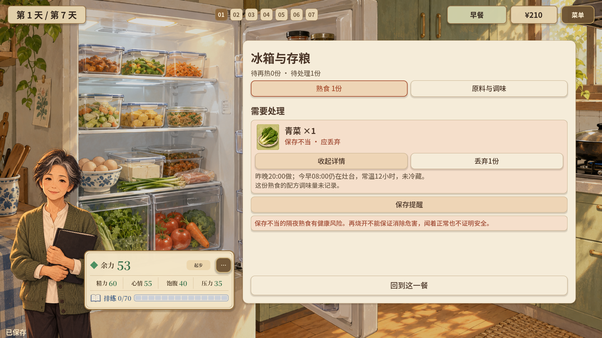
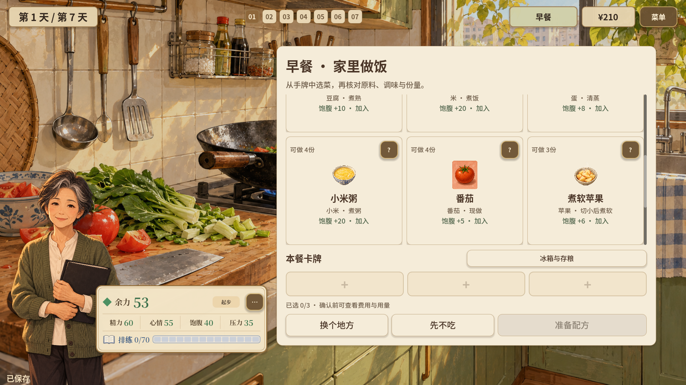
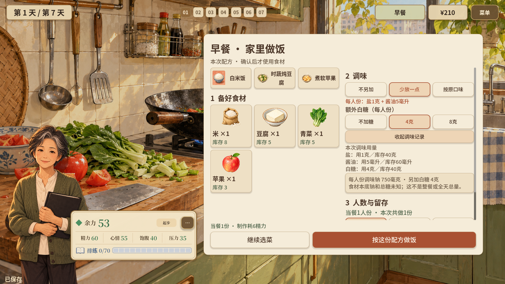
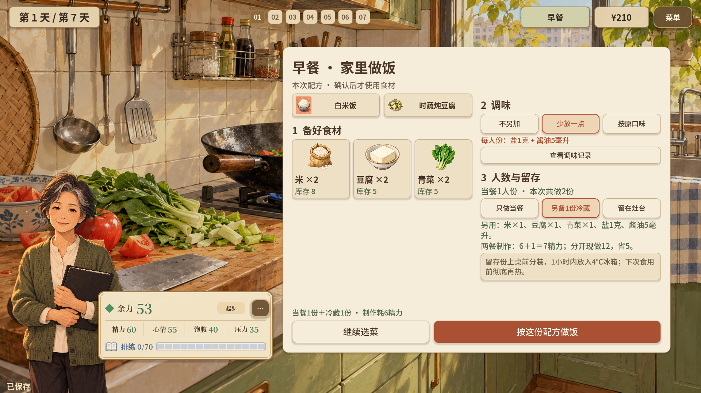
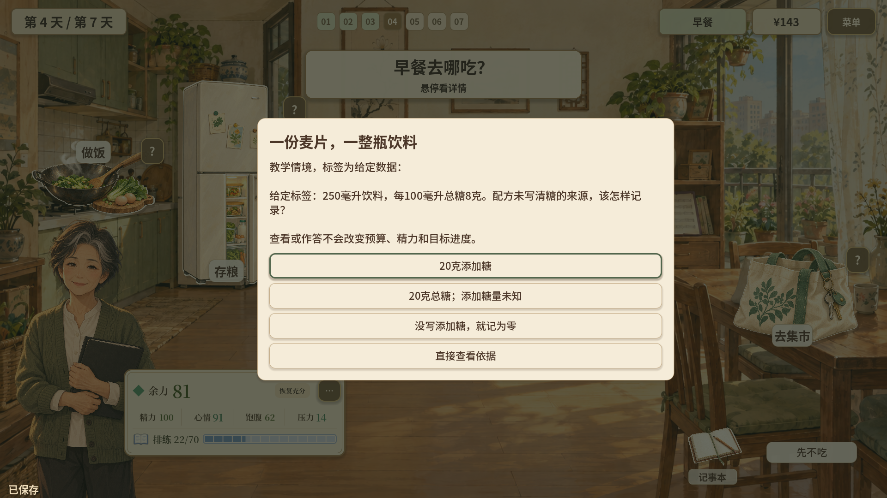
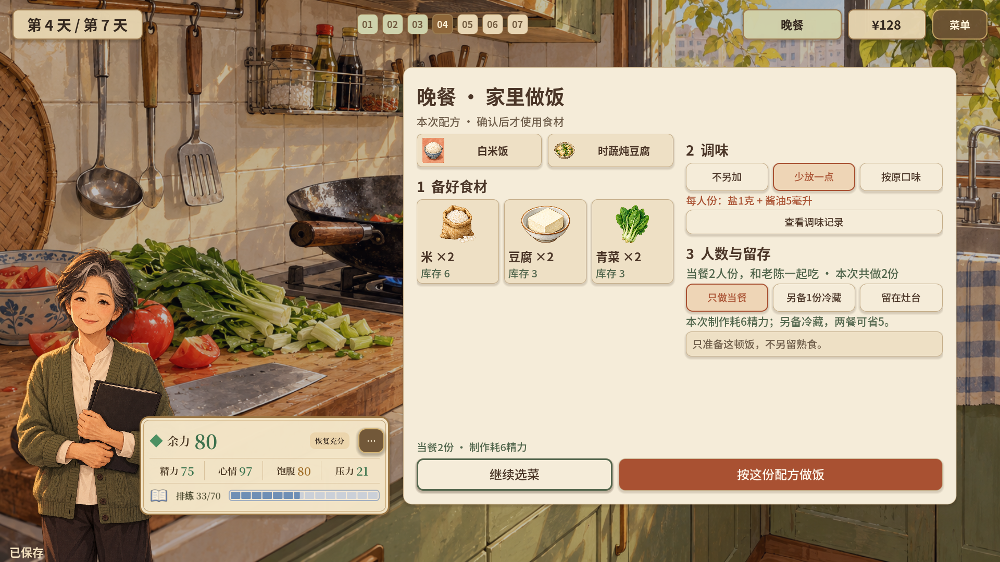

# 周阿姨篇：把营养科普放进日常选择

在《好好吃饭》的“自己的舞台”故事中，周阿姨要安排三餐、练歌与休息，为社区合唱汇演作准备。以下六组画面展示当前游戏已经实现的科普设计，可用于项目介绍、演示讲解或汇报配图。

全部截图均为当前游戏实际运行的 **1920 × 1080 完整横屏画面**，保留人物、生活场景、状态栏与操作面板，没有局部裁切。文中的定量例子均按关卡给定配方、模拟标签或游戏精力规则表述。

## 1. 剩菜食安：先看保存史，再决定怎样处理

**展示说明：** 玩家打开“冰箱与存粮”，能看到这份青菜从昨晚20:00到今早08:00一直放在灶台上的具体记录，以及相邻的处理按钮。科普内容与眼前这份食物的保存过程直接对应，让玩家练习根据时间、温度和记录作判断。

**讲解时可以说：** “这里让玩家先读这盘菜经历了什么，再决定如何处理。后面及时分装冷藏的备餐还会留下另一种保存记录，形成对照。”

补充画面：[冷藏熟食的保存史与原配方](04b-cold-storage-history.png)。

## 2. 适口制作：把关心落实到一道能选择的菜

**展示说明：** 蒸蛋、时蔬炖豆腐、煮软苹果等餐食带着食材和制作方法进入实际选菜流程。玩家可以围绕周阿姨的咀嚼困难与口味，尝试清蒸、炖煮、切小后煮软等做法，并继续组合不同类型的食物。

**讲解时可以说：** “适口不是一句提示，它对应一张可以选进这顿饭的菜谱卡。玩家要考虑她能不能吃、愿不愿意吃，也要考虑这一餐怎样搭配。”

补充画面：[主食、时蔬炖豆腐和煮软苹果组成的已选餐盘](02-soft-food-and-variety.png)。

## 3. 调味可比较：让“少放一点”有具体用量

**展示说明：** 配方页可以切换“不另加”“少放一点”“按原口味”，另行选择是否加白糖。界面随选择更新食盐、酱油和白糖用量，以及本关每人份的追加调味钠；这一组教学配方从“按原口味”的1500毫克变为“少放一点”的750毫克。

界面同时说明：食材本底钠和总糖尚未记录，当前显示的是已知调味量。玩家既能比较改法，也能看到这些数字具体覆盖哪一部分。

**讲解时可以说：** “我们把口头上的‘少放一点’变成可操作、可比较的配方变化，也把食盐与酱油一起放进记录。”

对照原图：[按原口味，1500毫克](03a-seasoning-usual.png) · [少放一点，750毫克](03b-seasoning-reduced.png)。

## 4. 小份备餐：把省力、份量和保存条件放在同一个决定里

**展示说明：** 选择“另备1份冷藏”后，界面列出多做这一份需要增加的食材和调味料，并展示本局的精力比较：两餐现做耗12，现做后再热耗7，可省5。分装、冷藏和再次食用的处理说明也与这个选择同时出现。

**讲解时可以说：** “备餐有实际好处，也有具体的份量和保存要求。玩家需要为下一餐作计划，而不是只看这一顿够不够。”

补充画面：[做完后，熟食继续保留保存史和原配方](04b-cold-storage-history.png)。

## 5. 标签练习：会换算整份，也会保留未知信息

**展示说明：** 第4天的模拟标签给出“250毫升、每100毫升总糖8克”，让玩家判断整瓶该怎样记录。正确选项为“20克总糖；添加糖量未知”。选项中的“全部算成添加糖”和“没写就记为零”对应两类常见的信息判断错误；作答后可以查看计算过程和依据。

第3天还安排了另一道题：把酱油“每100毫升”的钠换算到实际使用的10毫升。两道练习都允许直接查看依据，查看或作答不会改变预算、精力或目标进度。

**讲解时可以说：** “这里不仅练习算出一个数，也练习判断：哪些已经知道，哪些还不能下结论。”

补充画面：[酱油标签换算题](05-sodium-label-exercise.png) · [钠题反馈](05b-sodium-label-feedback.png) · [糖题反馈](06b-sugar-label-feedback.png)。

## 6. 共同进餐：把关心变成实际准备的一顿饭

**展示说明：** 玩家可以约老陈来家里吃晚饭。约好之后，配方页会显示“当餐2人份，和老陈一起吃”，米、豆腐、青菜的用量也随人数变化。只有真正完成这顿饭，餐桌记录里才会出现“第4天和老陈一起吃了晚饭”。

**讲解时可以说：** “共同进餐从一个邀约开始，接着影响买多少、做多少，最后留下真实用餐记录。关心饮食也可以通过一起准备、一起吃饭来表达。”

补充画面：[邀约与地点选择](07a-shared-meal-invitation.png) · [确认后的配方与共同进餐记录](08-recipe-and-shared-meal-records.png)。

## 可直接使用的开场说明

> 周阿姨篇围绕“为社区合唱汇演作准备”展开，把营养科普放进做饭、存粮、读标签和约朋友吃饭等日常决定。玩家在选择中看到具体用量、保存过程和实际记录，逐步练习判断信息、调整做法，并为下一餐作计划。

## 素材索引

| 文件 | 内容 | 使用建议 |
| --- | --- | --- |
| [00-home-context.png](00-home-context.png) | 周阿姨在家安排一餐 | 开场背景图 |
| [01-food-safety.png](01-food-safety.png) | 保存不当青菜的保存史与处理 | 正文推荐 |
| [02a-adapted-cooking-methods.png](02a-adapted-cooking-methods.png) | 煮软苹果卡牌上的食材与制作方法 | 正文推荐 |
| [02-soft-food-and-variety.png](02-soft-food-and-variety.png) | 已选主食、豆腐蔬菜和水果 | 适口制作的搭配补图 |
| [03a-seasoning-usual.png](03a-seasoning-usual.png) | 按原口味的调味记录 | 同场景对照 |
| [03b-seasoning-reduced.png](03b-seasoning-reduced.png) | 少放一点后的调味记录 | 正文推荐 |
| [04-cold-meal-prep.png](04-cold-meal-prep.png) | 小份备餐的用量、精力和保存说明 | 正文推荐 |
| [04b-cold-storage-history.png](04b-cold-storage-history.png) | 冷藏熟食保存史和原配方 | 食安与备餐补图 |
| [05-sodium-label-exercise.png](05-sodium-label-exercise.png) | 每100毫升到实际使用量的换算 | 标签学习补图 |
| [05b-sodium-label-feedback.png](05b-sodium-label-feedback.png) | 钠题反馈和依据 | 讲解计算过程 |
| [06-sugar-label-exercise.png](06-sugar-label-exercise.png) | 总糖与添加糖的信息判断 | 正文推荐 |
| [06b-sugar-label-feedback.png](06b-sugar-label-feedback.png) | 糖题反馈和依据 | 讲解信息边界 |
| [07a-shared-meal-invitation.png](07a-shared-meal-invitation.png) | 约朋友与选择地点 | 社交情境补图 |
| [07b-two-person-cooking.png](07b-two-person-cooking.png) | 共同进餐的两人份配方 | 正文推荐 |
| [08-recipe-and-shared-meal-records.png](08-recipe-and-shared-meal-records.png) | 已确认的用餐与共同进餐事实 | 讲解操作到记录的闭环 |

## 拍摄与实现核对

2026-10-27在独立的内存存档展示局中拍摄，从首日正常推进到第4天，未读取或改变原有玩家存档。截图内容来自现有界面，没有为了展示修改玩法或制作概念界面。对应运行报告见[capture-report.json](capture-report.json)。

实现依据：[每日科普与标签练习](../../../life-strategy/scripts/stories/StoryEducation.gd)；[食物与制作方法](../../../life-strategy/data/stories/choir_foods.xml)；[配方预览](../../../life-strategy/scripts/stories/CookingPlanStage.gd)；[熟食保存与再热](../../../life-strategy/scripts/stories/KitchenStock.gd)；[共同进餐](../../../life-strategy/scripts/stories/SharedMealPlan.gd)。科学资料与项目采用范围的既有整理见[老年营养证据说明](../../education/OLDER_ADULT_NUTRITION_EVIDENCE_2026-10-13.md)。
