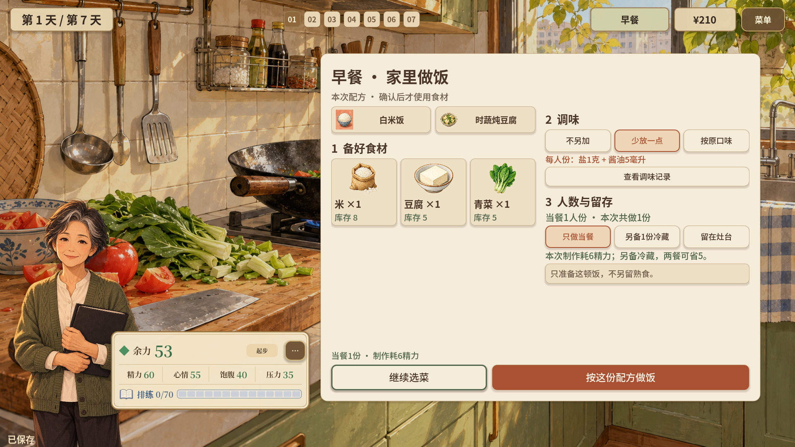
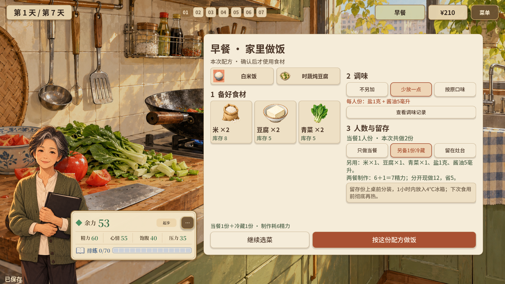
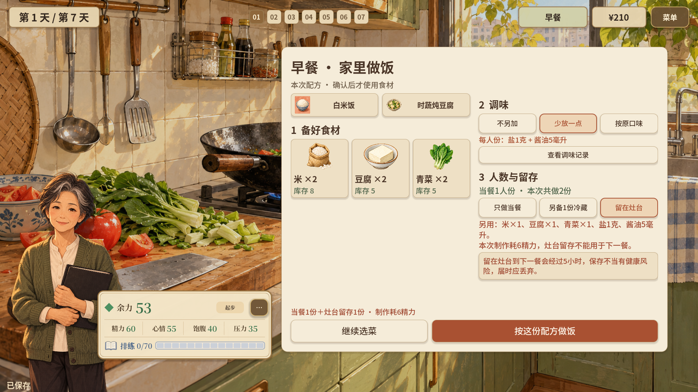
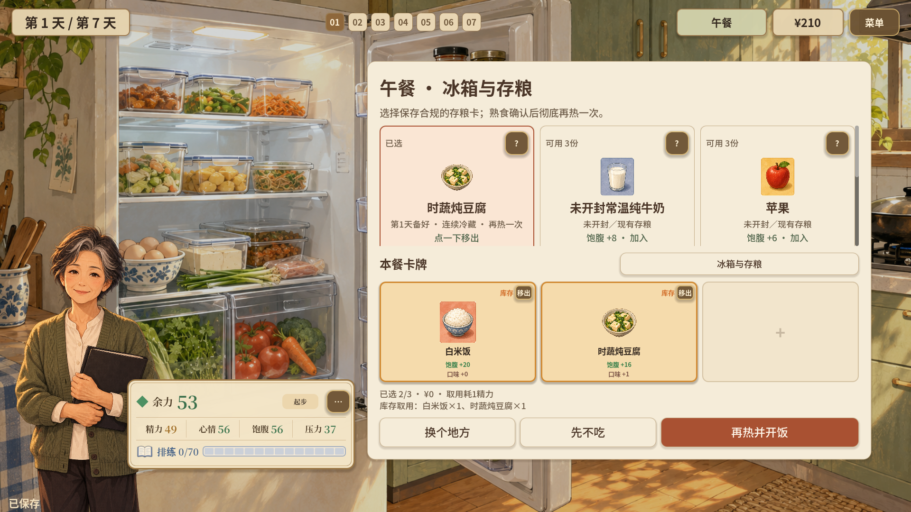
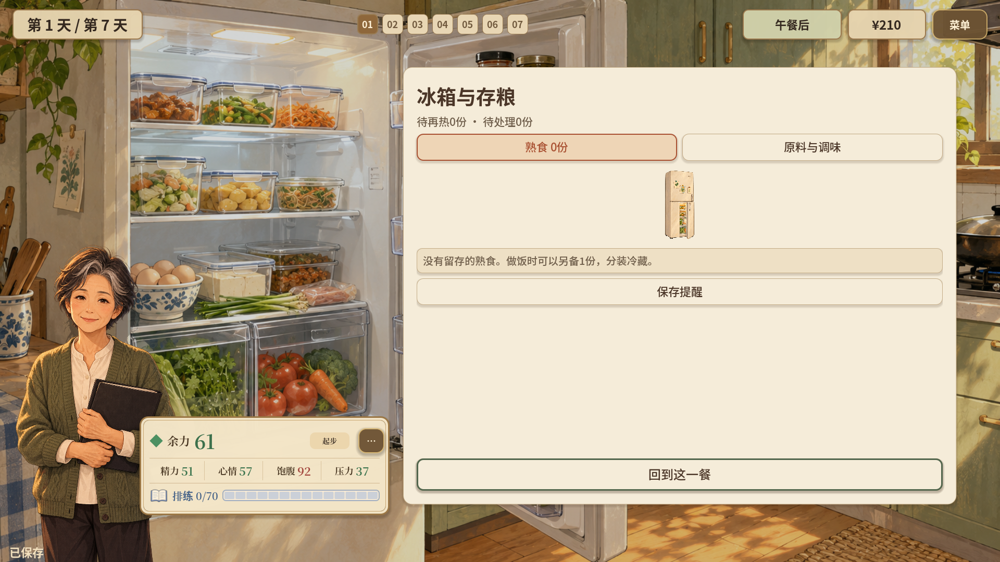
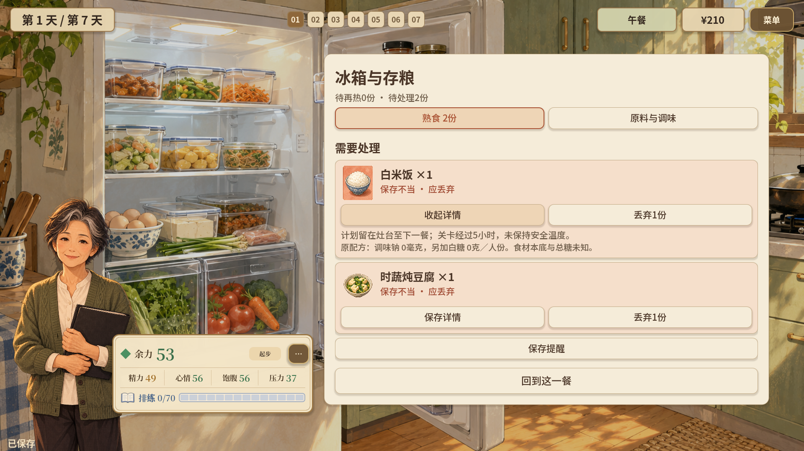
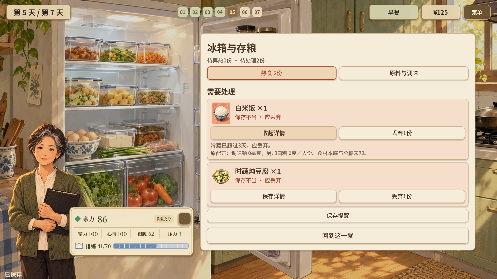
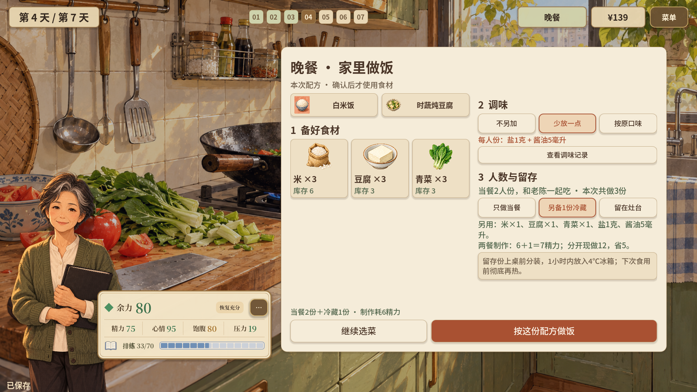
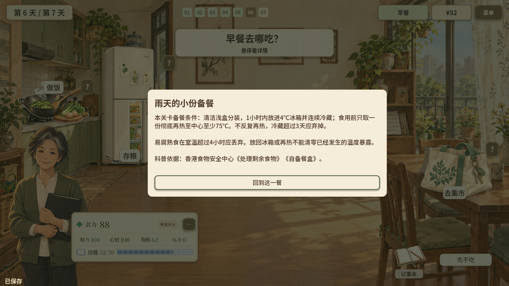

# 周阿姨篇主题展示：剩菜剩饭，怎样留、怎样吃、何时丢

这组材料围绕四个连续问题展开：**这一餐做多少 → 多做的怎样存 → 下一餐怎样吃 → 哪些情况应丢弃**。以下均为当前游戏已经实现的设计，配图是实际运行的1920×1080完整画面，保留人物、厨房／冰箱场景、状态栏与操作选项。

## 1. 只做当餐：先决定需不需要留

**设计说明：** 配方页提供“只做当餐”，显示“当餐1人份，本次共做1份”，米、豆腐和青菜都按这一餐的份量计算。当前选择不会额外生成留存熟食。

**可直接使用的图注：** “剩菜管理从做饭前开始：先按当餐人数决定做多少，再考虑是否为下一餐备一份。”

## 2. 另备1份冷藏：提前规划下一餐

**设计说明：** 切换到“另备1份冷藏”后，份数从1份变为2份，所需食材同步增加。界面把上桌前分装、及时放入冰箱、下次食用前再热等保存要求放在选择旁，并展示本局两餐的制作精力比较。

**可直接使用的图注：** “计划留给下一餐的饭菜，在上桌前就分出，并按要求冷藏。玩家同时看见多做一份的成本、后续便利和保存责任。”

本关采用“1小时内放入4℃冰箱”作为具体演练情境。公开资料强调小份分装、尽快冷却并在2小时内冷藏；展示时可将关卡条件与一般建议分别说明。[食物安全中心：处理剩余食物](https://www.cfs.gov.hk/sc_chi/consumer_zone/safefood_all/five_keys_apply_leftovers.html)

## 3. 留在灶台：让错误做法产生可见后果

**设计说明：** 玩家仍能选择“留在灶台”，但配方页即时给出红色说明：本关到下一餐会经过5小时，灶台留存不能用于下一餐，届时应丢弃。额外食材照常列出，让玩家看到这份留存也消耗了原料。

**可直接使用的图注：** “游戏把‘先放灶台，下一餐再吃’变成一个可以比较的错误选项：选择当下就能看到提醒，之后还会遇到需要处理的熟食。”

## 4. 留存后有保存史：下次吃之前先核对

**设计说明：** 实际确认冷藏备餐后，下一餐打开库存，可以看到留存的白米饭和时蔬炖豆腐。米饭的详情保留了清洁浅盒分装、冷藏时间与温度等记录，并标明“食用前须彻底再热”。

**可直接使用的图注：** “同样是剩饭剩菜，游戏要求玩家关注它经历了怎样的保存过程。下一餐的选择与前一餐的保存决定相连。”

画面里的“待再热2份”分别指一份米饭和一份菜；它们来自玩家为下一餐多备的一份组合餐。

## 5. 再热并开饭：只取这一餐要吃的份量

**设计说明：** 下一餐从冰箱选择有记录且符合关卡保存条件的饭菜，按钮明确写为“再热并开饭”。确认后，游戏记录一次再热食用，并扣除实际取用的熟食份量。

**可直接使用的图注：** “取出这一餐要吃的份量，完成再热后开饭。已经取用的份不会继续作为同一份库存反复食用。”

再热完成后，库存页中的对应米饭和菜已被扣除：

资料中也强调食用前应彻底翻热、避免反复翻热；中心温度至少75℃的说明可用于配套讲解。[食物安全中心：自备餐盒](https://www.cfs.gov.hk/sc_chi/consumer_zone/packed_meals.html)

## 6. 保存不当就丢弃：从提示走到实际处理

**设计说明：** 另一条实际操作路线选择了灶台留存。到午餐，米饭和菜都被标为“保存不当·应丢弃”，详情说明本关已经过5小时、未保持安全温度。这些批次不会成为可食用库存，玩家可以逐份执行丢弃。

**可直接使用的图注：** “提醒会落实到后续操作：保存不当的饭菜进入待处理列表，玩家需要清理，而不是直接放进下一餐的餐盘。”

补充画面：[执行丢弃后，待处理数量归零](08-discard-completed.png)。

开局还设置了一份上一晚留在灶台的青菜，展示明确的制作与放置记录，保存提醒涉及气味与再次加热的判断：

## 7. 冷藏也有时限：保存状态会随时间变化

**设计说明：** 这张图来自另一条正常推进到第5天的展示路线。第1天做好的米饭和菜一直未取用，库存页显示“冷藏已超过3天，应丢弃”，并将其从待再热移入待处理。

**可直接使用的图注：** “冷藏保存仍需记住时间。游戏中的熟食会随日期改变可用状态，让玩家持续管理留存的饭菜。”

本关沿用所采用资料中“冷藏超过3天的剩余食物应弃掉”的说明；这张图用于展示游戏如何处理超时情境。[食物安全中心：处理剩余食物](https://www.cfs.gov.hk/sc_chi/consumer_zone/safefood_all/five_keys_apply_leftovers.html)

## 8. 按人数安排：两人当餐加一份备餐，共做三份

**设计说明：** 约老陈来家里吃饭后，配方按当餐2人份计算。如果再选择另备1份冷藏，界面显示本次共做3份，食材需求也对应三份，帮助玩家把当餐人数和未来需求分别想清楚。

**可直接使用的图注：** “把‘今天几个人吃、下一餐留多少’算清楚，再决定做多少饭菜。”

## 9. 可回看的科普参考：把操作串成处理流程

**设计说明：** 第6天的“雨天的小份备餐”集中说明本关采用的分装、冷藏、按份再热、冷藏时限和超时处理条件。玩家在日常操作之外，可以再次查看这些选择背后的依据。

**可直接使用的图注：** “操作中遇到具体选择，记事本里回看处理依据，把一次备餐延伸成能复用的判断方法。”

## 演示选图建议

| 演示重点 | 建议图片 |
| --- | --- |
| 做饭时的三个选项 | 01、02、03，同一配方便于直接比较 |
| 正确留存到下一餐 | 02 → 04 → 05 |
| 错误留存到实际丢弃 | 03 → 07 → 08 |
| 冷藏后的时间管理 | 04 → 10 |
| 按人数减少不必要的剩余 | 01、09 |
| 处理方法与依据回顾 | 11 |

## 可直接使用的主题介绍

> 周阿姨篇把剩菜剩饭处理放进做饭、保存和下一餐选择的连续流程。玩家先按人数决定份量，再选择是否分出一份冷藏；下一餐查看保存记录、按份再热，并处理保存不当或超过时限的饭菜。每一次操作都会影响后续库存，让“怎样留、怎样吃、何时丢”成为生活中的具体判断。

## 素材与拍摄说明

12张图片均为2026-10-27拍摄的完整1920×1080游戏画面，没有裁切、拼接或覆盖标注。冷藏再热、灶台留存、冷藏超时等来自独立的内存存档展示路线，按现有玩法作选择并推进阶段／日期；未读取或改变原有玩家存档。截图展现现有的选择、文字说明、库存与状态变化。

配套运行记录见[capture-report.json](capture-report.json)。实现核对路径为原项目中的`scripts/stories/CookingPlanStage.gd`、`KitchenStock.gd`、`KitchenStockStage.gd`、`HouseholdMealStage.gd`与`StoryEducation.gd`。
