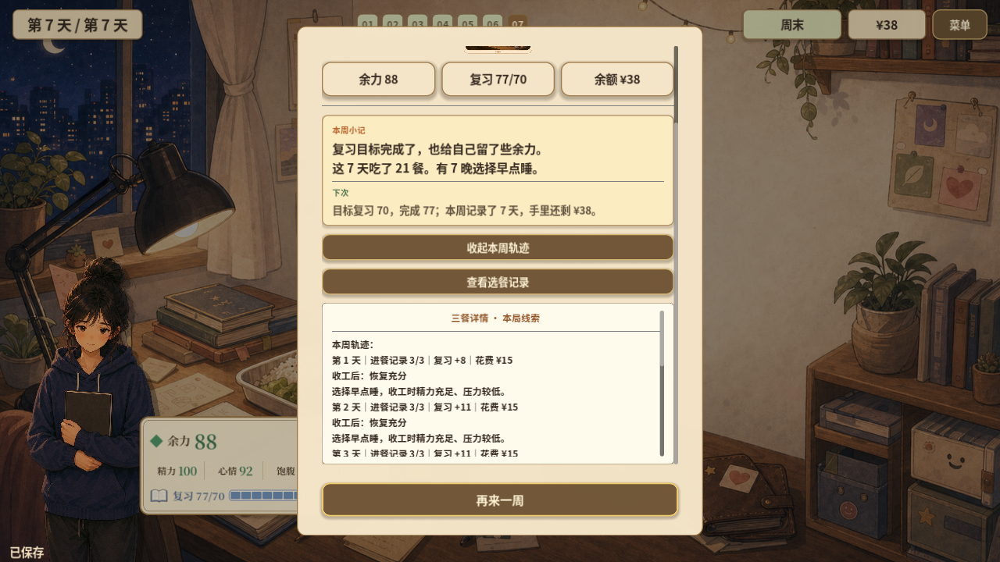

# 结局反馈感核对

2026-10-29。范围：当前原生1280×720画面，两篇各核对结局首页和展开回顾。学生篇由正常控制器规则、固定种子42执行一周后保存恢复；周阿姨篇读取并验证现有整周演示存档。全部截图为本次运行直接保存并逐张检查。未做真人试玩，也未逐条实测全部结局。

判断：学生篇偏弱，周阿姨篇中等。已有清楚的结果和真实经历记录，但关键选择如何影响结果、人物如何回应以及下一局值得改变什么，还没有充分呈现。

## 1. 学生篇结局首页：结果清楚，反馈偏弱

标题、余力88、复习77/70与余额38元清楚。本周小记回顾21餐和7晚早睡，但没有提炼哪一次具体选择带来了已记录的效果。结局插画在中心弹层中占比小，完成一周的表现力度有限。首屏未完整呈现后续建议和回顾入口。

## 2. 学生篇展开回顾：可追溯，但调整建议不足

逐日回顾能看到复习增量和恢复依据，这是可用基础。但“下次”栏实际重复目标70、完成77、7天与剩余38元，没有提供具体可尝试的调整。逐日条目需要玩家自己归纳。

## 3. 周阿姨篇结局首页：故事回应较好

舞台背景、演出图与“把歌唱完了”共同回应参演目标，比学生篇更具体。首页正文较多采用“实际记录”“确认进餐”等记账表达，人物语气和本局独有经历偏少。代码已区分实际参演、未满足条件及条件满足后另作安排；本次截图只覆盖实际参演分支。

## 4. 周阿姨篇展开回顾：记录丰富，重点藏得较深

可展开开局熟食、练习、同桌与备餐等真实记录，有潜力形成个人经历回顾。但首段重复首页餐次说明，独特经历放在较后的长文本里。内外两层滚动增加查找成本。“下次”建议虽可执行，仍较通用。

## 优先改善

1. 首页提炼本局最关键的一至两次选择，并连接已经记录到的具体效果；仅有相关统计时，不编造因果或未选择路线的结果。
2. 用一句角色回应和更突出的已有插画加强收尾，让结果分支与本局经历共同决定表达。
3. “下次”给一件与本局具体缺口或可探索空间相关的行动；保留完整轨迹供按需展开。

可访问性范围：截图中文字可辨，但仅检查了单一桌面尺寸；双层滚动、键盘焦点、读屏和其他尺寸的实际操作未在本轮验证。
