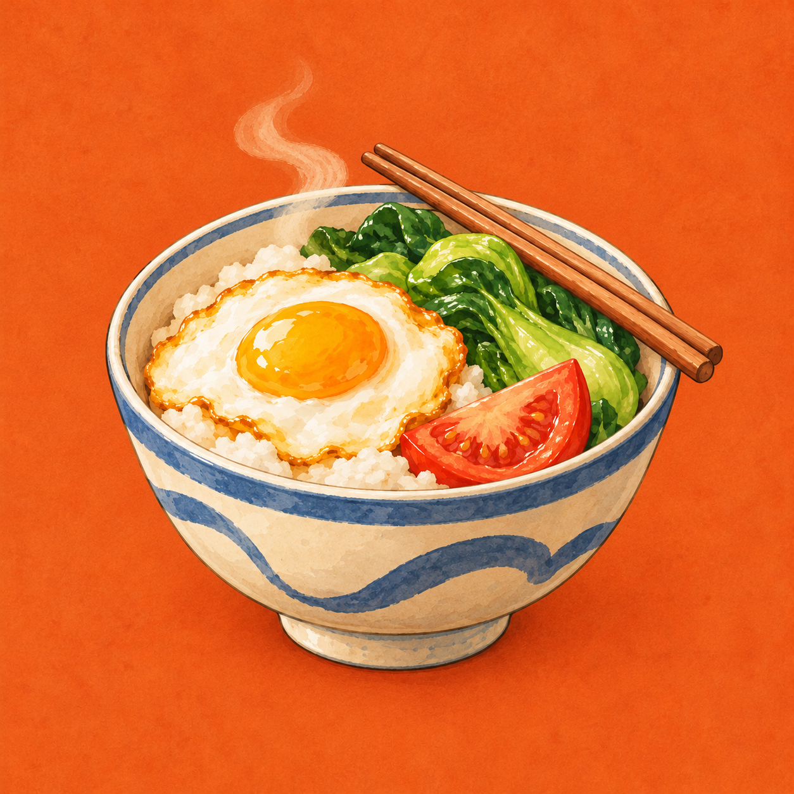
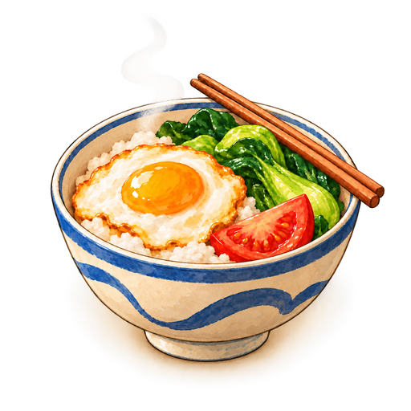

# 《好好吃饭》图标视觉稿 v1

日期：2026-10-28。方向：**一碗热饭**。



主体采用日常陶碗、米饭、鸡蛋和蔬菜，以暖橙底色、奶油白与蓝色陶纹衔接现有食物卡的手绘质感。食物组合用于表达日常吃饭与多样选择，不是营养合格标记。

系列图标共用于学生篇、周阿姨篇与后续人物，不绑定单一角色、考试或汇演。图标内不放文字，保留主体周围留白，便于后续检查小尺寸及平台圆角/圆形裁切。

2026-10-29更新：已按后续要求接入工程，当前采用v3透明母版；外围暖色阴影渐变到真实透明，四角alpha均为0。Godot图标、Windows六尺寸ICO、原生启动图、Web图标/加载页与选人页标记均已更新。下面保留v1视觉稿的设计与提示词；当前版本及验证见[入口改版记录](../process/ENTRY_REDESIGN_2026-10-29.md)。



使用内置 image_gen 生成；第二次编辑仅调整构图留白。原始生成文件保留，未调用CLI或外部API。原图尺寸、格式与SHA256见[metadata.json](../assets/game-icon-2026-10-28/metadata.json)。

## 首轮生成提示词

```text
Use case: logo-brand / stylized illustration.
Asset type: One polished square application icon for the Chinese cozy life strategy game “好好吃饭” (Eat Well). The game follows everyday people arranging meals and daily life; its established art uses warm paper, softly hand-painted food illustrations, ivory ceramic, muted blue decoration and terracotta accents.

Create a single finished icon, not a presentation board, not a mockup. Full-bleed opaque warm terracotta-orange square background with extremely subtle warm paper texture. One large welcoming bowl of a home-style meal is the entire central symbol, occupying about 78% of the canvas. Bold compact silhouette with generous safe space at every edge for a circular or rounded-square platform mask.

Subject: a charming but adult-friendly ivory ceramic rice bowl, with a simple muted indigo-blue rim and one broad blue curved decorative band. Three-quarter view, clear broad elliptical opening. Inside: soft ivory rice in a few broad scalloped masses, one beautifully simple golden-yolk fried egg, two generous fresh-green leafy vegetable shapes, and one warm red tomato wedge. Each food reads as a few clean, chunky shapes. A pair of warm wooden chopsticks rests naturally together along the upper bowl rim, creating one simple diagonal gesture; keep them inside the safe area. One restrained soft steam curl above the meal conveys warmth.

Style: premium cozy indie game icon, hand-painted gouache with softly modeled volume, warm brown edge definition and tactile ceramic, but simplified enough to read at 48 pixels. Warm sunlight, appetizing and comforting. Strong separation between the cream/blue bowl and orange backdrop. The bowl should feel substantial and handmade. Restrained texture on broad areas only, no tiny individual rice grains, no intricate bowl patterns. No cartoon face.

Composition: square, one centered motif, balanced and uncluttered. Bowl body fills the lower center, colorful meal fills the upper center. Do not make a food card with a white margin. No outer frames, no badges, no border, no extra scene, no table setting, no people. No text, Chinese characters, letters, numerals, watermark, logo of another brand, medical cross, shield, check mark, calorie numbers, sparkle ornaments, or multiple versions. Output the standalone production-quality icon image.
```

## 留白调整提示词

输入为第一轮生成稿；保留原构图元素、配色、质感与不透明背景。

```text
Edit the supplied game icon with one targeted composition refinement: increase breathing room around the complete bowl, food, steam and both chopsticks. Keep the existing warm terracotta-orange paper-textured backdrop, ivory ceramic with the muted blue wave band, appetizing egg/rice/green vegetables/tomato, the existing food arrangement, hand-painted gouache style and warm lighting.

Scale the entire central illustration down slightly and re-center it so every part, including the far right chopstick ends, stays comfortably inside an approximately 10% safe inset on every side of the square. Keep a bold, dominant bowl silhouette and preserve the calm full-bleed orange background. This is a standalone app icon intended to stay identifiable at 48 and 64 pixels. Preserve opaque background. No new objects, no face, no text, no outer frame, no border, no labels or multi-image presentation.
```
