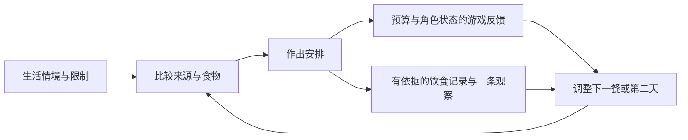

# 项目开发目标：通过生活策略学习营养判断

更新：2026-10-08。依据用户本次要求，项目以**营养科普教育为主要目的，游戏趣味性为必须验证的质量要求**。本文件说明产品目标、学习内容和设计取舍；执行顺序见[开发路线](../ROADMAP.md)。2026-10-07及此前“玩法优先、营养辅助”的排期保留为历史，不再代表当前目标。

## 1. 产品定位与成功定义

《撑过这一周》是一款面向校园生活情境的营养科普策略游戏。玩家在有限预算、可获得的食物、角色口味、精力和学习任务之间安排一周生活，在选择、反馈和再次尝试中练习饮食判断。

项目要同时证明两件事：**玩家愿意做选择、调整安排和再玩；玩家能够把学到的判断用于一个没见过的菜单。** 通关、打开知识详情或选择某类食物，都不能单独证明学习成功。

首批测试对象暂按成年大学生与初入独立生活的成年人招募，作为待验证的受众假设；角色年龄、个体摄入目标仍不据此推定。首个教育候选保留单角色、七天、四来源和现有23项食物，优先验证日常配餐、规律与规划，不扩张成完整营养课程。首日3–5分钟、整局15–25分钟是待测节奏目标。

## 2. 玩家应学会什么

| 学习目标 | 游戏中的练习 | 如何判断学会 | 首个教育候选范围 |
| --- | --- | --- | --- |
| L1 看懂食物组成与搭配 | 比较单品和复合餐中已知的谷薯、蛋白质来源、蔬菜等组成；查看跨餐出现的水果、奶类、豆类等 | 面对新菜单说出已知组成和可以调整的方向，不把“出现过”当作“已经吃够” | 必做；先显示已审核资料支持的类别事实 |
| L2 观察规律和多样性 | 在日结中查看实际餐次，在七日记录中比较重复与变化 | 能区分一次选择与连续模式，不通过重复复合菜名称虚增多样性 | 餐次事实与简单跨日对照必做；完整周聚合随后完善 |
| L3 在现实限制下制定安排 | 比较价格、库存、来源开放与口味，选择当前可执行的调整，或为下一餐留计划 | 提出一项确实买得起、找得到、阶段允许的调整，并说明代价 | 必做；没有可行方案时明确保留未知或延后计划 |
| L4 判断信息的可靠程度 | 识别已知、估算、未知及食物的多种特征；区分游戏效果和饮食信息 | 不把未知理解成没有，不把游戏余力或结局当作现实健康判断，不认为饮水或休息可清除饮食记录 | 必做；不开放没有依据的因素等级和健康结论 |

这些学习主题参考中国营养学会关于[食物多样与合理搭配](https://dg.cnsoc.org/article/04/K7tlcs-UQh67DBC5XY1Jqw.html)、[蔬果、奶类、全谷和大豆](https://dg.cnsoc.org/article/04/70JvPbFmTlyZbjoO67LeRg.html)以及[规律进餐](https://dg.cnsoc.org/article/04/wDCyy7cWSJCN6pwKHOo5Dw.html)的一般教育框架。具体课程、场景和验收方法是本项目的设计方案，不是指南直接规定的游戏规则。

WHO也强调饮食的适量、平衡、节制和多样，具体安排会受人群、文化和食物可及性影响。因此本项目采用多种可行安排，避免把一种菜单包装成所有人的唯一答案。[WHO：Healthy diet](https://www.who.int/news-room/fact-sheets/detail/healthy-diet)

本轮仅为规划核对公开来源；中国营养学会页面直读部分超时，相关主题另由官方检索结果核对。没有更新生产证据登记、延长复核日期、签署食物资料或批准玩家健康文案。具体输出仍按[营养专项](../../life-strategy/docs/plans/nutrition_health_guidance/README.md)审核。

## 3. 科普如何成为游戏体验

选择当下提供简短的组成预览，帮助玩家判断；确认后仍依真实费用、库存和玩法规则推进。日结只突出一条与实际选择有关的观察，旁边给出可执行的下一步或明确的下一餐计划；证据、估算和原始记录可以展开查看。周末回顾具体安排及变化，让玩家自己找到下一局想尝试的办法。

主要学习机会必须出现在正常流程中，不能全部藏在可选百科里。详细知识可以跳过；不以答题、凑齐类别或接受建议作为继续游戏的条件。一次失败应说明预算、精力或安排的具体原因，并给玩家重试空间。

现有七天流程可采用渐进的介绍节奏：前两天认识组成与资料状态，中段在预算和来源变化中练习安排，后段对照自己的记录。首次介绍后降低提示频率；复玩时保留判断信息，减少重复说明。每天出现什么学习机会由真实记录和可用选项决定，不固定给所有玩家同一句结论。

## 4. 趣味性怎样落实

| 趣味来源 | 实际设计要求 | 验证方法 |
| --- | --- | --- |
| 有代价的多种选择 | 食堂的费用与出门成本、外卖的便利与配送费、便利店的快速选择、存粮的有限库存各有适用情境 | 同种子比较至少三种不同安排；检查便利店、补货与混合来源策略，不只测通关 |
| 可预判的变化 | 复用周内事件和睡前预告，让玩家有准备、有应对；规则变化要清楚 | 参与者能说出一次根据预告调整的安排；检查事件是否只迫使玩家买一种食物 |
| 可感知的反馈 | 选择、费用、库存和角色状态变化清楚；日结解释与记录一致 | 玩家能解释一次选择的成本与收益，失败能找到具体原因 |
| 口味和生活语境 | 保留角色偏好、校园叙事及四来源场景特色；口味只是角色设定 | 玩家选择喜欢的食物时仍能讨论搭配，不把心情收益误认为营养收益 |
| 有理由复玩 | 先靠不同安排和现有事件种子产生变化，再决定是否加挑战与内容 | 玩家自愿再试，并能说明打算怎样改变；不以奖励诱导代替复玩理由 |

例如：当天精力不足时，外卖可能值得多付配送费；预算紧时，可以使用存粮并为后续餐次留钱。记录照实显示这些选择的组成和缺口，是否调整由玩家决定。如果当前来源没有合适选项，反馈应允许下一餐再安排。这样的情境同时练习规划和信息判断。

营养教育与玩法参数保持独立。不能为了让玩家背答案，规定“选蔬菜立刻加复习、选炸鸡必定生病”，也不能靠饮食总分决定最佳结局。保留已确认的R2恢复规则；如未来需要改变结局设计，另行提出具体方案。

## 5. 开发取舍

1. **优先做能练习的知识。** 每项新内容都要指向学习目标，并在真实选择、反馈或回顾中使用；单纯增加百科篇幅不算完成教育体验。
2. **知识必须可信。** 固定游戏配方可以支撑规格事实；健康解释还需要外部依据与专业复核。未知保持未知，不从价格、心情或名称反推营养。
3. **决策要有余地。** 不要求每餐包含所有类别，不把食物分成道德意义上的好坏，不用健康总分排名，也不让恢复行为抵消饮食记录。
4. **先完成小范围闭环。** 先审核一组代表性资料，形成选择预览→记录→观察→下一次调整；其余食物保留合法玩法和明确的信息不足态。
5. **按学习缺口扩张。** 标签阅读、食品安全、更多角色和长周期需解决已观察到的问题，再进入开发；不一次启动全部营养Backlog。

## 6. 同时验证学习与乐趣

先做两轮每轮5–8人的形成性试玩，随后用10–15人验证修订后的候选。用人数与原始表现记录小样本结果，不据此宣称医学改善、长期留存或适用于所有人。

以下为暂定产品验收目标，尚未获得实测数据；时长与趣味门槛可依据首轮基线调整并记录理由。专业、证据和关键误导门槛不能因此降低。

| 检查 | 方法 | 候选的暂定条件 |
| --- | --- | --- |
| 学习迁移 | 游玩前后各做4个简短情境任务，题目同难度但菜单不同；分别记录L1–L4，不把游戏通关计入成绩 | 至少80%参与者在新菜单中能解释组成/记录边界，并提出一项可行调整；同时报告前测与后测，若前测已有明显高分则换更合适的任务 |
| 关键理解 | 让玩家用自己的话解释unknown、游戏状态与饮食记录，以及恢复和饮食的关系 | 至少80%能正确区分资料状态与游戏效果；引导后仍把输出当诊断或认为可抵消饮食记录的情况为0 |
| 建议可行性 | 自动核对来源、预算、库存、阶段；人工执行试玩中出现的建议 | 显示为可执行的建议100%可完成；下一餐计划明确标注，不假装当前能做 |
| 操作与节奏 | 观察首次玩家完成首日及七日；记录卡点、停留与中断 | 至少80%独立完成首日；七日、失败和重开无阻塞；整局时长与解释负担达到经试玩校准的目标 |
| 乐趣与复玩 | 记录5级兴趣评价，并提供一次不附奖励的再次尝试机会 | 兴趣中位数至少4/5；至少60%自愿再试且能说明一项想改变的安排；试玩安排须预留再次尝试时间 |
| 策略差异 | 相同种子和资源限制比较来源/行动/睡眠策略；结合真人选择 | 至少三种安排各有可说明的适用情境；不存在已发现的无代价刷收益路径；结果不能只证明“都能到周末” |

若关键误解在两名及以上参与者中重复出现，先改信息与机制，再测试。若学习提升而游戏显得枯燥，减少重复说明、改善取舍与反馈；若游戏受欢迎而玩家无法迁移判断，改学习机会和回顾。两方面任一未达标，都继续迭代。

## 7. 里程碑与交付定义

短期0–12周交付一份可玩的教育候选，包含L1–L4的最小练习、可靠资料、可操作反馈及两轮试玩后的修订。中期3–6个月扩展跨日模式、挑战与回顾，验证延后理解。长期6–12个月按证据扩展生活情境和教学使用方式，建立持续内容复核与效果评价。

时间窗口按单项目持续投入估算，用于排序，不是完成承诺；审校、招募和实际复杂度会改变排期。每个版本都要同时记录学习目标、玩法取舍、资料版本、验证结果和遗留项。当前的工程成果不因目标调整重做，当前尚未通过的教育输出也不因本文件而自动开放。
