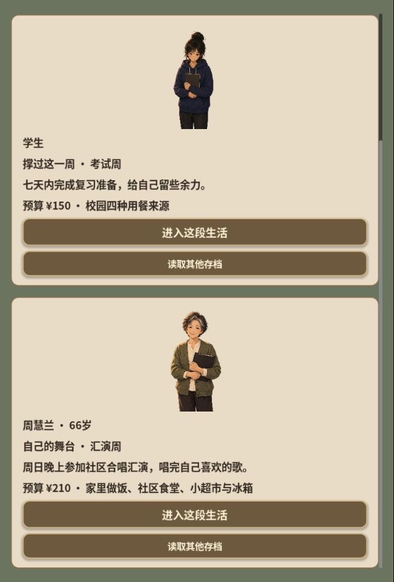
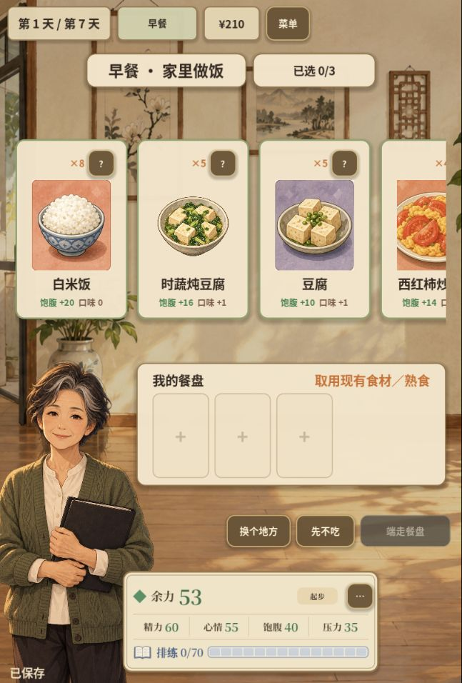
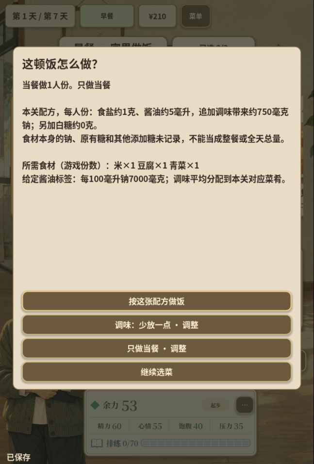
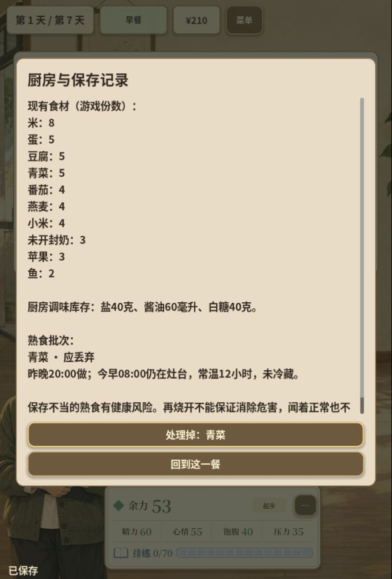

# 人物系列界面重新设计：实际页面审查与页面结构

日期：2026-10-14。用户明确要求重新设计UI，特别指出新人物与新机制没有对应页面。本轮证据来自当前已发布的0fb8af1网页版；截图均于本次审查重新捕获、保存并打开检查。设计探索尚未接入运行代码。

后续状态（2026-10-15）：已按“第2套原料、第1套色彩、融入原框架”接入本地运行代码。实施范围、测试与剩余浏览器验收见[实施记录](../process/UI_REDESIGN_2026-10-15.md)和[设计验收](../../design-qa.md)；下文保留为首次审查的原始发现。

## 审查范围

在用户当前Codex内置浏览器标签检查：故事入口 → 周阿姨介绍 → 首日开始 → 剩菜／厨房记录 → 来源选择 → 在家选菜 → 调味与保存 → 游戏进度菜单。视口约647×955，浏览器可见内容为Godot canvas，未得到各游戏控件的语义DOM。

| 步骤与截图 | 实际可见问题 | 重设计要求 |
| --- | --- | --- |
| 01当前入口、02故事卡 | 导入存档位于核心人物选择前；人物插画很小、空白较多，两篇都是同样的长卡片；第二人物需要滚动才完整看到 | 入口成为人物故事选择，突出人物、场景、自己的目标与继续位置，存档管理作为次要入口 |
| 03人物介绍 | 普通纸色文本弹窗，只有目标、条件、科普列表，缺少生活情境与任务预期 | 独立故事开局页，人物与地点共同讲清本周要做什么 |
| 04新日 | 又一层大弹窗；人物和家中背景塞在相同图片框，未体现今日安排 | 今日生活页用餐次／行动时间线和近期任务；开局后不连续叠加介绍层 |
| 05剩菜记录 | 食材、调味库存、熟食安全信息是一串文字；同等强调米和危险批次，不能一眼分辨保存状态 | 冰箱／厨房存货页分别呈现原料与熟食批次；制作时间、保存条件、可食用份与处置按钮在同一物件上 |
| 06来源 | 四个文字按钮和四个工具按钮，背景地点没有对应操作 | 生活地点入口：厨房、冰箱、社区食堂、小超市。各入口预告现在能做什么、已有库存或营业时间 |
| 07家里做饭、08b选菜 | 仍是食堂式横向餐牌与“我的餐盘”；在家做饭需要的原料、人数与准备流程不可见；右侧菜品被裁切 | 做饭工作台：菜谱、原料与份量相连，选择和制作不再完全照搬购买餐食页 |
| 08悬浮详情 | 刚选菜的详情在下方出现，视觉上盖住确认按钮和部分餐盘；移动到空白区域才清晰 | 移动端使用明确的详情入口及可关闭的短面板，主要操作保持可见 |
| 09调味保存 | 盐／酱油／保存方式被放进长说明与几个“调整”按钮；实际用量与选择关系不够直接 | 同页明确显示当前方案、用量、人数与留存份，使用分段选择；复杂依据按需展开 |
| 10进度菜单 | 存档、阅读记录、返回与继续都在七个同款按钮里，顶部空白较大；没有槽位缩略信息 | 存档册按故事和槽位展示日期／阶段／目标／保存时间，自动存档状态与手动分支清楚分开 |

现有暖色手绘背景、食物插画和人物自己的汇演目标可以继续使用。修改重点是机制与页面的一一对应，再统一排版、色彩和触控尺寸。

## 新页面结构

1. **人物故事入口**：学生考试周、周阿姨汇演周及后续人物各有场景封面；目标和继续位置可读。
2. **今日生活**：当前餐次、近期行动与自己的任务；周阿姨看排练、共同进餐和周日汇演，学生看复习安排。
3. **做饭工作台**：选择菜谱／查看原料 → 调味 → 当餐人数和备餐 → 确认制作。制作动作一次性消费已核对的原料。
4. **冰箱与厨房存货**：原料区与熟食批次区；明确未知、需要再热与需要处置，并保持原配方和保存历史。
5. **共同进餐与日程**：谁、哪天、哪里、几人份；未落实的邀约与实际完成在日程中有不同状态。
6. **本周记录与科普**：实际餐次、配方已知小计、未知项目与短情境练习；详情不会盖住关键操作。
7. **存档册**：自动进度与三个手动位置、预览、保存／读取、导入导出及覆盖选择。

这是现有Godot游戏的界面改造目标，保持七日流程、资源规则、真实批次与存档数据接口。人物页根据各自生活情境组织，不再只换立绘和目标标签。

## 视觉方向探索

先对“做饭工作台”生成三个独立方向：场景化厨房操作、食谱手账、清爽生活界面。每个方向使用相同角色／餐食／调味事实，比较结构、层次和操作方式，选定后再用于整套页面。

参考保持温暖日常与真实食物插画；周慧兰为66岁，人物自然、独立，有自己的喜好与合唱目标。调味显示本关配方的已知追加量，食材本底保持未知，不展示医学诊断或营养评分。

## 证据边界

本次实际操作看到页面与流程，不宣称完成全部七日、共同进餐完成态、触屏读屏或字体放大的可访问性验收。游戏画布的语义控件未通过浏览器DOM提供，需要在后续实现中另行验证键盘／焦点及移动触控。截图位置：`docs/assets/ui-redesign-2026-10-14/audit/`，本次未发布界面修改。

## 本次关键画面

视觉生成图与完整提示见[生成记录](../assets/ui-redesign-2026-10-14/concepts/image-provenance.json)。图中少量生成文案已记待校正，不作为新的剧情或营养事实。
