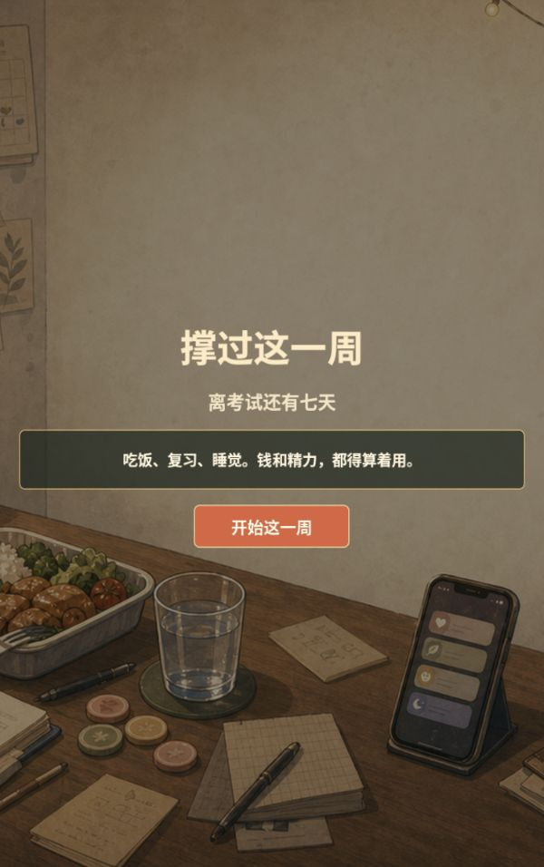
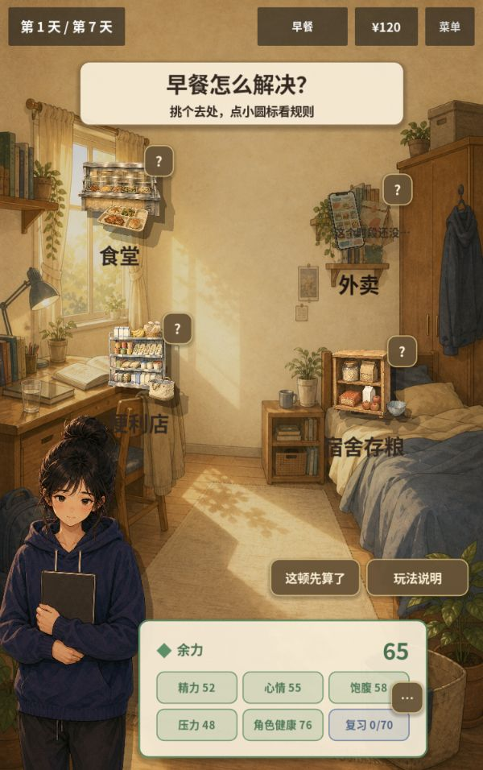
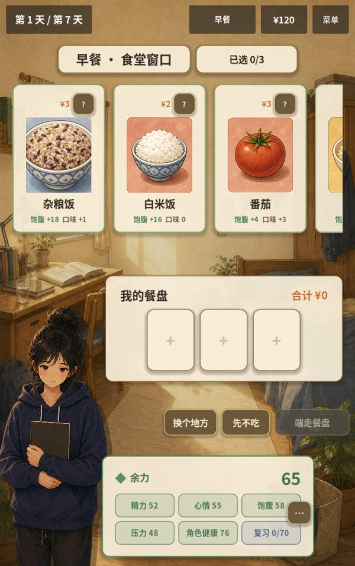

# 2026-10-05 · 校园篇早期原型

单一学生故事已串起选来源、选餐、行动与日结；界面以信息面板和列表为主。

[返回开发过程总览](../README.md)

## 截图

### 早期标题与开局

原图尺寸：600 × 956。

### 早期用餐来源

原图尺寸：600 × 956。

### 早期选餐界面

原图尺寸：600 × 956。

## 来源与记录

- [PROJECT_AUDIT_2026-10-05.md](../../process/PROJECT_AUDIT_2026-10-05.md)

每张图的原始路径、尺寸及SHA-256见[完整清单](../manifest.json)。截图保持原始字节；临时目录中的独有旧图已归档到本目录。
