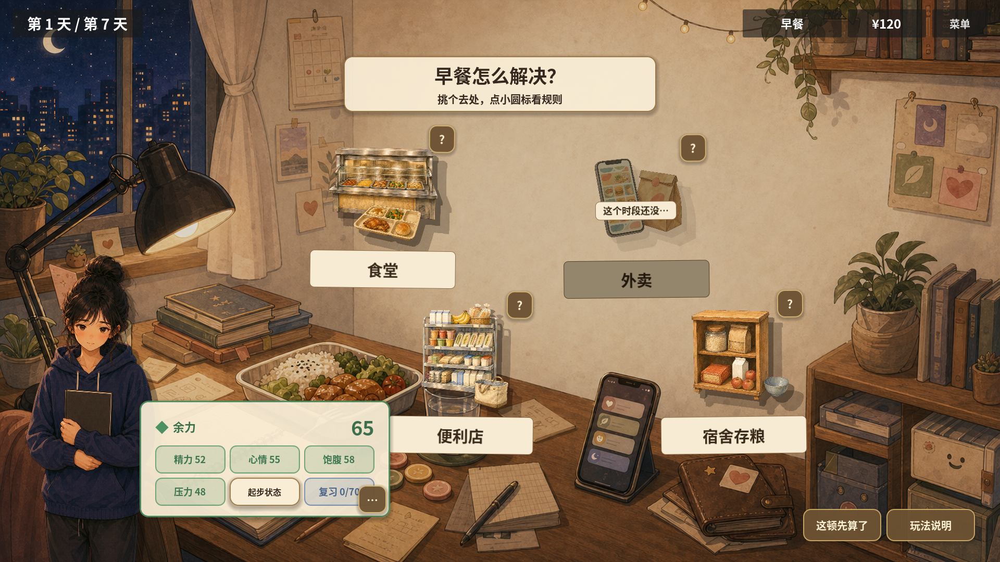
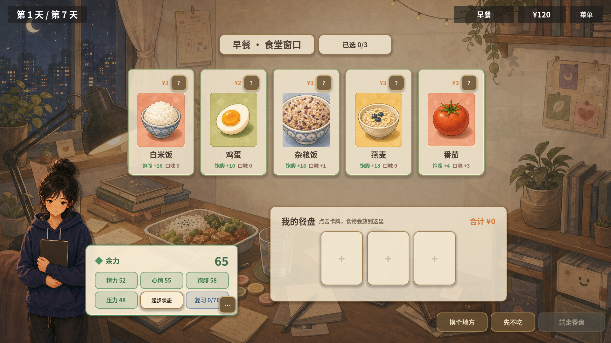
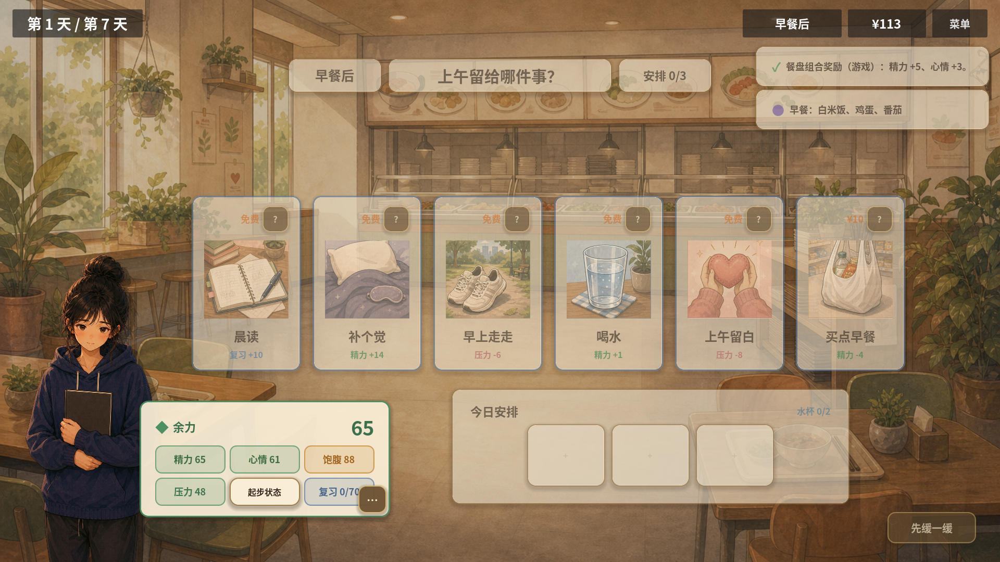
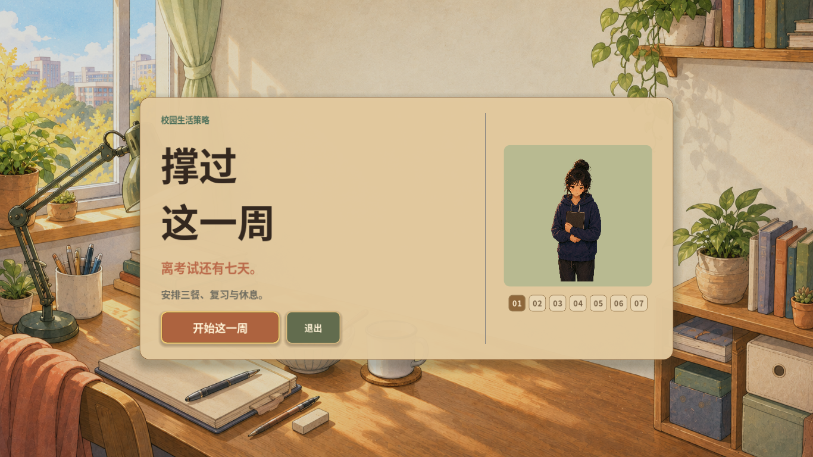
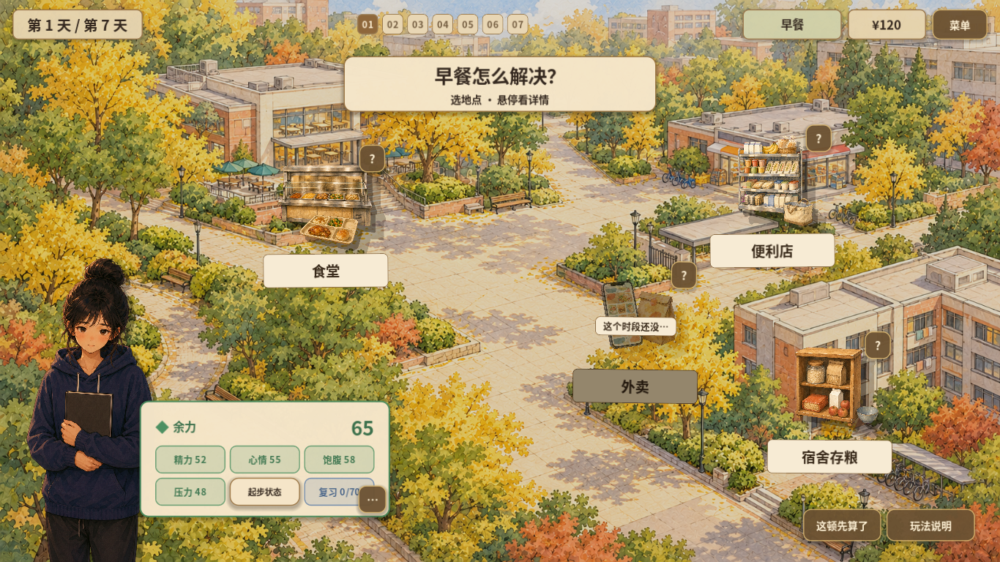
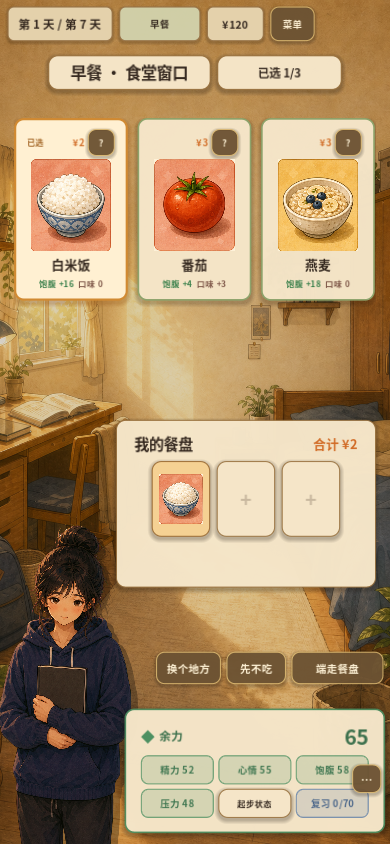
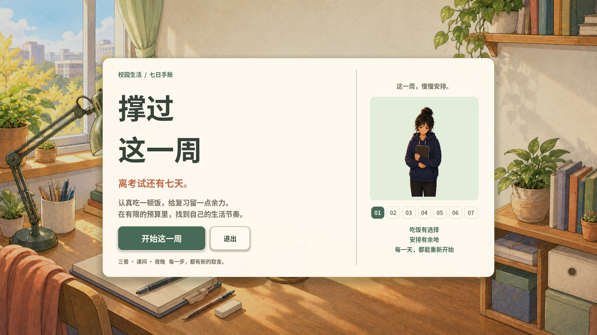
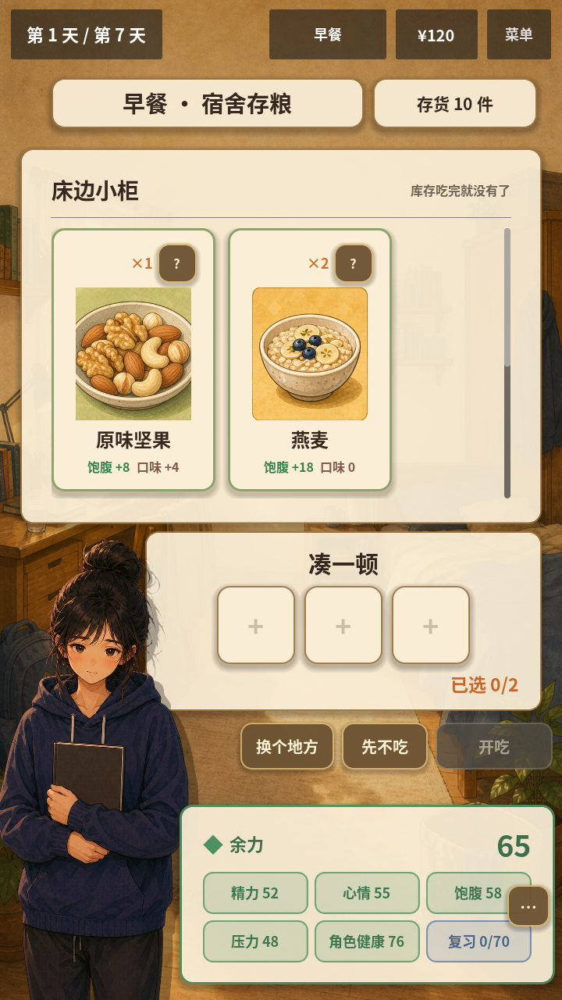
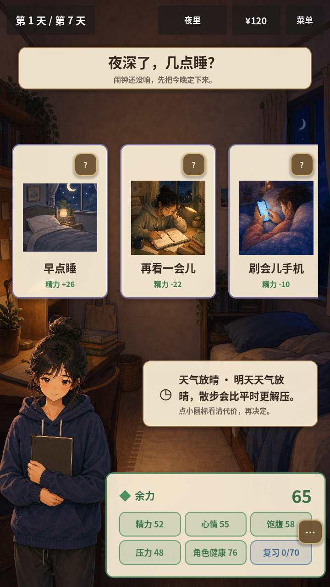

# 2026-10-08 · 从面板到插画场景

加入宿舍标题、手绘校园地图和卡牌状态；并列保存改版前界面。日期沿用截图批次，工程说明记录于10月9日。笔记本方案为未采用的探索稿。

[返回开发过程总览](../README.md)

## 截图

### 改版前标题

原图尺寸：1920 × 1080。

### 改版前来源面板

原图尺寸：1920 × 1080。

### 改版前选餐

原图尺寸：1920 × 1080。

### 改版前行动

原图尺寸：1920 × 1080。

### 插画标题

原图尺寸：1366 × 768。

### 校园地点地图

原图尺寸：1366 × 768。

### 竖屏卡牌与已选状态

原图尺寸：390 × 844。

### 未采用的笔记本风格探索稿（不是正式版本）

原图尺寸：1920 × 1080。

### 可读性调整前库存

原图尺寸：720 × 1280。

### 可读性调整前睡前页

原图尺寸：720 × 1280。

## 来源与记录

- [UI_V3_CARD_STYLE_2026-10-09.md](../../process/UI_V3_CARD_STYLE_2026-10-09.md)
- [EDU01_UX03_UX04_2026-10-08.md](../../process/EDU01_UX03_UX04_2026-10-08.md)

每张图的原始路径、尺寸及SHA-256见[完整清单](../manifest.json)。截图保持原始字节；临时目录中的独有旧图已归档到本目录。
