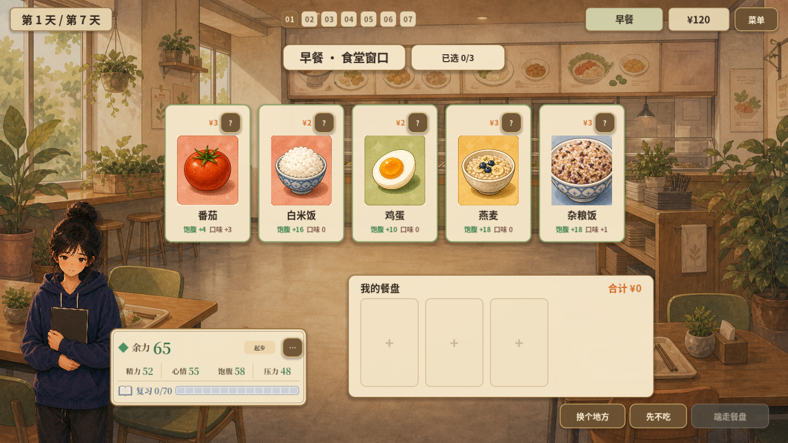
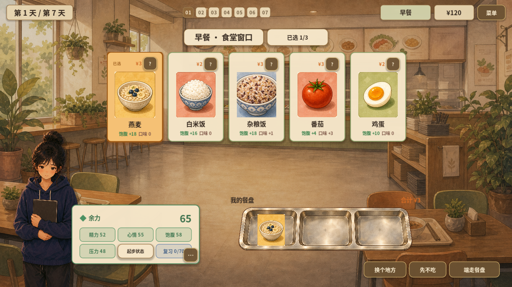
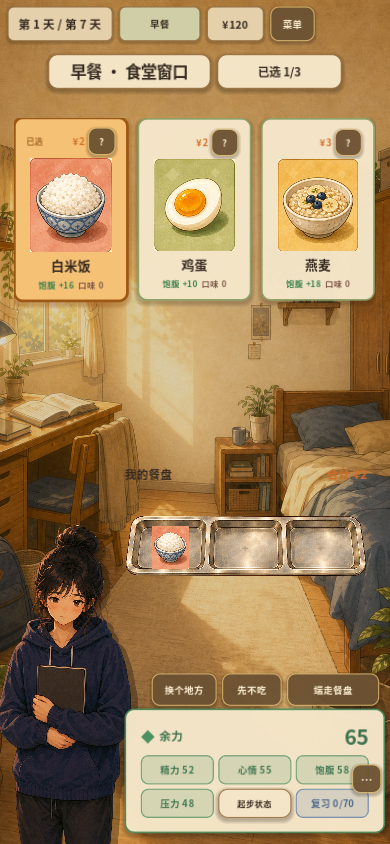

# 2026-10-09 · 人物状态与餐盘表达

人物状态进入HUD，选中食物在餐盘中集中呈现，并同步适配桌面与竖屏。

[返回开发过程总览](../README.md)

## 截图

### 人物状态HUD

原图尺寸：1366 × 768。

### 桌面已选餐盘

原图尺寸：1366 × 768。

### 竖屏已选餐盘

原图尺寸：390 × 844。

## 来源与记录

- [CHARACTER_HUD_IMPLEMENTATION_2026-10-09.md](../../process/CHARACTER_HUD_IMPLEMENTATION_2026-10-09.md)
- [TRAY_REFINEMENT_2026-10-09.md](../../process/TRAY_REFINEMENT_2026-10-09.md)

每张图的原始路径、尺寸及SHA-256见[完整清单](../manifest.json)。截图保持原始字节；临时目录中的独有旧图已归档到本目录。
