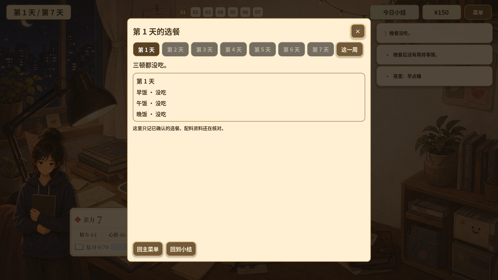
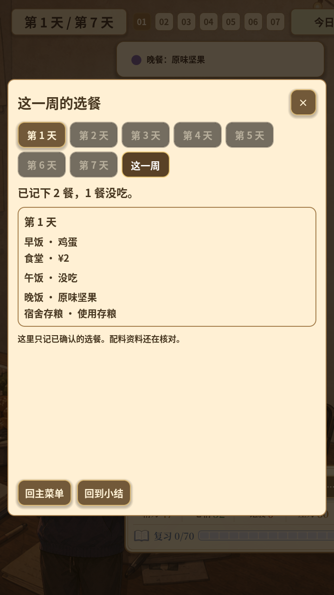

# 2026-10-12 · 真实餐次与日周记录

用已确认的餐次事实支撑日结与周回顾，移除旧餐次评分的生产输出。

[返回开发过程总览](../README.md)

## 截图

### 日结中的实际餐次

原图尺寸：1920 × 1080。

### 竖屏整周记录

原图尺寸：720 × 1280。

## 来源与记录

- [G4A8_SCORE_RETIREMENT_2026-10-12.md](../../process/G4A8_SCORE_RETIREMENT_2026-10-12.md)

每张图的原始路径、尺寸及SHA-256见[完整清单](../manifest.json)。截图保持原始字节；临时目录中的独有旧图已归档到本目录。
