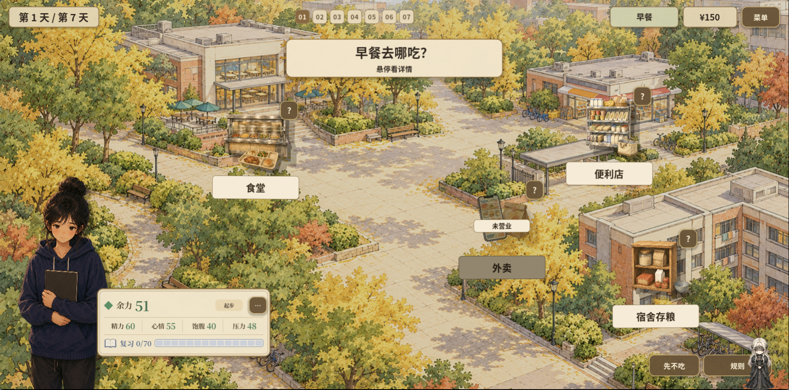
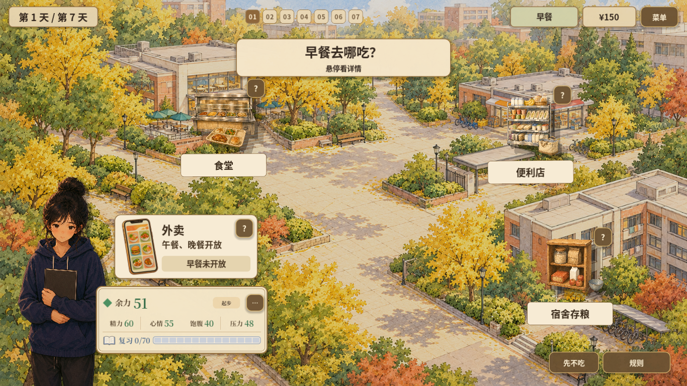
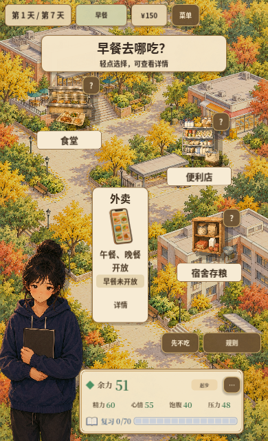
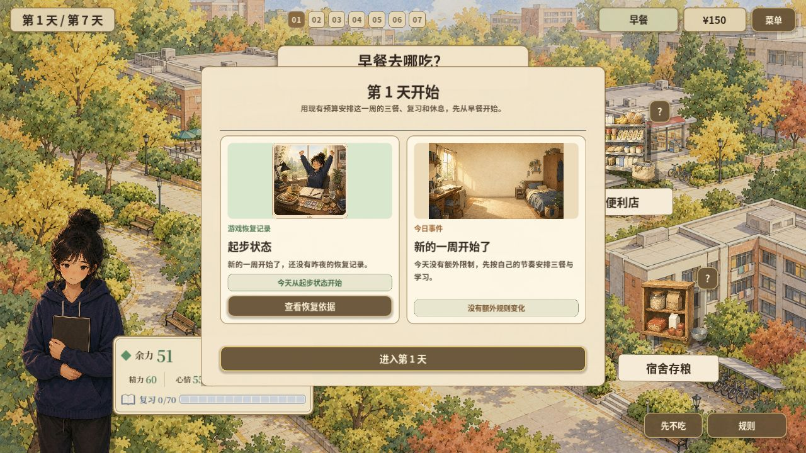

# 2026-10-13 · 外卖入口与小屏打磨

用餐入口与学生场景结合，竖屏外卖卡和点击区域经过多轮收拢。对应历史提交4d75437与41c60c0。

[返回开发过程总览](../README.md)

## 截图

### 入口调整前留档

原图尺寸：1912 × 948。

### 桌面入口调整后

原图尺寸：1366 × 768。

### 紧凑竖屏入口

原图尺寸：390 × 640。

### 10月13日网页试玩留档

原图尺寸：1280 × 720。

## 来源与记录

- [README.md](../../../README.md)

每张图的原始路径、尺寸及SHA-256见[完整清单](../manifest.json)。截图保持原始字节；临时目录中的独有旧图已归档到本目录。
