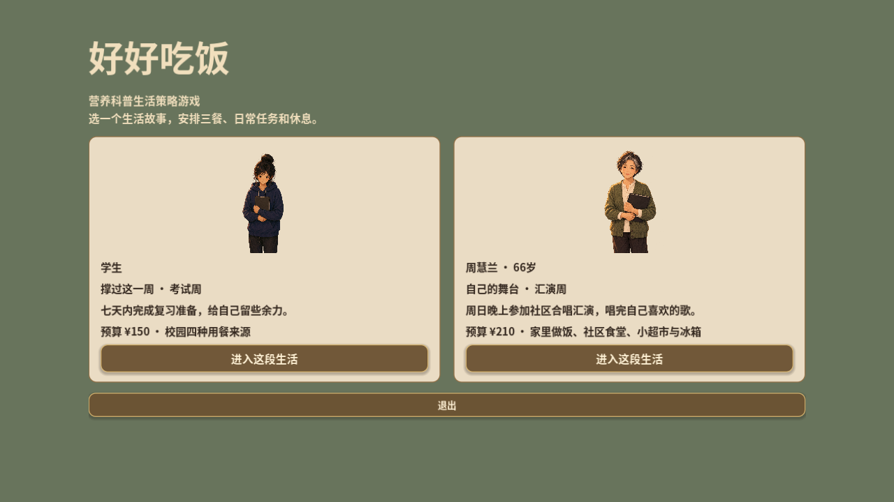
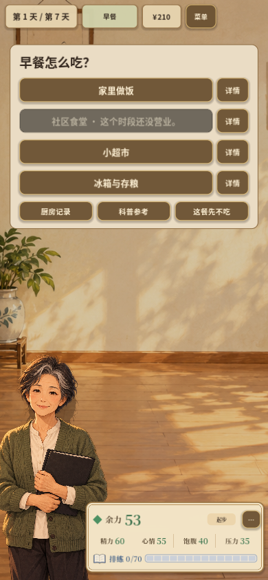
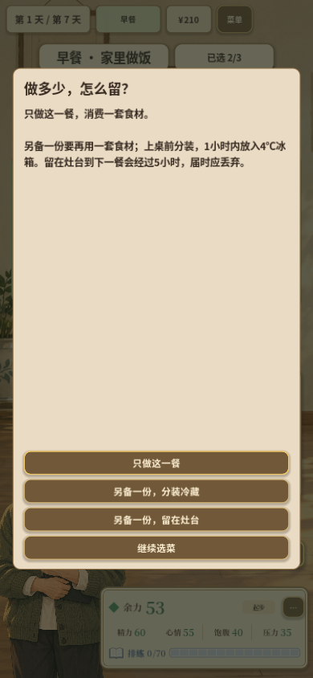

# 2026-10-14 · 从校园单篇到双人物故事

系列更名为《好好吃饭》，加入周阿姨的家庭做饭、库存与熟食管理。

[返回开发过程总览](../README.md)

## 截图

### 双人物故事入口

原图尺寸：1280 × 720。

### 周阿姨初版用餐来源

原图尺寸：390 × 844。

### 周阿姨初版库存

原图尺寸：390 × 844。

## 来源与记录

- [SERIES_IMPLEMENTATION_2026-10-14.md](../../process/SERIES_IMPLEMENTATION_2026-10-14.md)
- [CHOIR_CONTENT_2026-10-14.md](../../process/CHOIR_CONTENT_2026-10-14.md)

每张图的原始路径、尺寸及SHA-256见[完整清单](../manifest.json)。截图保持原始字节；临时目录中的独有旧图已归档到本目录。
