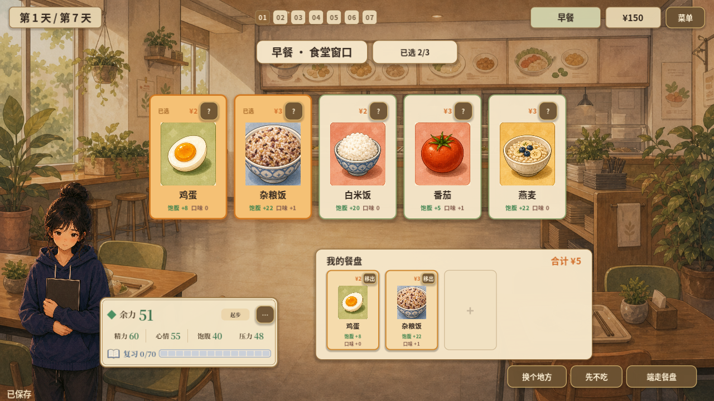
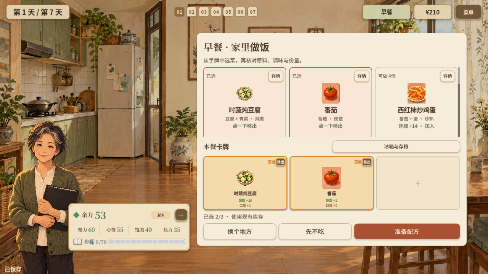
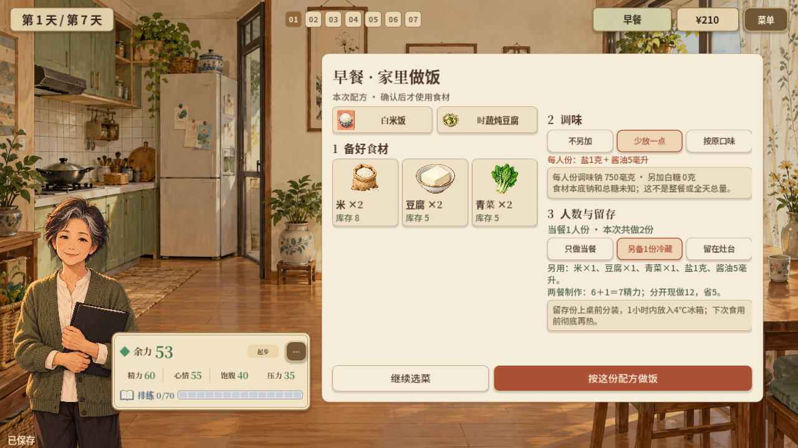

# 2026-10-16 · 共同卡牌与备餐收益

两篇共用可移出的已选卡，家庭篇衔接厨房工作台，说明多做一份的材料与精力收益。

[返回开发过程总览](../README.md)

## 截图

### 学生篇共同卡牌

原图尺寸：1280 × 720。

### 周阿姨篇共同卡牌

原图尺寸：1280 × 720。

### 额外一份的成本与收益

原图尺寸：1280 × 720。

## 来源与记录

- [GLOBAL_UI_CARD_PASS_2026-10-16.md](../../process/GLOBAL_UI_CARD_PASS_2026-10-16.md)
- [MEAL_PREP_COSTS_2026-10-16.md](../../process/MEAL_PREP_COSTS_2026-10-16.md)

每张图的原始路径、尺寸及SHA-256见[完整清单](../manifest.json)。截图保持原始字节；临时目录中的独有旧图已归档到本目录。
