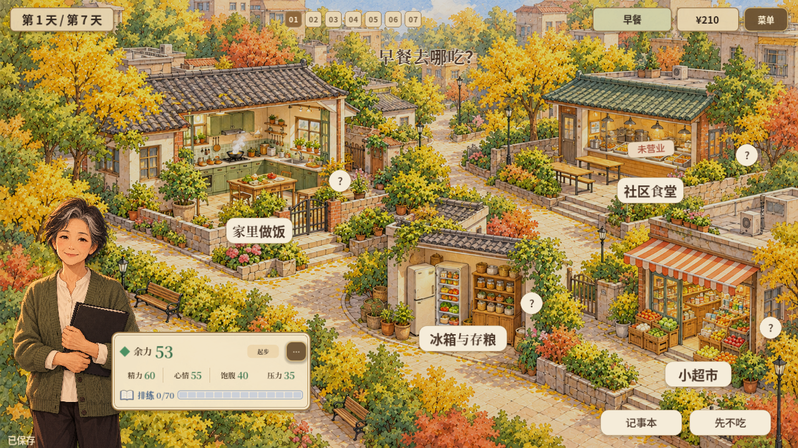
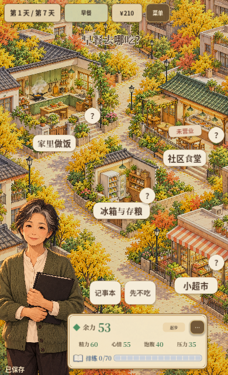

# 2026-10-20 · 周阿姨场景探索与调整

尝试将来源放入社区地图。该方案在次日根据情境反馈撤回，是开发过程中的探索版。

[返回开发过程总览](../README.md)

## 截图

### 探索版社区来源地图（后续撤回）

原图尺寸：1280 × 720。

### 探索版竖屏地图

原图尺寸：390 × 640。

## 来源与记录

- [HOUSEHOLD_SOURCE_SCENE_2026-10-20.md](../../process/HOUSEHOLD_SOURCE_SCENE_2026-10-20.md)

每张图的原始路径、尺寸及SHA-256见[完整清单](../manifest.json)。截图保持原始字节；临时目录中的独有旧图已归档到本目录。
