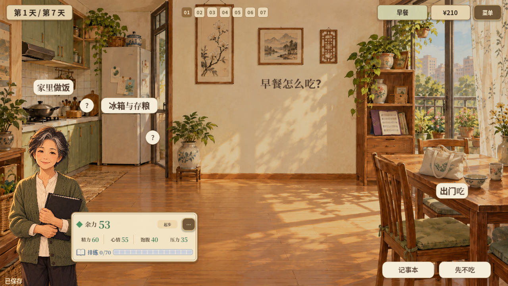
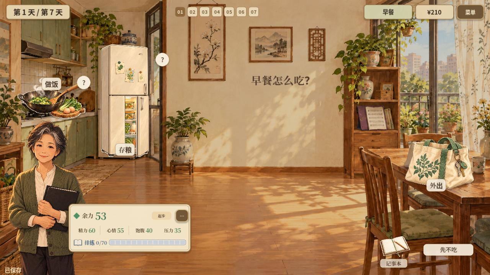
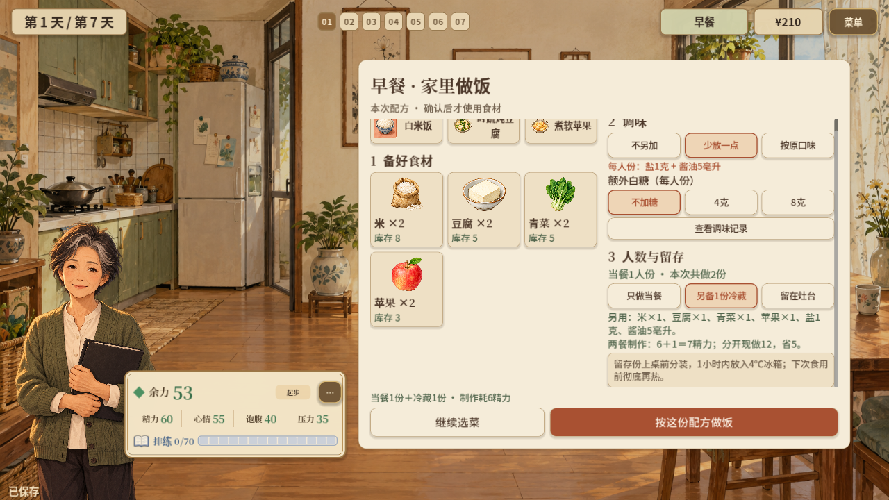

# 2026-10-21 · 回到家中，用物件承载操作

在家决定这一餐，确认外出后再切换地点；锅、冰箱、购物袋和记事本成为可点入口。

[返回开发过程总览](../README.md)

## 截图

### 纠正后的家中情境

原图尺寸：1280 × 720。

### 图形物件入口

原图尺寸：1280 × 720。

### 份数与冷藏配方确认

原图尺寸：1280 × 720。

## 来源与记录

- [HOUSEHOLD_HOME_CONTEXT_2026-10-21.md](../../process/HOUSEHOLD_HOME_CONTEXT_2026-10-21.md)
- [HOUSEHOLD_GRAPHICAL_ENTRIES_2026-10-21.md](../../process/HOUSEHOLD_GRAPHICAL_ENTRIES_2026-10-21.md)
- [HOUSEHOLD_PANTRY_FLOW_2026-10-21.md](../../process/HOUSEHOLD_PANTRY_FLOW_2026-10-21.md)

每张图的原始路径、尺寸及SHA-256见[完整清单](../manifest.json)。截图保持原始字节；临时目录中的独有旧图已归档到本目录。
