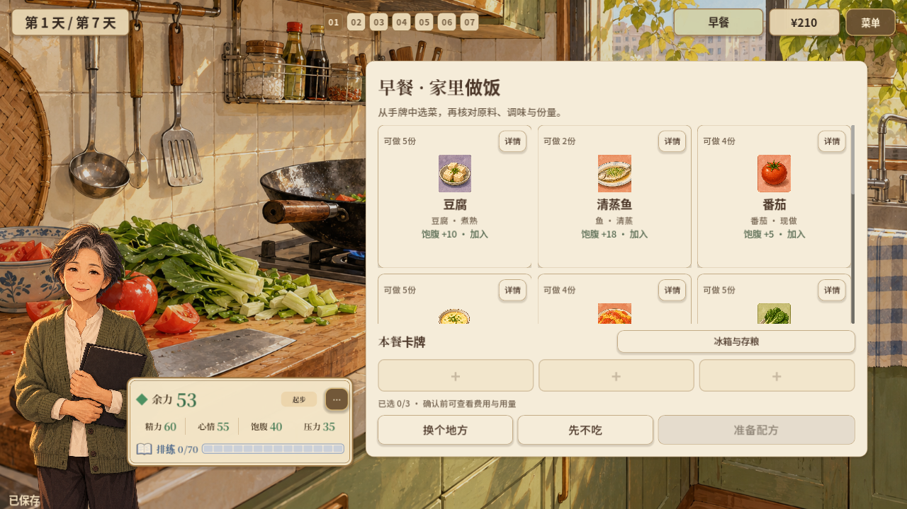
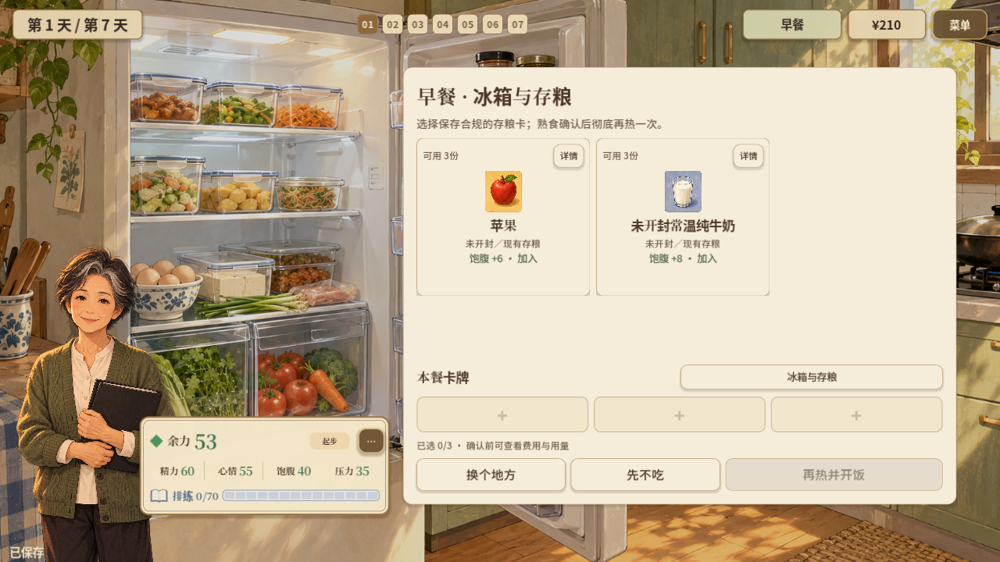
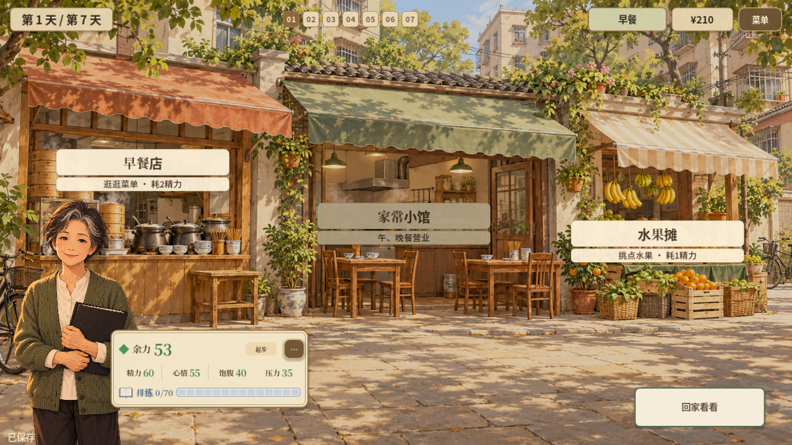

# 2026-10-23 · 厨房、冰箱与集市独立成景

进入厨房做饭，打开冰箱看存粮，去集市后选择早餐店、小馆或水果摊。

[返回开发过程总览](../README.md)

## 截图

### 厨房近景

原图尺寸：1280 × 720。

### 冰箱与熟食

原图尺寸：1280 × 720。

### 集市店铺入口

原图尺寸：1280 × 720。

## 来源与记录

- [HOUSEHOLD_LOCATIONS_2026-10-23.md](../../process/HOUSEHOLD_LOCATIONS_2026-10-23.md)

每张图的原始路径、尺寸及SHA-256见[完整清单](../manifest.json)。截图保持原始字节；临时目录中的独有旧图已归档到本目录。
