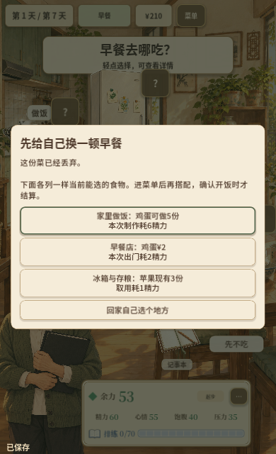
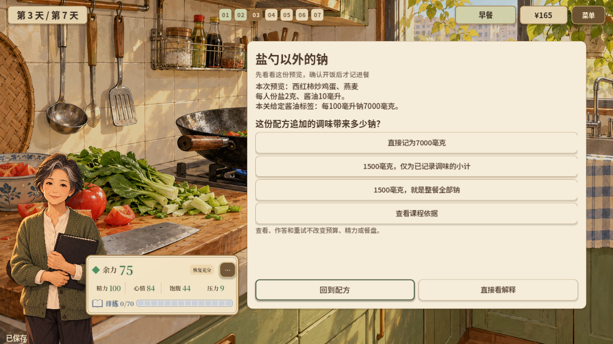

# 2026-10-27—28 · 把科普放进实际选餐

首日隔夜菜处置衔接可行早餐，随后使用当前餐次开展组成、钠和糖的标签练习。

[返回开发过程总览](../README.md)

## 截图

### 首日隔夜菜处置

原图尺寸：390 × 640。

### 实际可选早餐

原图尺寸：390 × 640。

### 依据当前餐次的钠练习

原图尺寸：1280 × 720。

### 依据当前餐次的糖练习

原图尺寸：1280 × 720。

## 来源与记录

- [ZHOU_LEARNING_LOOP_2026-10-27.md](../../process/ZHOU_LEARNING_LOOP_2026-10-27.md)
- [ZHOU_DAYS_2_TO_4_2026-10-28.md](../../process/ZHOU_DAYS_2_TO_4_2026-10-28.md)

每张图的原始路径、尺寸及SHA-256见[完整清单](../manifest.json)。截图保持原始字节；临时目录中的独有旧图已归档到本目录。
