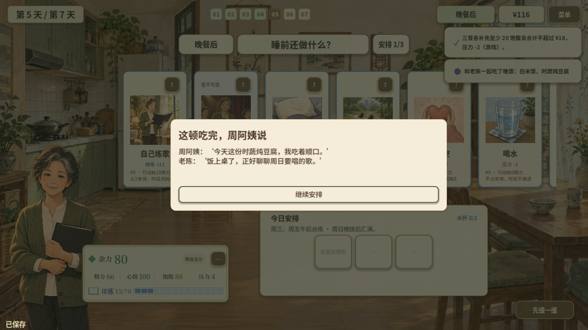
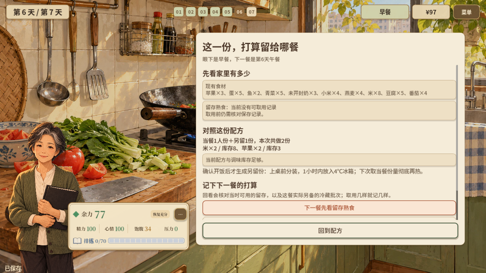
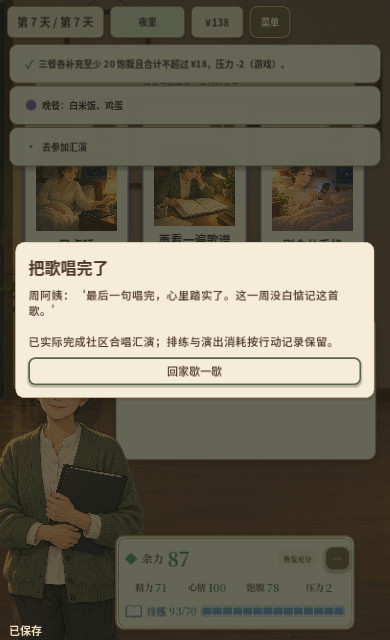
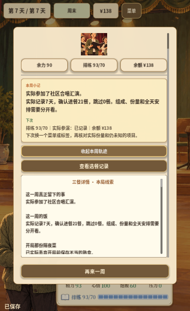

# 2026-10-28 · 共餐、备餐到汇演与周回顾

第5天回应人物需要和真实共餐，第6天计划并实际取用备餐，第7天回应汇演结果并回顾一周。

[返回开发过程总览](../README.md)

## 截图

### 第5天真实共餐

原图尺寸：1280 × 720。

### 第6天配方与下一餐计划

原图尺寸：1280 × 720。

### 第7天实际参演

原图尺寸：390 × 640。

### 整周实际记录

原图尺寸：390 × 640。

## 来源与记录

- [ZHOU_DAY_5_2026-10-28.md](../../process/ZHOU_DAY_5_2026-10-28.md)
- [ZHOU_DAY_6_2026-10-28.md](../../process/ZHOU_DAY_6_2026-10-28.md)
- [ZHOU_DAY_7_2026-10-28.md](../../process/ZHOU_DAY_7_2026-10-28.md)

每张图的原始路径、尺寸及SHA-256见[完整清单](../manifest.json)。截图保持原始字节；临时目录中的独有旧图已归档到本目录。
