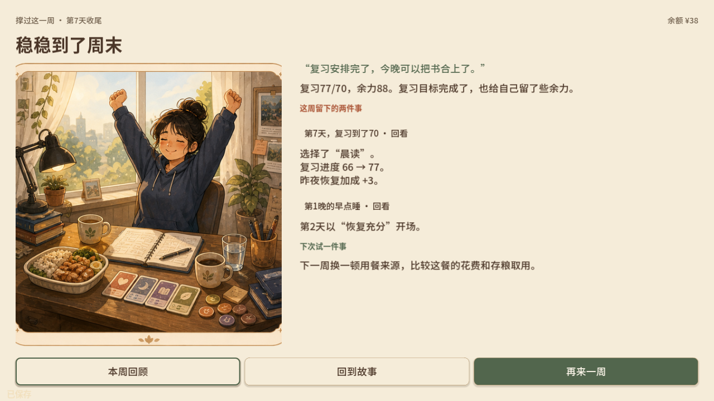
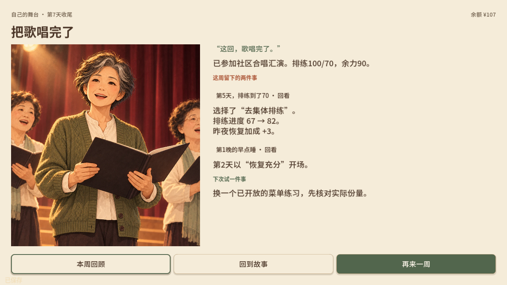
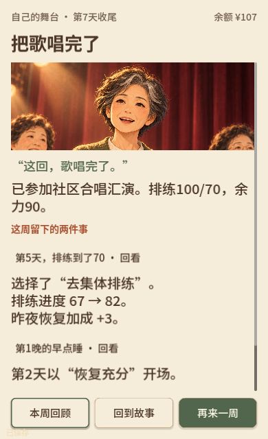
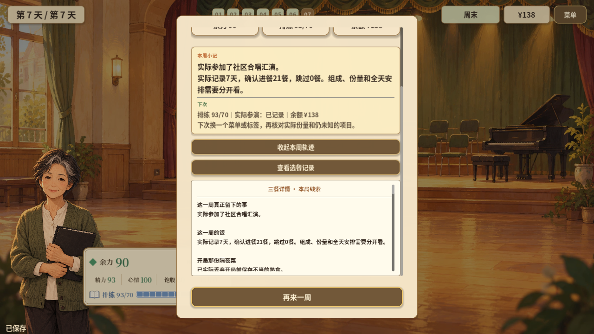

# 2026-10-29 · 结局回应这一局的选择

双篇使用独立结局页，回看关键选择、实际效果与下一次尝试。另附本轮改版前的周回顾用于对照。

[返回开发过程总览](../README.md)

## 截图

### 学生篇新版结局

原图尺寸：1280 × 720。

### 周阿姨新版结局

原图尺寸：1280 × 720。

### 竖屏新版结局

原图尺寸：390 × 640。

### 本轮改版前的整周回顾留档

原图尺寸：1280 × 720。

## 来源与记录

- [ENDING_FEEDBACK_2026-10-29.md](../../process/ENDING_FEEDBACK_2026-10-29.md)

每张图的原始路径、尺寸及SHA-256见[完整清单](../manifest.json)。截图保持原始字节；临时目录中的独有旧图已归档到本目录。
