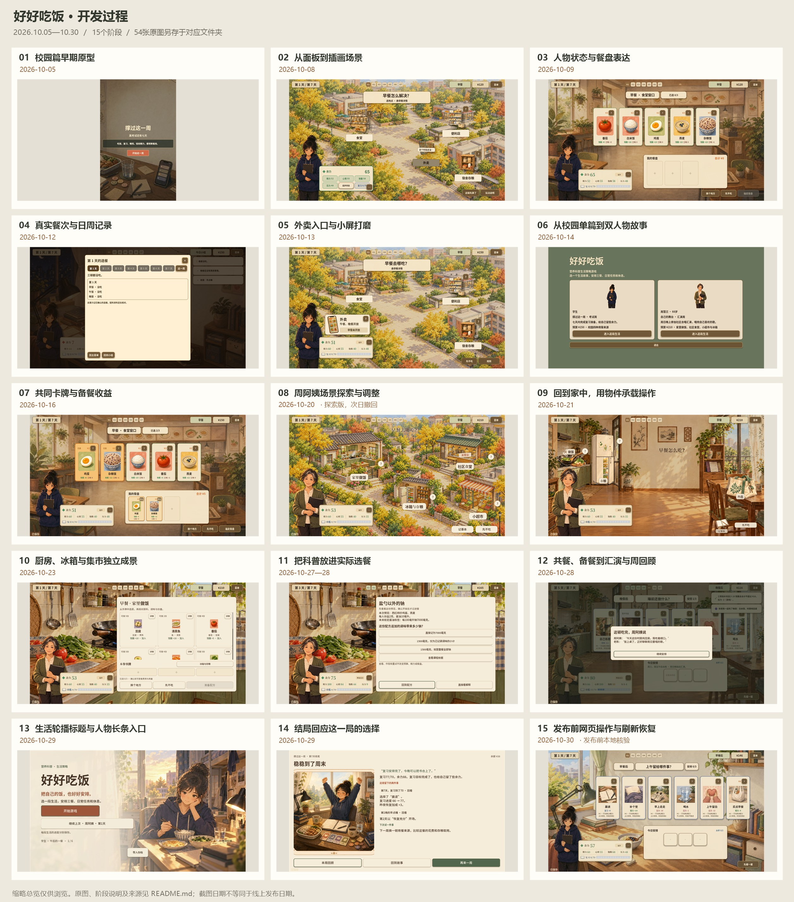

# 《好好吃饭》开发过程与历史截图

按时间保存2026年10月5日至30日的15个开发阶段、54张代表截图，可用于汇报、展示和版本前后对照。每个阶段单独成文件夹，原图保留原始尺寸与字节。

## 展示顺序

简短汇报可依次看01早期原型 → 02插画地图 → 06双人物故事 → 09家中情境 → 10独立地点 → 13新版入口 → 14结局反馈。完整开发过程按下表01—15浏览，点阶段名称即可查看原图。

| 阶段 | 日期 | 主要变化 | 原图 |
| --- | --- | --- | ---: |
| [01 · 校园篇早期原型](01-2026-10-05-campus-prototype/README.md) | 2026-10-05 | 单一学生故事已串起选来源、选餐、行动与日结；界面以信息面板和列表为主。 | 3 |
| [02 · 从面板到插画场景](02-2026-10-08-illustrated-campus/README.md) | 2026-10-08 | 加入宿舍标题、手绘校园地图和卡牌状态；并列保存改版前界面。日期沿用截图批次，工程说明记录于10月9日。笔记本方案为未采用的探索稿。 | 10 |
| [03 · 人物状态与餐盘表达](03-2026-10-09-character-and-tray/README.md) | 2026-10-09 | 人物状态进入HUD，选中食物在餐盘中集中呈现，并同步适配桌面与竖屏。 | 3 |
| [04 · 真实餐次与日周记录](04-2026-10-12-meal-records/README.md) | 2026-10-12 | 用已确认的餐次事实支撑日结与周回顾，移除旧餐次评分的生产输出。 | 2 |
| [05 · 外卖入口与小屏打磨](05-2026-10-13-takeout-entry/README.md) | 2026-10-13 | 用餐入口与学生场景结合，竖屏外卖卡和点击区域经过多轮收拢。对应历史提交4d75437与41c60c0。 | 4 |
| [06 · 从校园单篇到双人物故事](06-2026-10-14-two-stories/README.md) | 2026-10-14 | 系列更名为《好好吃饭》，加入周阿姨的家庭做饭、库存与熟食管理。 | 3 |
| [07 · 共同卡牌与备餐收益](07-2026-10-16-cards-and-preparation/README.md) | 2026-10-16 | 两篇共用可移出的已选卡，家庭篇衔接厨房工作台，说明多做一份的材料与精力收益。 | 3 |
| [08 · 周阿姨场景探索与调整](08-2026-10-20-community-experiment/README.md) | 2026-10-20 | 尝试将来源放入社区地图。该方案在次日根据情境反馈撤回，是开发过程中的探索版。 | 2 |
| [09 · 回到家中，用物件承载操作](09-2026-10-21-home-and-objects/README.md) | 2026-10-21 | 在家决定这一餐，确认外出后再切换地点；锅、冰箱、购物袋和记事本成为可点入口。 | 3 |
| [10 · 厨房、冰箱与集市独立成景](10-2026-10-23-kitchen-fridge-market/README.md) | 2026-10-23 | 进入厨房做饭，打开冰箱看存粮，去集市后选择早餐店、小馆或水果摊。 | 3 |
| [11 · 把科普放进实际选餐](11-2026-10-27-28-learning-loop/README.md) | 2026-10-27—28 | 首日隔夜菜处置衔接可行早餐，随后使用当前餐次开展组成、钠和糖的标签练习。 | 4 |
| [12 · 共餐、备餐到汇演与周回顾](12-2026-10-28-complete-household-week/README.md) | 2026-10-28 | 第5天回应人物需要和真实共餐，第6天计划并实际取用备餐，第7天回应汇演结果并回顾一周。 | 4 |
| [13 · 生活轮播标题与人物长条入口](13-2026-10-29-title-and-character-entry/README.md) | 2026-10-29 | 两位人物各有生活轮播图；完整人物插画承载选择，网页加载展示真实下载进度。 | 4 |
| [14 · 结局回应这一局的选择](14-2026-10-29-ending-feedback/README.md) | 2026-10-29 | 双篇使用独立结局页，回看关键选择、实际效果与下一次尝试。另附本轮改版前的周回顾用于对照。 | 4 |
| [15 · 发布前网页操作与刷新恢复](15-2026-10-30-web-release-check/README.md) | 2026-10-30 | 最新结局版本同步到试玩目录。这里保留发布前本地Pages目录的实际选餐和刷新恢复截图，线上验收另见发布记录。 | 2 |

## 归档说明

- 这是精选展示目录；完整的正式验证截图仍保留在[docs/assets](../assets/)，已有开发记录的图片链接继续有效。
- 日期使用截图批次或对应工程记录日期，不补造更早截图，也不把每次本地改动称为正式发布版本。
- 第02阶段的笔记本风格为未采用探索稿；第08阶段的社区地图次日已撤回；第15阶段展示发布前本地网页核验。
- [manifest.json](manifest.json)记录每张图的来源、尺寸、大小与SHA-256，便于核对。缩略总览仅用于浏览，汇报取图请使用阶段文件夹内的原图。
- 新阶段采用“序号-日期-主题”建文件夹，补上代表原图、简短说明及来源记录；展示资产不放入本地缓存目录。

[2026-10-30文件清理记录](../process/WORKSPACE_CLEANUP_2026-10-30.md)
