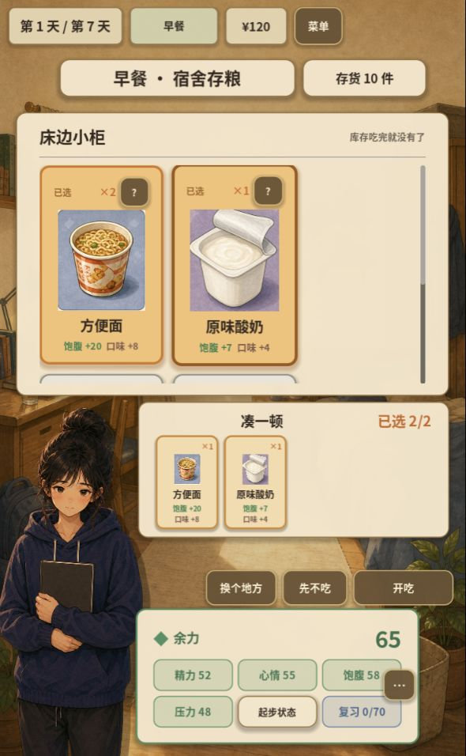
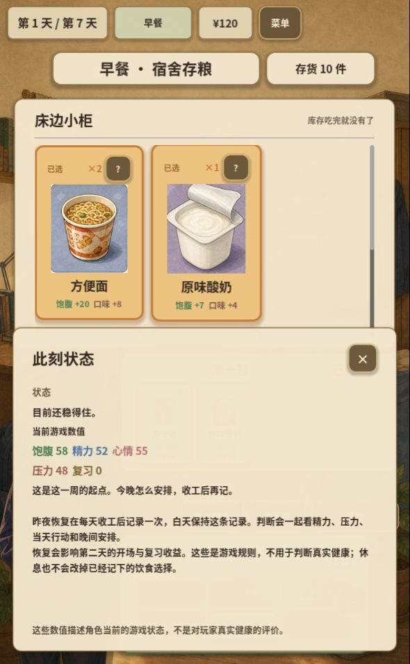
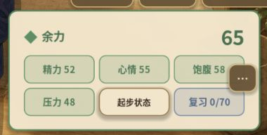

# 人物状态栏审查与优化方向 · 2026-10-09

范围：当前本地游戏的常驻人物状态栏，以及点击「…」展开的状态详情。使用本次浏览器实际截图，窗口为 590 × 956；本轮未修改游戏。

1. **常驻状态栏：读数清楚，视觉偏重。** 暖色纸面与游戏卡牌有联系，但外框与六个小格的描边重复，属性格形似可点击按钮。四项即时属性、昨夜恢复和复习目标混在同一网格，层级不足。详情按钮叠在网格右侧边缘，显得游离。
2. **状态详情：入口可用，展开与关闭正常。** 现有详情足以承接解释和恢复规则，常驻栏可以更简洁。保留该交互，把入口移入人物档案卡的右上角。

建议采用「纸质人物档案卡」：

- 暖米色纸面、细棕色边框、轻阴影；减少内部方框。
- 顶部集中显示「余力 65」，昨夜恢复作为小标签。首日起步说明留在详情。
- 中部用两列显示精力、心情、饱腹、压力，保留名称和数字，配短刻度或细条。
- 底部单独显示「复习 0/70」及进度，使目标与即时属性分开。
- 异常数值用局部橙红提示，并配短标签；正常数值使用低饱和色。饱腹过低与过高、压力偏高都应按原有规则提示，不能把所有条形理解为越满越好。
- 收紧面板高度与留白，让人物插画仍然是这一角的视觉主体。

可读性方面，小字和仅靠色彩传递状态都需要注意。建议保留数字与短标签。本次只观察普通状态及鼠标详情操作，未实测危险状态、键盘、触摸或屏幕阅读器，也未对桌面宽屏另行截图。

截图：

