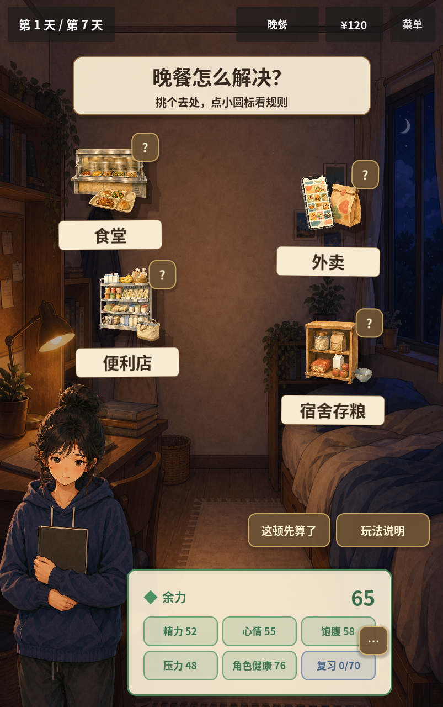
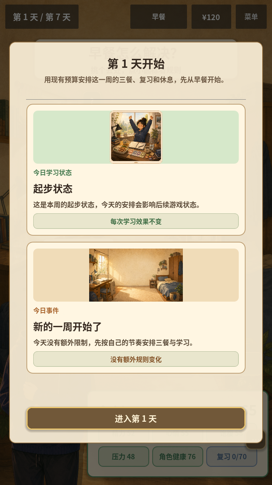

# EDU-01学习任务与UX-03/04收口 · 2026-10-08

本轮完成EDU-01设计任务包，收口已有UX-03未提交布局改动，并完成UX-04首日说明。下一项为NUT-208C1恢复日终接入，资料审校准备与旧提示清单继续按EDU-02/03推进。完整教育候选仍需G1/G4与玩家验证。

## 1. 教育任务包

- [七日场景、提示与评分方案](../education/EDU01_LEARNING_SCENARIOS_AND_ASSESSMENT.md)：L1–L4映射已有七日事件，逐项定义触发、无资料/无手牌替代路径、首次与复玩规则。
- [参与者任务页](../education/EDU01_PARTICIPANT_TASKS.md)：A/B各4题，前后测使用不同菜单，主持人与答案分开；每项0–2，另记关键误解，不参与健康评分或游戏结局。
- 包含多解的预算/库存题、独立游戏效果与资料判断题，以及主持、缺失回答、前后顺序和复玩观察记录规则。

这里只完成内部设计与条件核对。题目是给定模拟条件，尚无真人数据，也没有由此取得食物profile、健康规则或玩家文案的专业签署。组成预览、营养观察与建议仍未接入生产。

## 2. UX-03的实际修改与验证

开工时工作区已包含来源名称底板、存粮区域尺寸/纵向滚动、睡眠预告自动换行及3项readability用例。保留这些未提交成果，本轮追加实际核验和最后一处来源位置修正，不重做来源界面。

实际Web720×1280检查发现便利店名称会被角色头部遮住左侧文字；将V2移动布局中的ConvenienceProp纵向锚点从0.53移到0.48。最终600×956浏览器中名称完整，夜间实际渲染也无遮挡。食堂、外卖、便利店和宿舍继续使用各自场景。

最初同步回归1/3通过，另两项读到了尚未完成换行与最小尺寸收缩的暂态高度。正常游戏进程等待真实帧后，同一场景的餐碗与事件便签均能放入布局。测试辅助现先完成子项排版，再按声明的锚点与偏移更新独立容器尺寸；保留原边界断言。实际渲染探针独立检查真实帧，避免只凭同步辅助判断布局。

验证点包括：存粮首排名称/快速状态、滚动至末排仍可读、确认按钮可见、餐碗不遮挡确认、三种画布的第1–7日睡眠预告及提示位于便签内、来源名称位于画布内。



## 3. UX-04首日说明

V2首日弹窗使用“起步状态”，说明现有预算、一周安排和从早餐开始；不使用“昨日记录”解释未发生的上一日。第二日及以后继续使用真实昨日状态与事件。显示层复制学习状态后替换首日标题/说明，不改current_learning_state、数值、恢复或日终规则；组件缺省文案也区分首日和后续日。

现有v2_flow用例补查：首日无昨日/昨天陈述，重开首日说明不改游戏状态或学习状态；原有后续日状态、事件、插画与响应式检查保留。



## 4. 验证范围

| 检查 | 本轮结果 |
| --- | --- |
| 统一回归、资源导入与主入口烟测 | 233/233、24套件、0失败/跳过；最新日志artifacts/edu01-ux03-ux04-2026-10-08-verification.log |
| 可读性套件 | 3/3，含宿舍内容、睡眠7日预告与来源名称对比度；旧同步暂态误报已修正 |
| 本地Web导出与真实PCK目录审计 | 通过，PCK约53.12MiB；最终候选artifacts/edu01-ux03-ux04-2026-10-08-web，未改Play |
| 独立图形渲染 | 720×1280、803×1280、1920×1080三个SubViewport；21个睡眠日/尺寸组合通过，15张截图，每尺寸JSON报告记录errors为空 |
| 实际浏览器 | 720×1280首日/存粮首末排/选择确认；600×956最终候选首日与来源位置；可见现金120，吃一份存粮后仍120；所检浏览器错误日志为空 |
| 冻结恢复基线 | 原legacy_baseline.json保留；未修改恢复规则或健康XML，C/D仍未接生产 |

803×1280用于覆盖600×956在移动扩展模式下的近似逻辑画布，它不是803像素宽的真实手机。图形探针记录原生窗口尺寸，截图来自SubViewport；实际浏览器尺寸另用DOM与截图确认，不以原生请求尺寸冒充竖屏。

本轮未执行真实手机触摸、多浏览器完整七日/失败/重开验收、策略平衡或真人教育测试；不把局部Web检查记为完整发布通过。旧“角色健康”仍由NUT-208C/D收口，23份profile仍draft，新健康开关继续关闭。

## 5. 复现方式与后续

从仓库根目录运行统一验证：

```powershell
.\tools\verify_project.ps1 -GodotPath 'E:\Program\GodotEngine\Godot_v4.7.2-stable_win64_console.exe' -ExportWeb -ExportOutput '.\artifacts\edu01-ux03-ux04-2026-10-08-web'
```

独立可读性图形探针需要正常图形环境，不使用headless：

```powershell
& 'E:\Program\GodotEngine\Godot_v4.7.2-stable_win64_console.exe' --path life-strategy --script res://tests/readability_visual_probe.gd --resolution 720x1280 -- --output=res://.godot/ux03-ux04-visual
```

探针按三个画布生成报告与截图，退出码反映检查结果；使用RenderingServer.force_draw为被遮挡的测试窗口生成实际帧。[Godot RenderingServer文档](https://docs.godotengine.org/en/stable/classes/class_renderingserver.html#class-renderingserver-method-force-draw)

本轮曾通过Godot AI4.3.0正常游戏环境复现回归和截图；后续桥接出现18000端口占用，未停止未知监听进程或改全局配置，最终采用独立图形探针与实际浏览器完成核验。后续MCP操作先重新读会话，不沿用本轮旧session_id。

工程改动见[V2控制器](../../life-strategy/scripts/ui_v2/GameRootV2.gd)、[新日弹窗](../../life-strategy/scripts/ui_v2/NewDayPopup.gd)、[可读性回归](../../life-strategy/tests/test_readability.gd)、[流程回归](../../life-strategy/tests/test_v2_flow.gd)和[图形探针](../../life-strategy/tests/readability_visual_probe.gd)。保留全部此前未提交改动，本轮未提交、推送或发布。
