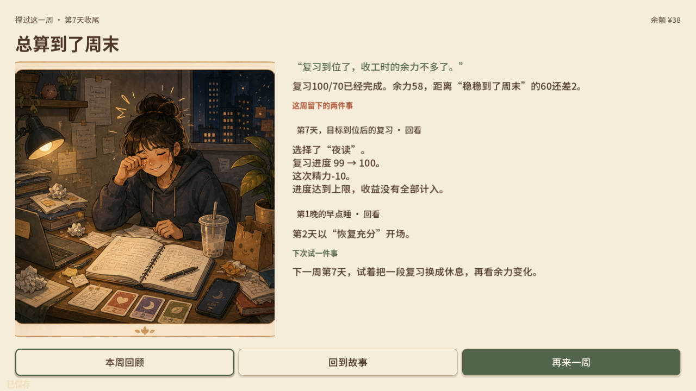
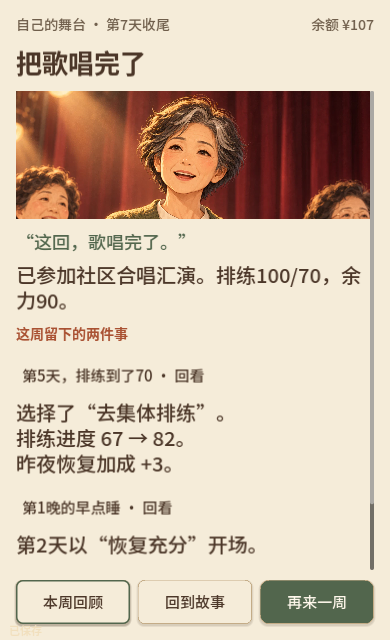

# 双篇结局反馈与合法触发路线

日期：2026-10-29。依据[优化方案](../design/ENDING_FEEDBACK_OPTIMIZATION_2026-10-29.md)实施。工程、原生与本地网页检查完成；真人反馈与学习验证另行完成。

## 玩家现在会看到什么

结局从日结弹层中独立出来，用故事插画、人物短句和清楚的结果依据收尾。首页最多提炼两件有记录的本局经历，并给出一件下次可尝试的事；完整回顾进入独立阅读层，正文只用一个滚动容器。

- 学生复习55/70时明确还差15，并根据第6天实际没有餐后复习的记录，建议下一周在这天试着留一段。
- 复习100/70、余力58的路线会回应目标到位后继续复习的选择：进度99→100、行动精力-10，部分收益受到上限截断；下次可以在对应日期尝试换一段休息。依据中区分行动自身变化与餐后公共消耗。
- 周阿姨按实际参演、演前条件不足、具备条件但另作安排、低余力收束分别回应。演前缺项读取当时冻结的排练、精力和安排位，不用睡后的恢复结果替代。
- 主动另作安排有独立插画和人物回应。已经参演后又低余力收束时，两个事实并列保留。
- 来源页可看刚才行动的实际效果，日结补首次达到目标和第一次低余力的衔接；重开回到新一周，过去的餐次与恢复不继续消费。

横屏采用插画与周记分栏，竖屏上下排列，主要操作固定在底部。短竖屏保留标题、主要原因、一件关键经历和操作；第二件经历及较长的下次建议可以向下阅读。插画按各自人物位置裁切，保留人物面部。

进度变化、恢复加成和演前缺项按语义分行，避免窄屏把“82”等数值拆到两行。

## 结局是否真的能够触发

两篇各4类主要结局都具有从第1天开始执行的实际场景路线。“总算到了周末”包含目标未到与目标已完成两个正文变体，共9条路线，其中两条在第2天提前结束。

[路线与导入指南](../assets/endings-feedback-2026-10-29/ROUTE_GUIDE.md)提供每条路线的中文逐日安排、触发前存档与结局存档；[机器步骤](../assets/endings-feedback-2026-10-29/routes/routes.json)包含初始种子、真实对话选择、来源、食物、行动与睡眠。

路线使用固定种子42。实际场景处理新日、周阿姨开场选择、集市和菜单、卡牌确认、行动可用性、日结与汇演回应；没有修改数值、强塞手牌或设置结局ID。9条路线的最终数值均与原规则命令模拟一致。正常新开局的菜单有随机变化，导入触发前存档可以复现完全相同的状态。

这是脚本驱动的实际场景流程，不能当作真人从头游玩或学习效果。另有原生指针、键盘及真实浏览器交互检查。

## 记录与兼容

`EndingFeedbackBuilder`只读已冻结事实，稳定选择关键经历，不消费随机数。人物文案、事件、下一次尝试与原始记录位置分别组织，界面不从显示文字反推状态。

新行动记录增加可选`feedback_trace`：保存行动前状态、原请求、封顶后实际变化及进度修正分项。实际变化在现有封顶之后、公共时段消耗之前截取；记录层不重复结算。编解码对当日及历史行动均检查差额、范围、分项和恢复来源。

旧档没有逐次证据时使用日合计与真实行为，不补推过去的增量，也不把空白旧记录写成某天没有复习。只有成功标记、没有真实参演行动的旧档不展示已经唱完。原`HouseholdFinale.review`结构和验算保持，新模板在展示层读取，避免旧档因文案替换而失效。

邀约不算已同桌；冷藏未取用不算完成备餐后续；未开封奶和水果不算熟食再热。游戏余力、复习/排练目标和营养判断继续分开，健康资料审核状态与功能开关保持原范围。

## 验证结果

| 检查 | 本轮结果与范围 |
| --- | --- |
| 完整回归 | 663/663，52套件，失败0、跳过0；末次依据说明补充后，19项结局专项、主场景和导出检查再次通过 |
| 发布门禁 | 50项；新增独立结局页、反馈代码与三张插画必须真实进入PCK，缺少任一项会拒绝 |
| 玩法保护 | 校园510局、周阿姨40局，共550局，同种子原有报告完整一致；比较只排除新增行动证据字段。[对照](../assets/endings-feedback-2026-10-29/strategy-comparison.json) |
| 合法可达 | 8类主要收尾、9条实际场景路线，全部从第1天正常执行并保存有效触发前/结局档；最终状态均与原规则模拟一致 |
| 原生窗口 | 1280×720、1920×1080、640×960、390×640；九条路线的末次睡眠卡真实指针触发，回顾、餐次记录、Esc、重复/迟到输入、只读与重开验证 |
| 跨进程恢复 | 桌面和窄屏互读另一引擎进程保存的9份结局，各9例；重新展开不改变资源、库存、恢复、行动或已冻结回顾 |
| 最终包内运行 | 匹配Godot 4.7.2直接加载Web PCK，检查9个变体、真实导出场景/脚本/插画、只读回顾与旧整周档解码；与WebGL检查分开记录 |
| 网页终检 | 1280×720、390×640核对9条展示路线；实际文件导入、两篇刷新继续与重开、关闭标签后继续、旧档共餐/备餐反馈、餐次记录与Esc返回通过。学生提前结束由网页睡眠卡触发；周阿姨实际点击参演、关闭回应、选择睡眠后进入结局。[浏览器记录](../assets/endings-feedback-2026-10-29/browser-checks.json) |

完整[机器摘要](../assets/endings-feedback-2026-10-29/verification.json)与[包文件指纹](../assets/endings-feedback-2026-10-29/web-files.json)分别保存。原生逻辑尺寸、实际窗口、注入输入、浏览器输入与真人试玩的证据不互相替代。

## 素材与当前候选

使用内置ImageGen补三张独立分支插画：学生未赶上、周阿姨未上台、周阿姨另作安排。已检查人物、场景、风格和构图，保存到`life-strategy/assets/generated/endings/feedback/`；原生成文件保留。[完整提示词、参考和输出路径](../assets/endings-feedback-2026-10-29/image-provenance.json)。

本地Web候选：`artifacts/ending-feedback-2026-10-29-web/`。本记录对应的工程检查点未更新线上`Play/`、提交或推送；后续用户授权发布与`Play/`同步见[2026-10-30发布记录](ENDING_WEB_RELEASE_2026-10-30.md)。试玩入口支持直接导入本轮演示档。

Windows沙盒下的Godot编辑器目录/安全保存及原生着色器缓存初始化诊断保留在原始日志与摘要中；脚本测试、实际渲染和最终包检查分别确认结果，不能把初始化诊断隐藏成“全部日志无错误”。

1920×1080末轮首次注入中，最后一条路线的一次指针点击没有激活回顾，未见脚本错误；同一代码随后完整重跑9/9通过。原始失败日志保留，具体是否由聚焦或布局时序引起尚未确认，后续真人/实机检查继续留意。

工程改造不等于已经证明反馈感、乐趣或教育效果。真人形成性试玩、专业/迁移任务和真实手机触摸继续按方案单独验收。
