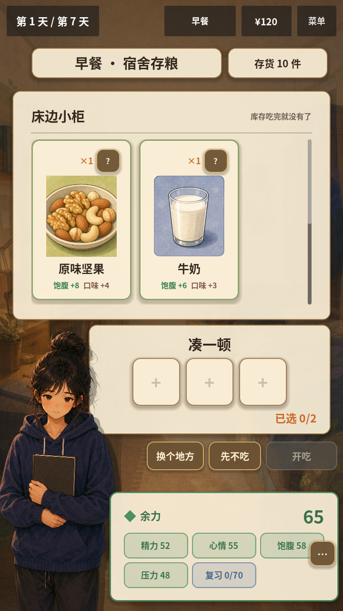

# NUT-208C3：旧负担路径与V1共享迁移 · 2026-10-08

C3已完成：36项食物/来源/行动/睡眠配置移除burden，V1/V2、共享餐食、事件、限幅与余力/结局不再生产或消费旧负担。V1新增同源恢复记录及冻结消费。下一项D完整统一恢复与结局表达；C3仅隐藏已失效的数字入口，不把本轮称为完整教育候选。

## 1. 清理范围

- 23食物、4来源、6行动、3睡眠移除旧属性；CardDataStore在解析时丢弃burden/diet_burden/character_health，旧键不会退成字符串字段。
- MealResolver用餐/跳餐增量不再包含旧键，伪造食物或来源旧键不改变结算；余力接口要求显式恢复贡献，移除旧默认回退。结局统一R2，不再以旧负担挡住最佳结局。
- GameData新局与标签不再声明旧值，转换函数退休；两个控制器移除组合、行动、睡眠和日终旧写入，通用增量拒绝旧键，限幅清除残留旧状态。WeeklyEventService拒绝旧增量并清理旧目标键。
- 白米饭等价格、来源费、库存、饱腹/精力/口味、组合其他效果、R2阈值和旧quality兼容玩法保持。quality与其精力/压力效果继续按NUT-308清理，不将其解释为新营养教育。
- DayCarryoverService变为冻结记录转接入口，不再接受饮食指标生成恢复。原服务与原历史生成器以只读.gd.txt存于冻结fixture旁，历史生成入口明确拒绝用当前源码重写旧证据。

健康快照/旧档识别中的禁用键和历史fixture仍保留，它们是必要反例，不做全仓关键字删除。原legacy_baseline.json哈希保持3F67E90FBDFBE423853E390BB8AF4B0C0C3BB2F5AE4CEAB4CB5FEBAE6F50F2F5。

## 2. V1兼容范围

V1使用与V2相同的RecoveryStateService、RecoveryGameplayService及R2余力/结局接口：合法睡眠冻结实际增量，成功行动计数与有序日终来源记录，生成独立恢复结果，保存深拷贝历史，下一日验证时间/版本并消费冻结效果。重复睡眠、日终和开场幂等；缺失/未知记录阻止推进。

V1补齐行动精力门槛、每天一次的补货和库存变更，事件修正用实际数值，复习收益应用冻结恢复与实时状态。第7日不预留不存在的未来餐费。它仍为兼容场景，不新增角色或教程；原V1日内流程/显示方式及非旧负担效果保留。

## 3. 数字入口与D边界

删除旧字段后不能继续显示0分或100分兜底，因此V2旧数字芯片隐藏，详情不读三种旧别名，V1状态条/tooltip/说明移除旧项；组合提示删除已不存在的“额外游戏消耗”。没有将旧值改名为恢复分。

目前HUD常驻恢复状态、原因入口、四来源/行动/睡眠详情的统一解释、日结/新日依据和真实轨迹结局文案仍归D。旧场景节点名作为布局占位可保留隐藏，D再调整结构与响应式。

## 4. 验证

| 检查 | 结果 |
| --- | --- |
| 新recovery_retirement专项 | 11/11：全部目录/起始状态、XML旧属性注入、用餐/跳餐旧参数、事件/状态拒旧、V1补货/限制、记录防重复/深拷贝、次日/事件/复习、未知阻断、两版本完整七日、V1真实场景 |
| 全量Godot4.7.2 | 274/274、27套件、0失败/跳过；资源导入与主入口烟测通过 |
| 门禁与本地Web | 原22项门禁覆盖继续有效；最终Web导出/PCK目录审计通过，候选artifacts/nut208c3-2026-10-08-web |
| V2同种子对照 | 原6策略×12种子72局、444条有效记录；除移除字段外预算、库存、余力、复习、最终状态、结局及餐次无差异 |
| 实际图形渲染 | 720×1280、803×1280、1920×1080三个SubViewport、21个日/尺寸组合、15张截图，errors为空 |
| 冻结历史 | JSON原样；原旧服务/生成源码只读归档，不打包或运行 |

见[对照报告](NUT208C3_COMPARISON_2026-10-08.json)、[新增专项](../../life-strategy/tests/test_recovery_retirement.gd)和[图形探针](../../life-strategy/tests/readability_visual_probe.gd)。原meal_systems、口味流程、M1 UI、day_carryover与恢复测试按新语义迁移，保留对应费用、增量、边界、未知态及健康隔离覆盖，没有改旧JSON凑期望。

本轮MCP会话为空，采用统一headless入口、V1真实场景用例与独立图形探针。截图是逻辑SubViewport，不是实际手机；本轮没有新增浏览器、真实触摸或真人试玩验收，不以固定脚本样本宣称平衡/留存或健康结果。

## 5. 续接

下一项D：HUD显示离散昨夜恢复及依据，食物/来源不再描述恢复加减，行动/睡眠显示真实游戏效果；日结、新日、帮助、V1/V2和结局文案使用同一口径，并核验桌面/竖屏/实际输入。按C1/C2/C3对照与规则边界收口后，再进入G2策略平衡和最小科普切片。

日志为artifacts/nut208c3-2026-10-08-verification.log、retirement.log、visual.log及visual-errors.log，完整开工源码/样本仍为本机忽略缓存。保留之前所有未提交成果，本轮没有提交、推送、发布或修改Play。23份营养profile仍draft，新营养开关全关，健康档案schema和专业签署未变。
