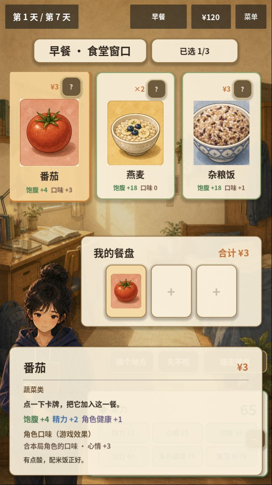
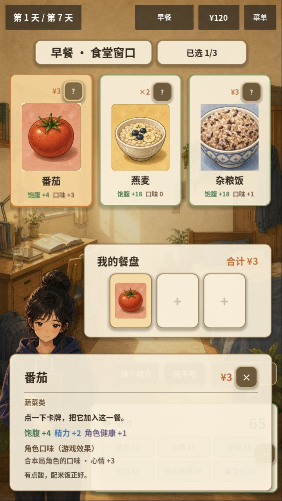
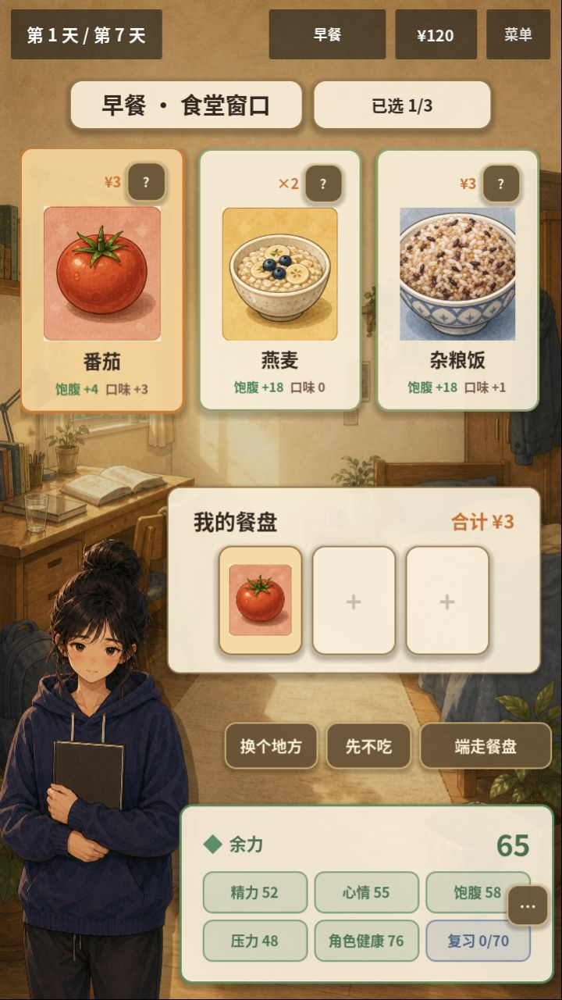
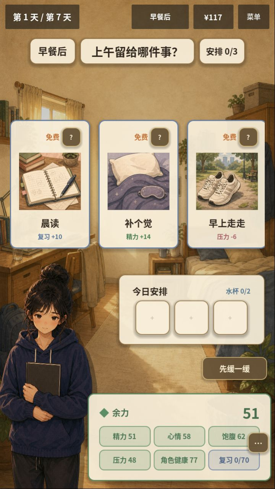

# UX-01：详情输入边界修复 · 2026-10-07

## 结果

G0.1 / UX-01已完成局部修复与回归。悬浮、键盘焦点和长按产生的临时预览只展示信息；点击问号打开的固定详情提供关闭按钮，并且不会被其他卡牌的悬浮覆盖。关闭详情、Esc与长按释放不结算餐食，正常确认仍可结算一次。

本轮确认当前聊天直接连接Godot MCP 4.3.0，本项目插件和服务均4.3.0，编辑器ready。场景读取、运行、运行时调用、鼠标输入、截图和日志均实际调用成功。

## 复现依据与改动

10月5日记录的误触风险在本轮受控输入中得到复现：720×1280逻辑布局下，非固定详情的关闭按钮中心约为(630,963.5)，位于餐盘确认区域内。鼠标离开卡牌移到该位置后，预览先消失；随后点击使预算120→117、餐次0→1，阶段早餐→早餐后。该原生复现使用逻辑布局与窗口缩放转换；不把它当成实际手机测试。

原因是临时预览提供了需要稳定停留的操作按钮，却同时受卡牌失去悬浮/焦点自动关闭控制。固定详情也可能被另一张卡牌的预览重新替换成临时详情。

改动保持原有手势和结算：

- StickyNotePopup仅在固定详情中显示/启用关闭和可选行动按钮；临时预览保留文本，离开或松开手指仍可收起。
- GameRootV2忽略固定详情打开期间收到的非固定预览请求；新的显式信息请求仍能更换固定详情。
- 新增2项组件回归、1项主流程回归及异步真实输入探针；没有更改用餐费用、库存、恢复规则或上游MCP签名目录。

实现见[便签详情](../../life-strategy/scripts/ui_v2/StickyNotePopup.gd)、[V2控制器](../../life-strategy/scripts/ui_v2/GameRootV2.gd)、[组件回归](../../life-strategy/tests/test_food_preference_ui.gd)、[流程回归](../../life-strategy/tests/test_v2_flow.gd)和[输入探针](../../life-strategy/tests/detail_input_probe.gd)。

## Web竖屏验证

当前源码本地导出包在实际浏览器720×1280视口验证了以下四步，浏览器错误日志为空：

1. 选择番茄：已选1/3、合计¥3、预算¥120，临时预览显示信息且没有关闭按钮。
2. 点击问号：打开带关闭按钮的固定详情。
3. 点击固定详情关闭按钮：仍为早餐选餐、已选1/3、预算¥120，没有自动结算。
4. 点击“端走餐盘”：进入早餐后、预算¥117，正常结算一次。









## 测试与MCP执行边界

| 检查 | 结果 |
| --- | --- |
| 统一验证、资源导入与主入口烟测 | **227/227、23套件**，通过；相较上次224新增3项 |
| 本地Web导出与真实PCK目录审计 | 通过，PCK约53.12MiB；保存在artifacts/ux01-2026-10-07-web |
| MCP test_run / recovery_rules | **14/14**，在重启后的编辑器中通过 |
| MCP game_eval中的UI套件 | **32/32**，food_preference_ui 11项、v2_flow 21项，在正常游戏进程中通过 |
| MCP实际鼠标/按键/触摸事件探针 | 食堂和存粮的原生运行检查通过；关闭/Esc/长按不改变阶段、现金、库存、餐次或选择 |
| 实际Web竖屏 | 四步通过，720×1280，错误日志为空 |

**MCP的test_run在编辑器上下文执行。** 本项目非@tool的运行时UI场景在那里会成为占位脚本，直接运行UI套件会报placeholder错误。本轮保留游戏脚本的运行方式，通过game_eval在正常游戏进程调用McpTestRunner执行UI套件；全量仍以统一headless入口为准。纯规则套件可直接使用test_run。首次错误不是通过修改业务脚本为@tool来解决的，也不记为测试通过。

原生编辑器运行实例本轮始终维持1920×1080；输入探针报告requested_size、actual_size和resolution_matched，不据文件名或请求尺寸宣称竖屏已验证。720×1280的证据来自本节实际Web截图。触摸是合成InputEventScreenTouch回归，真实手机仍待后续验收。

探针调用方式（启动V2游戏、确认helper_live=true后）：

```gdscript
var probe = load("res://tests/detail_input_probe.gd").new()
return await probe.run(get_tree().current_scene, Vector2i(1920, 1080), "cafeteria")
```

将来源改为dorm_storage可检查库存路径。探针重开一局、关闭健康功能、历史路径为空，在.godot/ux01-2026-10-07保存截图，不写用户健康历史。

本机结果记录：artifacts/ux01-2026-10-07-results.json、artifacts/ux01-2026-10-07-verification.log、.godot/ux01-2026-10-07/mcp-runtime-tests.json。这些日志和候选包属于忽略的本机产物；上述报告、截图和探针保留在项目中。

当前版本仍有现金/库存信息混显、来源可读性、存粮卡裁切、睡眠预告越界等G0.1待办。下一项为 **UX-02：按付款方式展示价格或库存**，然后UX-03/04与NUT-208C1。本轮没有提交、推送或发布，Play未改。
