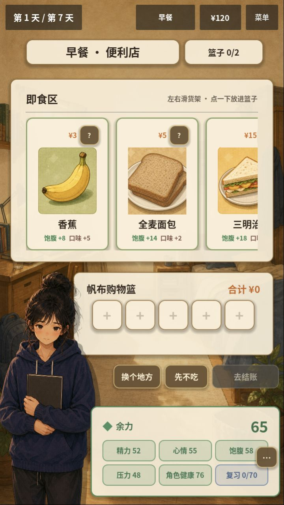
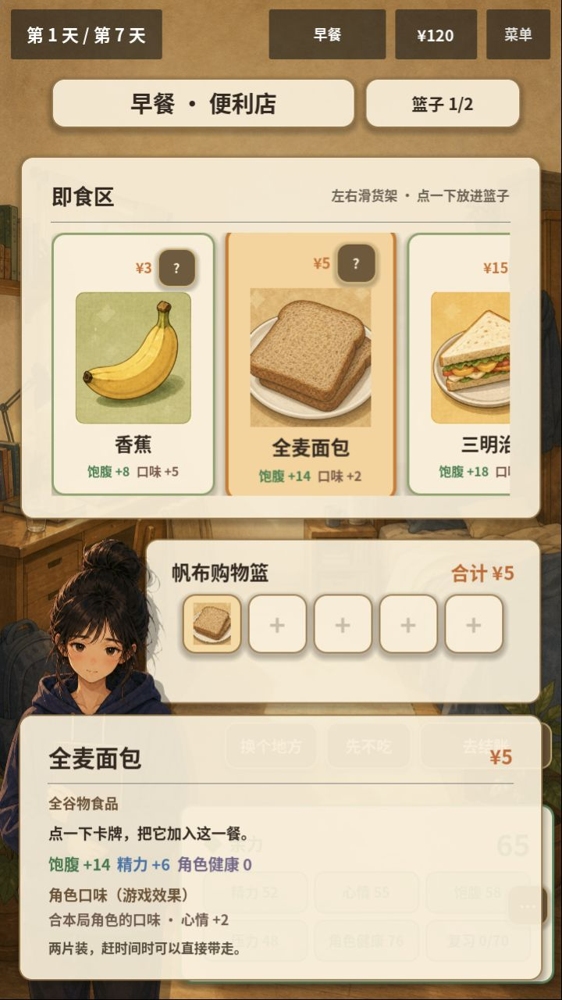
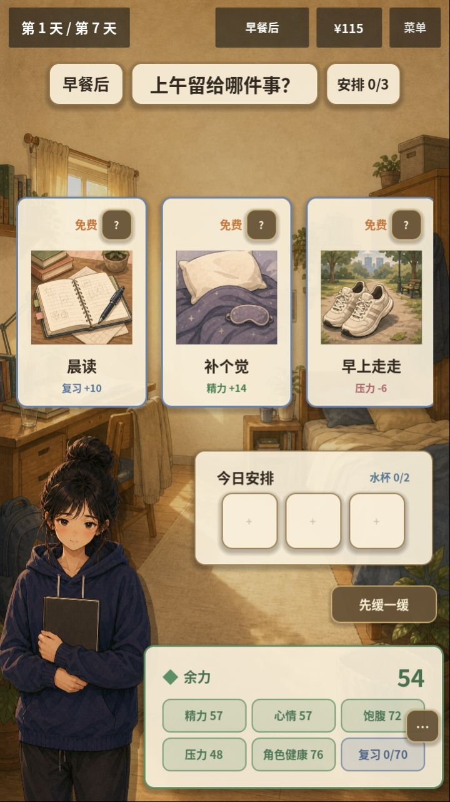
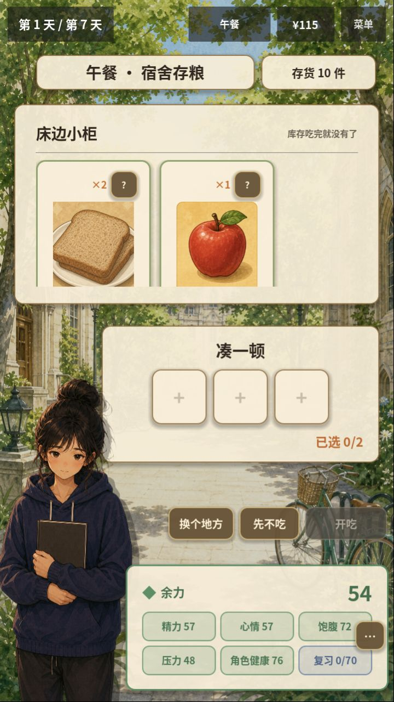
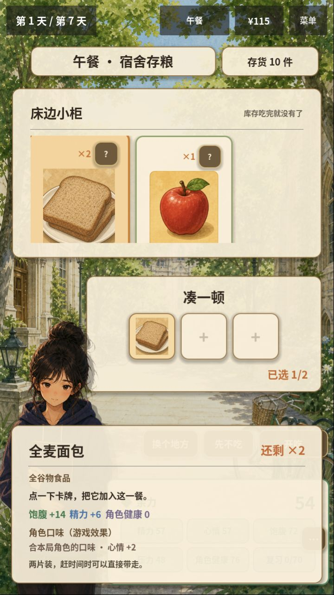
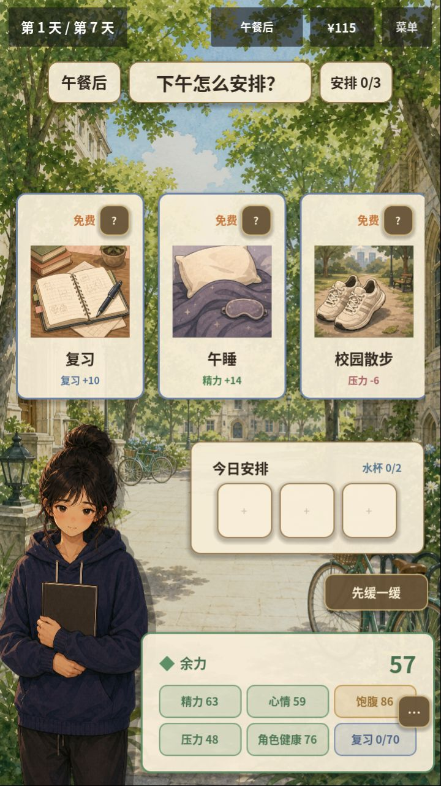
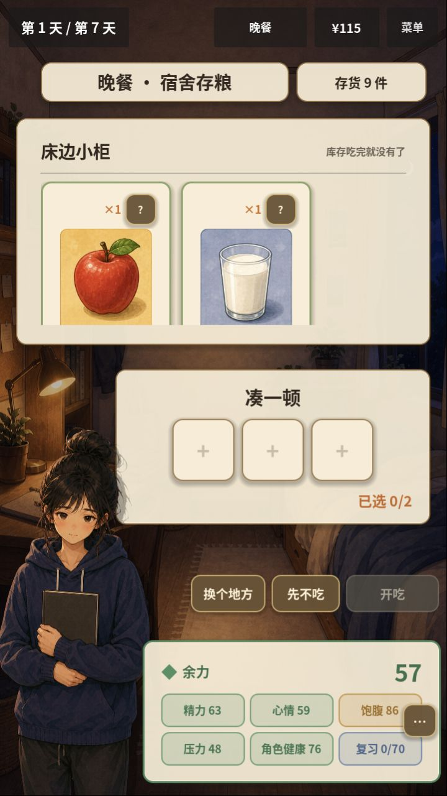

# UX-02：付款方式与价格/库存展示 · 2026-10-07

## 结果

G0.1 / UX-02已完成。食堂、便利店和外卖等现金来源显示食物价格；宿舍存粮显示当前库存。库存耗尽或补货不会改变现金卡牌的价格与可购买状态，现金购买仍受预算限制。

修复位于[MealStageBase](../../life-strategy/scripts/ui_v2/stages/MealStageBase.gd)：只有payment_mode=stock时向卡牌提供库存数量，现金来源使用卡牌既有价格显示；存粮缺少数量条目时按0显示，避免退回现金价格。食物单价、来源费用、扣费与库存消耗算法未修改。

## 回归证据

新增[3项流程回归](../../life-strategy/tests/test_v2_flow.gd)，覆盖：

- 食堂燕麦、便利店苹果和外卖三明治在库存2→0→空→8时仍显示价格、保持可购买；费用计入合计，余额不足仍禁止选择。
- 宿舍存粮显示×2/×0，数量更新与空库存正确反映到标签和可选状态。
- 宿舍没有燕麦时，食堂购买燕麦按其价格结算，不消耗宿舍库存。

全量统一验证 **230/230、23套件**，主入口烟测与本地Web导出/PCK审计通过；相较UX-01新增3项。MCP在正常游戏进程运行food_preference_ui/v2_flow两组UI回归 **35/35**。编辑器上下文的test_run仍按[UX-01记录](UX01_DETAIL_INPUT_2026-10-07.md)的适用边界使用。

## 实际Web竖屏对照

本轮实际浏览器视口720×1280，错误日志为空。按真实选择入口操作，没有给浏览器注入游戏状态：

1. 便利店全麦面包显示¥5；选择后卡牌、详情和购物篮合计均为¥5。
2. 确认购买后预算120→115。
3. 午餐进入宿舍，面包仍为×2、总存货10件，现金购买没有扣宿舍库存。
4. 从宿舍吃一份面包，预算仍为115；晚餐再次进入宿舍，总存货为9件。

本次浏览器抽到的食堂首屏未包含燕麦；燕麦和外卖三明治由对应真实数据的场景回归覆盖，不以其他食物截图代替它们的视觉证据。原生MCP临时诊断曾因给强类型hand赋普通Array而中断，该测试实例已停止；正式测试、Web回归和生产代码没有该错误。

本轮主要改动为一个生产文件及流程测试；上游MCP、数据XML、健康资料和恢复规则未改。候选包及日志为artifacts/ux02-2026-10-07-web和artifacts/ux02-2026-10-07-verification.log，属于忽略的本机产物。

**下一项为UX-03：竖屏关键文字与来源可读性。** 本报告中的存粮卡底部信息裁切仍存在，将在该切片处理；UX-04和NUT-208C1按路线继续。本轮未提交、推送或发布，Play未改。
