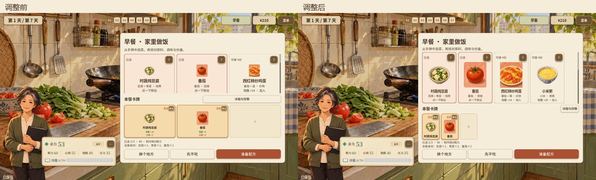
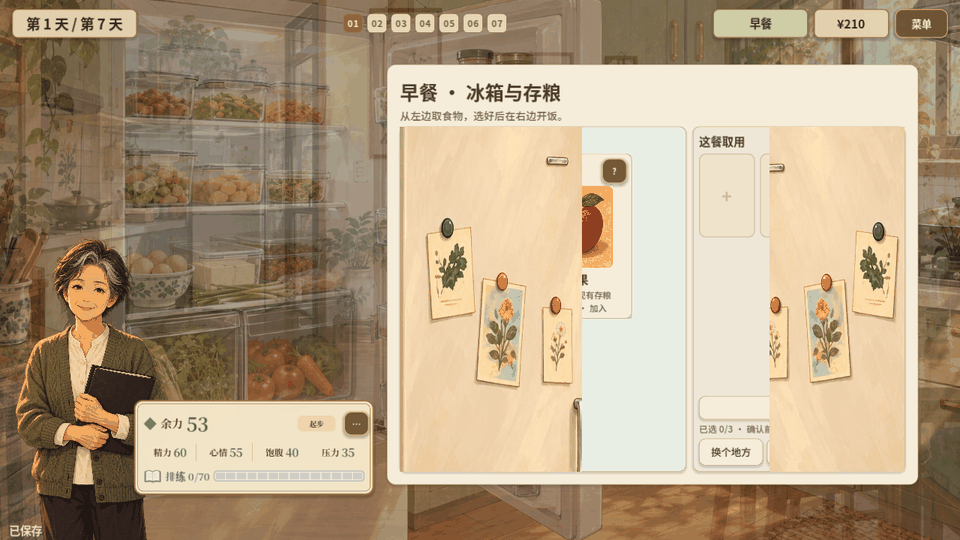
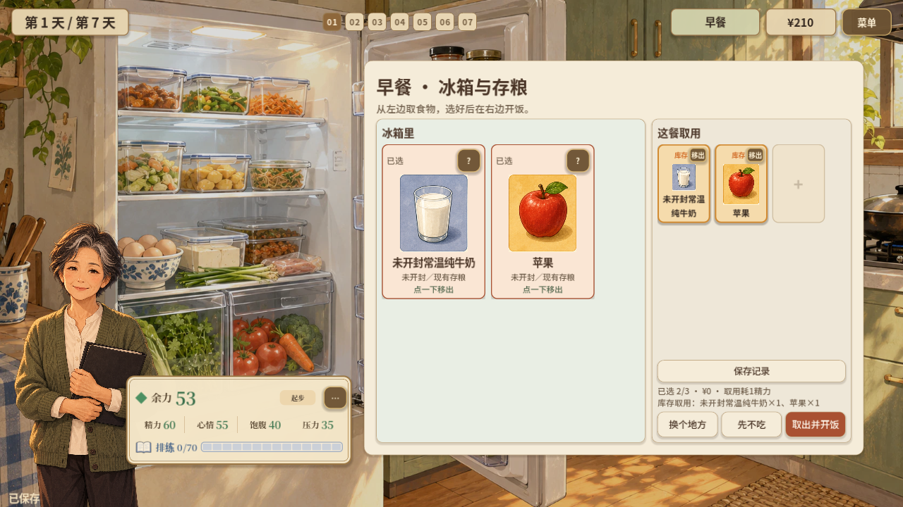
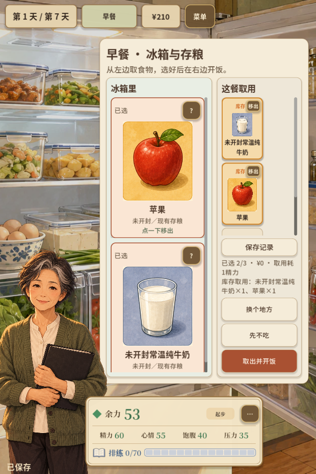

# 周阿姨卡牌比例与冰箱布局 · 2026-11-01

本轮处理周阿姨篇多个页面中卡牌宽度被容器拉伸、插画固定过小、已选卡横向铺满的问题；随后按用户追加要求，冰箱取餐改为左右布局并加入开门展开。

## 卡牌与原料

- 做饭、早餐店、家常小馆、水果摊和冰箱使用2:3竖版食物卡，列数随可用宽度调整；长名称与不可选原因仍完整显示。插画使用卡内剩余空间，保留原图比例。
- 已选区固定为112×168的小卡，保留插画、名称、费用或来源标记及移出操作，取消重复的小号数值行；数值仍可在手牌和详情查看。空位和已选卡等高，第一次选菜不会挤压手牌区域。
- 周阿姨行动与睡前卡采用同一竖版框架，固定插画区域并对齐标题，费用文字按需换行。该布局仅在周阿姨篇启用。
- 配方与库存的原料卡按近方形排列，依据空间调整列数，不再随宽面板拉成长条。

## 冰箱取餐

新增独立冰箱场景，继续复用原选餐及库存结算。左侧展示冰箱食物，右侧展示本餐取用、保存记录、费用和确认。窄屏保持左右关系，两侧分别滚动；确认区固定可见。

进入时两扇门从中间向外展开，过渡约0.34秒；门面复用现有冰箱插画，动画只改变显示。选普通存粮显示“取出并开饭”，包含需再热的熟食时显示“再热并开饭”。取餐、再热和食品可用性仍由原规则判断。

## 验证

- 完整698/698、54套件，失败0；新增比例、完整首行、原料卡和冰箱左右分区/单次确认检查。
- 59项发布门禁、主场景启动、本地Web导出及92.90 MB PCK审计通过；新冰箱场景与脚本均为必需打包内容。
- 两篇在1280×720和640×960分别采样，修改前后各62张原生画面；包括五种周阿姨来源中的四种代表性用餐页，以及行动、睡前、配方、库存等页面。早餐店另由五来源、多尺寸回归覆盖。
- 原生输入检查三项选择、详情、移出、键盘焦点和从1280×720实时缩至390×844；选择不消费资源，移除后仍可重选。
- 双尺寸实际从家里点冰箱，捕获开门中间帧、左右选餐、查看库存并确认一次；每份各记录1餐，余额保持¥210，牛奶库存准确减少1份。
- 首次选餐压力探针使用了已不属于该来源的旧测试食品，已改为八种合法厨房食品，最终探针errors为空；不沿用失败的旧采样作验收。
- `git diff --check`通过。没有改动食物、行动、恢复或预算的数值规则。

截图摘要与验证结果在[verification.json](../assets/zhou-card-layout-2026-11-01/verification.json)。原始日志与截图位于`.cache/zhou-card-proportions-2026-11-01/`，最终候选位于其`web/`目录，文件哈希见`web-files.json`。

本轮验证为原生渲染与输入、自动测试和导出检查，未完成实体手机或实际WebGL浏览器验收；未更新线上`Play/`发布包。
