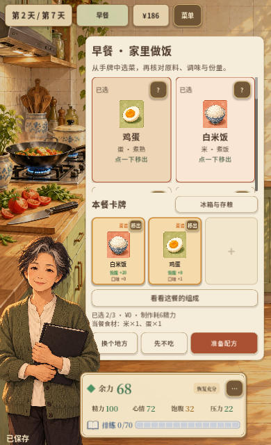
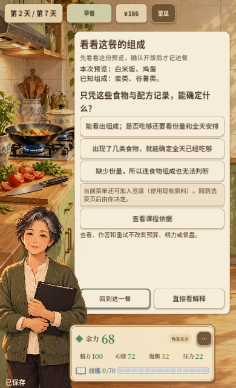
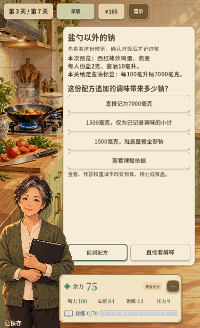
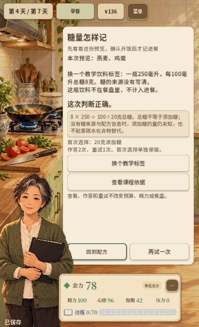
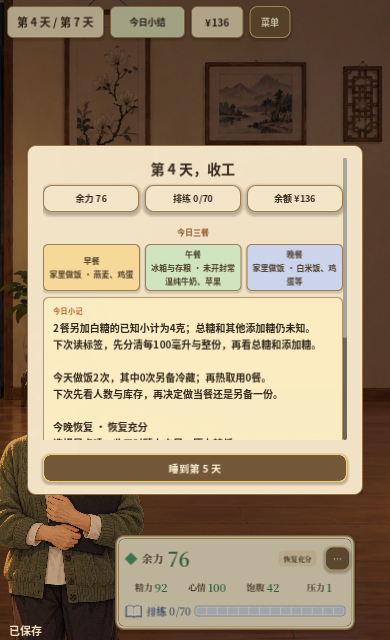

# 周阿姨第二轮切片：第2–4天的实际选餐与标签练习

日期：2026-10-28。接续首日整改，在现有卡牌和工作台中接入第2–4天组成、调味钠和糖标签练习。**本轮完成本地工程与相应原生验证；专业审校、真人学习迁移、真实手机及浏览器刷新验收仍分别待完成。** 第5–7天的进一步叙事和课程接入留给后续切片。

## 玩家现在能做什么

- 第2天选好食物后，可从“看看这餐的组成”查看本次真实选择及本关声明的类别。解释区分已知组成与仍不明确的份量/全天情况；若当前手牌、材料、调味库存和余额允许，提供一个可自行采用的加入或替换方案。
- 第3天在做饭配方中打开练习，题目读取当前每人份盐和酱油用量。少放一点、按原口味、不另加的算式对应已记录调味量；外食没有用量记录时保留未知。冰箱有冻结配方时读取原批次，混合未记录项目明确标出。
- 第4天练习先核对当前另加白糖，保留总糖与其他添加糖的未知。可选教学饮料标签250毫升×8克/100毫升，以及300毫升×6克/100毫升，分别练习20克与18克总糖的记录边界；这些饮料不计入餐盘或日结。
- 作答、直接看解释、查看依据、重试、换题和返回分别处理。首次错误不会被正确重试覆盖；先看解释或依据后才作答的情况单独标明，不充当独立判断证据。关闭未作答题目会记录跳过，查看页面不等于作答或学会。
- 离开练习可回到原选菜或配方；调味、白糖和留存方式保留。只有确认开饭才扣款、扣材料并生成进餐记录。
- 日结从已确认餐次生成一条组成或已知调味/白糖观察，连接到下一次核对操作。未知量不记零，教学变式不充当实际摄入；日结观察及餐次背景冻结保存。

已有预算、制作/再热成本、人物偏好、排练、恢复和结局条件保持原参数。新练习不发精力、金钱、健康分或排练奖励，正式健康指导开关保持既有配置。

## 实现与存档

`HouseholdMealLearning.gd`负责情境快照、给定标签题、首次/重试记录、输入校验和日结观察。`HouseholdStudyPresenter.gd`复用现有工作台处理展示、输入、原配方返回与实际菜单可行性；用现有食物与字体，没有新增生成美术。

`HouseholdMealStage.gd`的入口只在第2–4天显示，未选食物时禁用；`CookingPlanStage.gd`从当前配方发出练习请求。`GameRootV2`增加这些衔接及确认后的事实快照，公共工作台支持自定义返回处理。

存档增加可选的`household_lessons`字段，保留原v1 schema及故事版本。旧档缺少该字段时只建立空练习记录，不从旧的“看过课程”标记补造作答。当前题面/反馈及原配方返回位置一起保存，读取不重复增加查看或作答次数。非法正确性标记、过期返回位置及不一致的配方会在恢复前拒绝，原局保留。

每个情境保留首次和最近31次作答，累计次数独立；不同实际配方与教学变式分开记录。同一餐盘只改变顺序不会清除原来的首次选择。未确认的预览背景与已确认进餐有明确标记。

## 验证

| 检查 | 结果及范围 |
| --- | --- |
| 完整回归、主场景及导出 | **563/563，47套件，失败0、跳过0**；[摘要](../assets/zhou-study-2026-10-28/verification.json) |
| 新专项 | **21项**，覆盖实际调味量、糖边界、变式隔离、首次/帮助/重试/跳过、32次保留边界、取消与原配方返回、重复输入、旧档及事务拒绝、冰箱冻结配方、日结历史、可行性、字形及三种逻辑画布 |
| 原生实际输入 | **1280×720、390×640**均完成第2天组成判断及重试、第3天实际调味/换标签/返回确认、第4天先看解释/糖标签重试及真实三餐日结；Tab和Esc路径覆盖。[桌面](../assets/zhou-study-2026-10-28/desktop-report.json)、[窄屏](../assets/zhou-study-2026-10-28/mobile-report.json) |
| 跨进程JSON恢复 | 两种尺寸分别从另一个引擎进程写出的钠题待答、钠题反馈和糖题反馈恢复。保留首次选择与当前页，返回原配方后材料及进餐记录不变；[桌面](../assets/zhou-study-2026-10-28/desktop-restart-report.json)、[窄屏](../assets/zhou-study-2026-10-28/mobile-restart-report.json) |
| 布局 | 720×1280、853×1280、1920×1080逻辑画布检查选餐入口、食物滚动区、展开依据和长反馈；工作台正文滚动，返回/解释/重试留在固定底部 |
| 策略保护 | 周阿姨40局、学生篇510局，共**550局**，同种子同命令策略报告与上一轮逐字段一致，错误0；[对照摘要](../assets/zhou-study-2026-10-28/strategy-comparisons.json) |
| Web包 | 本地候选`artifacts/zhou-study-2026-10-28-web/`，9文件，PCK **93,156,744字节 / 88.84MiB**。项目配置、关键资源和开发内容隔离审计通过；[文件哈希](../assets/zhou-study-2026-10-28/web-files.json) |
| 最终包运行 | 匹配的原生Godot 4.7.2直接加载最终Web PCK，检查第3天打开练习、错误作答、保存、原配方返回与实际确认；调味钠仍为真实配方1500毫克，错误0；[结果](../assets/zhou-study-2026-10-28/pack-runtime.json) |

原生三天用例从合法前日命令生成的有效存档开始；不是从第1天起连续七日的UI试玩。策略诊断不经过新练习界面，不代表真人成功率或学习有效率。包内原生运行也不替代浏览器WebGL和IndexedDB验证。上一轮未完成的浏览器刷新验收，本轮没有标为通过。

完整工程日志保存在`.cache/zhou-study-2026-10-28/verification-export.log`，专项与原生输入日志按同日名称保留。科学资料、模拟数据与待审项目见[审校包](../education/ZHOU_DAYS_2_TO_4_REVIEW_PACKET_2026-10-28.md)。

本轮未覆盖`Play/`、提交、推送或上线，也没有把工程回归当作专业审校或真人教育效果。

## 当前画面

以下均为本轮实际原生输入或独立进程恢复的截图，已逐张检查。

下一项建议沿既定路线接第5–7天：适口做法与人物回应、真实共餐的后续、小份备餐规划、汇演与周回顾；专业审校和真人试玩继续独立准备。
