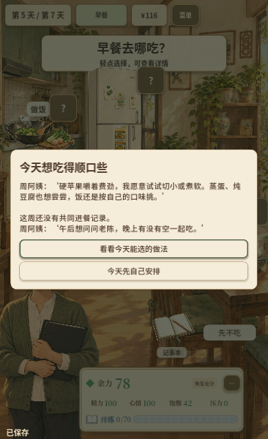
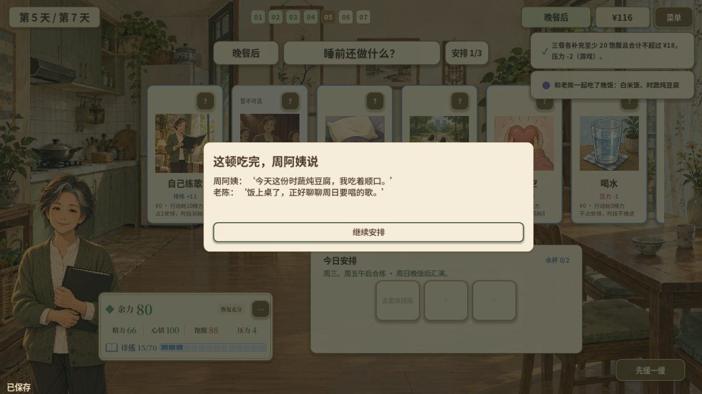
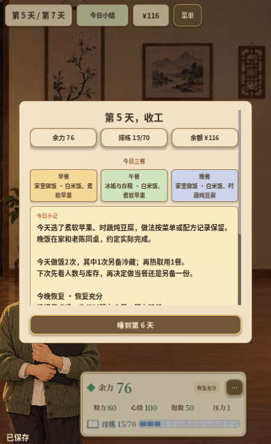

# 周阿姨第5天：个人需要、做法与真实共餐

日期：2026-10-28。接续[第2–4天切片](ZHOU_DAYS_2_TO_4_2026-10-28.md)，本轮完成第5天的本地工程与相应原生验收。人物先表达自己的困难和喜好，玩家选择做法或自己安排，实际吃完才出现回应，日结和餐次记录保留实际结果。第6天备餐规划、第7天汇演回应及整周回顾继续接入；专业审校、真人教育与趣味验证、真实手机和浏览器刷新仍分别待完成。

## 玩家现在会经历什么

- 第5天早餐前，周阿姨说硬苹果嚼着费劲，愿意试切小或煮软，也想尝蒸蛋、炖豆腐，保留自己的口味。可以看看当前能选的地方，也可以直接自己安排。
- 菜单和配方工作台可查看当天做法与约定，使用已有食物插画。页面说明已选项目和当前可行性；进入、返回或取消都不自动选菜、不消耗材料。配方里的调味、另加白糖和冷藏草稿原样返回。
- 确认实际进餐后，记录当前食物及当时的做法。明确的相应做法可以出现“我吃着顺口”的主观台词；普通食物仍按自己的选择回应。冰箱只读取原批次配方，未记录做法时保持未知。
- 午饭后可先问老陈晚上有没有空，再安排合练。接受邀约只代表约好；在家实际同桌按两人份做，小馆沿用已有费用规则，吃完才出现老陈的餐后台词。
- 关闭邀约界面、自己安排、约好后换地点或跳过晚饭都有各自结果。日结不会补写同桌，也不会假定已经去合练。既有“一周一次共餐”规则保持；前一天已经共同进餐时，不会在第5天补造新邀约。
- 日结、详细记录和周回看使用冻结的餐次回应及第5天回顾。部分做法已知、部分缺失时仍说明缺失；后续改菜单或读取存档不会改写已发生的体验。

这段内容不增加健康分、金钱、精力或排练奖励。人物口味回应不代表营养充足或健康改善；预算、制作/再热消耗、排练、恢复和结局参数保持原值。

## 实现与存档

`HouseholdDayFive.gd`负责个人需要、已确认做法、回应快照、共餐事实、日结与校验；`HouseholdDayFivePresenter.gd`复用纸面工作台和人物对话，负责入口、取消、固定返回按钮、焦点及待关闭回应。选菜、配方、实际开饭、邀请、日结与记录查看在`GameRootV2.gd`衔接。

存档增加可选字段`household_day_five`，保留v1 schema和故事版本。缺少字段的旧档建立兼容状态，不重播此前未记录的开场，不补造进餐、回应或邀约。新档保存个人需要页、做法页及原配方返回位置、邀请答复和实际食后回应；确认关闭后只记一次，不再次结算餐次。过期返回位置、不一致的共餐标记、伪造待回应和无实际记录的确认标记在恢复前拒绝，原局保留。

已有第1天和第2–4天学习状态、校园篇和重开流程继续隔离。中文子集字体已补齐本轮用字并重新导入。

## 验证结果

| 检查 | 结果及范围 |
| --- | --- |
| 完整回归 | **581/581，48套件，失败0、跳过0**；主场景启动通过。[摘要](../assets/zhou-day5-2026-10-28/verification.json) |
| 第5天专项 | **18项**，覆盖个人选择、导航不结算、原配方返回、真实回应、未知做法、取消/接受邀约、两地点实际同桌、换地点/跳餐、存档事务拒绝、旧档、前日已共餐、记录回看、字形及三种逻辑画布 |
| 原生鼠标/键盘 | **1280×720、390×640**分别完成在家同桌、小馆同桌、取消后自己吃、约好后换地点四条路线；涉及实际做饭、再热、三餐、人物回应及日结。[桌面](../assets/zhou-day5-2026-10-28/desktop-report.json)、[窄屏](../assets/zhou-day5-2026-10-28/mobile-report.json) |
| 跨进程JSON恢复 | 两种尺寸在独立引擎进程恢复个人需要页、含冷藏/白糖草稿的做法页、邀请答复、实际同桌晚饭回应；返回和关闭后材料、资源、餐次与社交历史不变。[桌面](../assets/zhou-day5-2026-10-28/desktop-restart-report.json)、[窄屏](../assets/zhou-day5-2026-10-28/mobile-restart-report.json) |
| 布局 | 720×1280、853×1280、1920×1080逻辑画布专项；实际桌面/窄屏截图逐张检查，长正文滚动，返回按钮固定可见 |
| 既有策略保护 | 周阿姨40局、校园510局，共**550局**同种子命令策略报告与上一轮逐字段一致，错误0。[对照](../assets/zhou-day5-2026-10-28/strategy-comparisons.json) |
| 最终Web包 | 本地候选`artifacts/zhou-day5-2026-10-28-web/`，**9文件，PCK 93,175,372字节 / 88.86MiB**。项目配置、关键资源和开发内容隔离审计通过。[文件哈希](../assets/zhou-day5-2026-10-28/web-files.json) |
| 最终包内运行 | 匹配的Godot 4.7.2原生运行时直接加载最终Web PCK，完成第5天需要、做法页及原配方保存/恢复、实际做饭与再热、邀请、实际同桌、待回应恢复及冻结日结；错误0。[结果](../assets/zhou-day5-2026-10-28/pack-runtime.json) |

最终回归修复了混合记录的日结漏项：一天里既有明确做法又有未记录做法时，原先只展示前者，现在会同时保留未知提示。专项与最终全量回归覆盖此边界。

导出初始化出现一条Windows `Safe save failed`日志，对应文件未定位；已保留在验证摘要和原日志中。导出命令、最终PCK配置/资源审计及直接加载该包的运行检查均通过，没有脚本错误。原日志为`.cache/zhou-day5-2026-10-28/verification-export-final.log`。

上述原生路线从合法前日命令生成的存档进入第5天，不是从首日连续七天的UI试玩；脚本策略不经过新对话界面，不代表真人通关、学习或趣味结果。包内原生运行不替代浏览器WebGL和IndexedDB的刷新/重开验证。本轮没有更新`Play/`、提交、推送或上线。

## 直接检查第5天

[第5天入口演示存档](../assets/zhou-day5-2026-10-28/day-five-demo.json)可在最新本地源码或本轮候选包中，通过“菜单 → 导入存档文件”导入并选择一个存档位置。进入后可直接看到个人需要，检查做法、邀约和日结。

演示档的前四天由合法命令执行三餐、休息和睡眠生成，用于内容检查；此前没有练歌，排练为0，不能据此评估整周难度或正常通关表现。旧版线上试玩尚未包含本轮内容。

## 实际画面

专业表述、来源核对和真人任务见[第5天审校包](../education/ZHOU_DAY_5_REVIEW_PACKET_2026-10-28.md)。下一项接第6天雨天小份备餐：从次日安排与当前库存决定份数/留存，再用实际取用记录回应计划是否可行。
