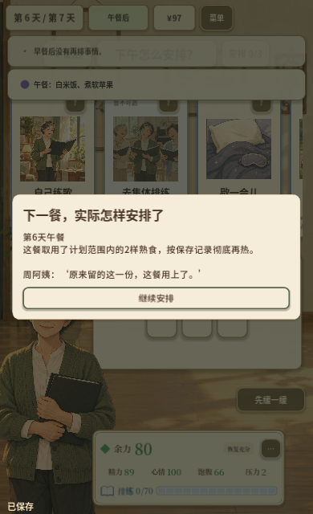
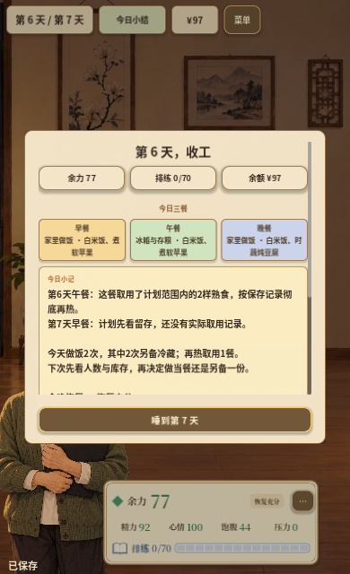
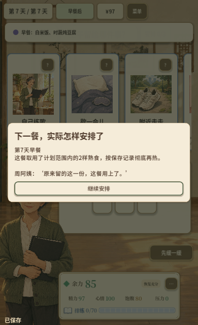

# 周阿姨第6天：小份备餐计划与后续实际取用

日期：2026-10-28。接续[第5天切片](ZHOU_DAY_5_2026-10-28.md)，本轮把“先看人数与库存，再决定当餐或另存一份”接入选菜、配方、实际进餐和跨日日结。完成本地工程及相应验证；第7天汇演回应和整周回顾继续制作，专业审校、真人学习/趣味与完整浏览器验证仍分别待完成。

## 玩家现在会经历什么

- 第6天开场先提到明晚汇演，再查看当前库存或直接安排当餐。规划页从厨房实时读取食材和可取用冷藏熟食，不生成新的菜单或消耗。
- 选菜页与做饭工作台可打开“对照库存，安排下一餐”。配方背景下显示实际当餐人数、另留份数、所需食材及库存、调味可行性和当前留存方式；不足时回配方调整。两人当餐另留一份，共做三份。
- 可以记“下一餐先看留存熟食”“下一餐到时另安排”，也可以清除当前计划。选择只记录打算，返回保留原调味、白糖和留存草稿；只有确认开饭才制作和结算。
- 下一餐来源页简短提醒原计划，已有冷藏提示继续显示实际食物及取用条件。下一餐确认后，系统依据真实批次ID区分全部取用、部分取用、改选其他安排、没有对应冷藏份或跳餐。常温奶和完整水果不冒充熟食再热。
- 第6天晚餐计划明确指向第7天早餐。第6天日结保留“还没有实际取用记录”，第7天实际吃完后才显示后续回应；此前日结保持当时事实。
- 计划与取用结果可在记录页回看。没有记计划也能正常做饭和取用，不补造学习意图或完成记录。

所有制作、再热、食材、调味、费用、排练和恢复沿用原有规则。规划和关闭回应不发放额外奖励，也不要求每个人一定备餐或遵守最初计划。数量仍是本关计量，不推断现实摄入充足或个人营养需要。

## 实现与存档

`HouseholdPreparation.gd`负责下一餐映射、每餐一条可调整计划、可用批次背景、实际批次取用结果及冻结日结；`HouseholdPreparationPresenter.gd`复用工作台和人物对话处理开场、规划、返回与待关闭回应。`GameRootV2`在实际餐次推进后解析计划结果，并接入来源提示、日结和回看。

状态通过可选字段`household_preparation`保存，保留v1 schema和故事版本。缺字段旧档建立兼容状态，不重播开场、不补造计划；第6天仍可主动打开规划入口。新档可恢复库存页、配方中的计划页、当前同日或次日回应和日结；读档与关闭不再次扣材料或生成餐次。

存档校验检查计划日期/餐次、当时已有批次、真实餐次与结果一致性、待回应/已关闭标记及原配方返回位置。未来餐次计划、无依据批次、伪造结果或冲突弹层会在替换原局前拒绝。校园篇与重开状态隔离。

## 验证结果

| 检查 | 结果及范围 |
| --- | --- |
| 完整回归 | **603/603，49套件，失败0、跳过0**；资源导入、主场景启动与Web导出审计通过。[摘要](../assets/zhou-day6-2026-10-28/verification.json) |
| 备餐专项 | **22项**：实时库存、计划/清除无消耗、原配方返回、批次准确对应、部分取用、没备份、灶台与丢弃、换来源/跳餐、临时改用存粮、前日批次、跨日冻结、JSON恢复、旧档、事务拒绝、两人加一份、库存不足、常温存粮边界、无计划路线、字形及三种逻辑画布 |
| 原生输入 | **1280×720、390×640**分别完成冷藏份实际取用、临时改做当餐、灶台留存不能证明冷藏备餐三路线。冷藏路线继续经过第6天日结和第7天早餐；Tab、Esc及滚动可操作。[桌面](../assets/zhou-day6-2026-10-28/desktop-report.json)、[窄屏](../assets/zhou-day6-2026-10-28/mobile-report.json) |
| 跨进程恢复 | 两种尺寸各恢复开场、含冷藏/白糖草稿的计划页、同日取用回应、第6天日结、第7天回应五份JSON。恢复、返回与关闭后资源、批次、餐次及社交历史不变。[桌面](../assets/zhou-day6-2026-10-28/desktop-restart-report.json)、[窄屏](../assets/zhou-day6-2026-10-28/mobile-restart-report.json) |
| 布局 | 720×1280、853×1280、1920×1080逻辑画布；归档的双尺寸截图逐张检查，长正文滚动，返回固定可见，来源提示缩短后保留食物及保存条件 |
| 既有策略保护 | 周阿姨40局、校园510局，合计**550局**同种子命令策略报告与第5天版本逐字段一致，错误0。[对照](../assets/zhou-day6-2026-10-28/strategy-comparisons.json) |
| 最终Web候选 | `artifacts/zhou-day6-2026-10-28-web/`，9文件，PCK **93,192,416字节 / 88.88MiB**；配置、关键资源和开发内容隔离审计通过。[文件大小及哈希](../assets/zhou-day6-2026-10-28/web-files.json) |
| 最终包直接运行 | 匹配的Godot 4.7.2原生运行时直接加载最终Web PCK，检查原配方计划/保存/返回、实际备餐与取用、回应恢复、冻结日结、第7天早餐和跨日回应，错误0。[结果](../assets/zhou-day6-2026-10-28/pack-runtime.json) |

Godot初始化出现Windows `Safe save failed`日志，对应文件未定位；保留在验证摘要与`.cache/zhou-day6-2026-10-28/verification-export.log`。导出命令、最终配置/资源审计及实际加载该包的运行检查通过，没有脚本错误。

原生路线从合法命令生成的前日存档进入第6天，不是首日至结局连续七日UI试玩。命令策略保护既有玩法结果，不经过新规划交互，也不代表真人通关、学习迁移或趣味。原生PCK运行不能替代WebGL、IndexedDB真实刷新和关闭重开。本轮没有更新`Play/`、提交、推送或上线。

## 直接检查

[第6天入口演示存档](../assets/zhou-day6-2026-10-28/day-six-demo.json)可在最新源码或本轮候选包中通过“菜单 → 导入存档文件”导入。另有[第7天早餐实际取用后的演示存档](../assets/zhou-day6-2026-10-28/next-day-followup-demo.json)，用于查看跨日回应和第6天当时的待取用记录。

前五天以合法命令安排三餐、休息和睡眠，用于内容检查；没有练歌，排练为0，不作为正常通关或整周难度证据。旧版线上包未包含本轮内容。

## 实际画面

食安资料、数量边界与真人任务见[第6天审校包](../education/ZHOU_DAY_6_REVIEW_PACKET_2026-10-28.md)。下一项接第7天：演前实际准备与排练回应、真正参与演出后的角色台词，以及按整周真实餐次/计划/共餐记录生成回顾。
