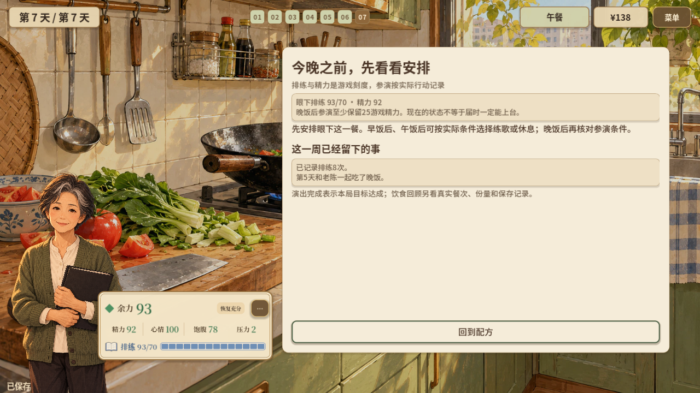
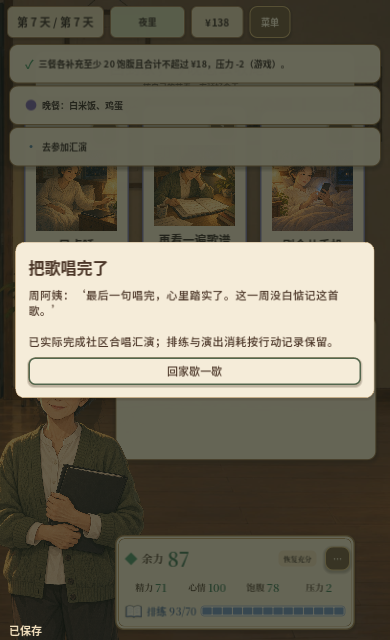
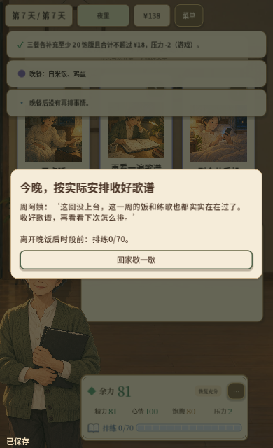

# 周阿姨第7天：汇演回应与整周事实回顾

日期：2026-10-28。接续[第6天备餐](ZHOU_DAY_6_2026-10-28.md)，完成第7天演前核对、实际参演回应、未参演分支及冻结的整周回顾。本轮是本地工程与相应原生验证；双篇从首日至结局的连续UI验收、浏览器刷新/关闭重开、专业审校与真人学习/趣味验证仍分别推进。

## 玩家现在会经历什么

- 第7天开场先看实际排练与当前精力。来源页、选菜、配方及餐后行动可查看演前安排；当前状态不保证到晚饭后仍然满足条件。
- 早饭后、午饭后的核对页可以执行眼下真实可行的练歌或休息，使用既有行动、收益、安排位、上下限与时段结算。查看和返回不占安排；从做饭配方打开时保留原调味、白糖和留存草稿。
- 晚饭后可以从原行动卡或核对页实际参加汇演。只有真实执行后才出现唱完后的角色台词，并在结局使用已有汇演插画；关闭台词只回到夜间安排，不替玩家选睡眠。
- 离开晚饭后时段之前冻结当时的排练、精力、安排位和实际选择。未满足条件时说明具体缺口；满足条件后选择休息或其他安排时，以“这一周，按自己的安排”收束，不补写心理动机。
- 结局先提炼实际参演与三餐记录，再给出下一次可尝试的一件小事。展开本周轨迹，可查看首日处置、首次作答/帮助/重试、实际同桌、冷藏备餐和真实取用，随后保留原有逐日轨迹与配方记录。
- 结局文字使用“本周小记／下次”，回到普通日结恢复“今日小记／明天”。未到第7天就提前结束时，只回顾实际经过的日数，不补造参演。

游戏仍要求排练达到70、演前至少25游戏精力；本轮沿用原参演条件、成本、恢复和结局枚举。完成演出表示完成本局人物目标，不判定营养充足或已经学会饮食判断。

## 回顾和存档

`HouseholdFinale.gd`负责演前状态快照、回应确认、实际记录聚合、冻结回顾和校验；`HouseholdFinalePresenter.gd`复用工作台与对话。`GameRootV2`接入现有行动执行、时段推进、结局及存档恢复。公共餐后行动页增加按故事与日期显示的核对入口；公共日结组件按日结/结局切换小标题。

可选字段`household_finale`保留v1 schema及故事版本，保存开场、核对页/原配方返回位置、实际演前上下文、待关闭回应和整周回顾。演前上下文同时写入真实晚饭后时段记录，恢复前核对实际参演行动与结果。伪造原因、待回应、上下文或回顾计数会被拒绝，原局保留。

缺字段旧档使用兼容状态，不重播开场或补造演前原因。已有实际行动照实显示；只有成功标记而没有参演行动时，不展示已经完成。读取、关闭与重新展开回顾不重复执行参演、扣款、扣材料、增加作答或改变已冻结的回顾。

练习统计按情境区分首次独立正确、首次独立错误、帮助后首次及重试，不用正确重试覆盖首次错误。邀约不算实际同桌；灶台留存不算可用冷藏备餐；未开封奶和完整水果不算熟食再热。数量均为关卡记录，不能外推营养充足、医学结论或真人教育效果。

## 验证结果

| 检查 | 结果及范围 |
| --- | --- |
| 完整回归 | **627/627，50套件，失败0、跳过0**；资源导入、主场景启动与最终Web导出审计通过。[摘要](../assets/zhou-day7-2026-10-28/verification.json) |
| 第7天专项 | **24项**：实际演前状态、真实补练、原配方返回、参演时段、实际参演与重复输入、未达排练、精力/安排位边界、主动另作安排、JSON恢复、旧档未知、上下文/回顾事务拒绝、练习首次/帮助/重试、餐次/共餐/冷藏/常温边界、提前结束、校园与重开、跨日弹层衔接、字形及三种逻辑画布 |
| 原生鼠标/键盘 | **1280×720、390×640**各完成实际参演、排练不足、具备条件但另作安排三条第7天路线，覆盖前日备餐取用、核对页真实休息、原配方返回、晚饭后回应、睡眠与结局/轨迹展开；Tab与Esc可操作。[桌面](../assets/zhou-day7-2026-10-28/desktop-report.json)、[窄屏](../assets/zhou-day7-2026-10-28/mobile-report.json) |
| 跨进程恢复 | 两种尺寸各从另一引擎进程保存的开场、行动核对页、配方核对页、实际参演待回应和结局五份JSON恢复；关闭/返回/展开不改变资源、批次、餐次、行动和历史。[桌面](../assets/zhou-day7-2026-10-28/desktop-restart-report.json)、[窄屏](../assets/zhou-day7-2026-10-28/mobile-restart-report.json) |
| 布局 | 720×1280、853×1280、1920×1080逻辑画布；归档双尺寸截图逐张检查，核对入口不遮挡行动，长正文与本周轨迹滚动，返回/再来一周保持可用 |
| 既有策略保护 | 周阿姨40局、校园510局，共**550局**同种子命令策略报告与第6天版本逐字段一致，错误0。[对照](../assets/zhou-day7-2026-10-28/strategy-comparisons.json) |
| 最终Web候选 | `artifacts/zhou-day7-2026-10-28-web/`，9文件，PCK **93,210,764字节 / 88.89MiB**；配置、关键资源与开发内容隔离审计通过。[文件大小及哈希](../assets/zhou-day7-2026-10-28/web-files.json) |
| 最终包内运行 | 匹配的Godot 4.7.2原生运行时直接加载最终Web PCK，检查演前核对、真实休息、前日冷藏取用、原配方保存/返回、实际参演、待回应与冻结结局恢复、小标题及汇演插画，错误0。[结果](../assets/zhou-day7-2026-10-28/pack-runtime.json) |

原生第7天路线使用合法命令生成的前六天存档，包含脚本执行的丢弃、练习、共餐和备餐；这些不是前六天的真人操作、学习效果或从首日连续七日UI验收。低精力和满安排位边界为受控专项，不冒充合法七日平衡路线。策略模拟保护既有玩法报告，不经过新核对界面；原生Web PCK运行不能替代WebGL和IndexedDB真实刷新。

Godot初始化的Windows `Safe save failed`日志保留在摘要和`.cache/zhou-day7-2026-10-28/verification-export-final.log`，对应文件未定位。导出命令、最终配置/资源审计及实际加载该包的运行检查通过，没有脚本错误。本轮未更新`Play/`、提交、推送或上线。

## 直接检查

[第7天入口演示存档](../assets/zhou-day7-2026-10-28/day-seven-demo.json)与[完成参演后的整周回顾存档](../assets/zhou-day7-2026-10-28/week-ending-demo.json)，可在最新源码或本轮候选包通过“菜单 → 导入存档文件”导入。演示档先前的练习操作由脚本完成，不作为真人掌握或趣味证据。

## 实际画面

表达边界与真人任务见[第7天审校包](../education/ZHOU_DAY_7_REVIEW_PACKET_2026-10-28.md)。下一项为双篇从首日至结局的连续游玩，覆盖成功、未达成、读档与重开，再补浏览器刷新和关闭重开；专业审校及真人学习/趣味验证分别完成。
