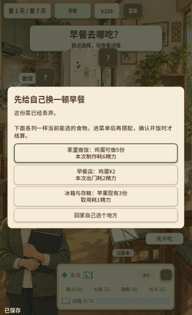
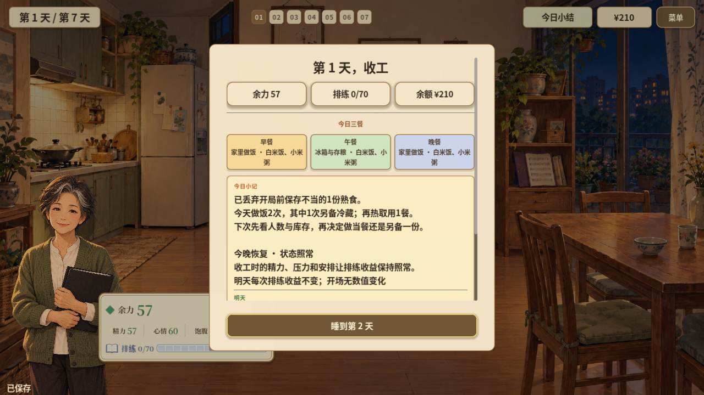

# 周阿姨篇第一轮：首日食安与下一餐闭环

日期：2026-10-27。按用户同意的整改范围完成ZH-01至ZH-05的本地实现。包含首日实际选择、替代早餐入口、留存取用提示、日结事实回顾及存档兼容；后续七日课程、汇演叙事、大字模式及真人教育验证继续分轮推进。

## 玩家流程

1. 新开周阿姨篇，进入第1天后直接看到灶台熟食的原有保存记录。玩家可丢弃，也可先放着并安排别的早餐；Esc对应明确的“先放着”选项。不要求答对题才能继续，暂未处理不等于已经丢弃。
2. 接着列出厨房、早餐店及冰箱中当前可选的一项食物及成本。选项来自实际缓存菜单，按营业、库存与余额筛选；进入菜单不预选菜品、不付款、不消费库存。也可返回家中自行选择来源。
3. 玩家实际另备冷藏份后，下一餐家中场景显示仍可取用的熟食名称、数量、取用消耗及保存/再热提醒。未备餐、批次已消费、超期或保存史不清时不显示可取用提示。现做、外食仍可照常选择。
4. 日结先回顾当日真实处置、制作、冷藏留存及再热餐次。开局前的熟食单独表述；未开饭、仅查看、仅邀请或取用常温奶不会被写成再热熟食。回顾冻结进当天记录，后续改动库存不倒改历史。
5. 自动、手动与导入导出共用新的情节进度字段。停在首日选择或早餐入口时读取存档，会恢复对应步骤；已完成的选择不重播、不重复丢弃。旧v1存档缺少该字段时记录为旧版未记录状态，不补造选择或强制回放；schema与人物版本保持不变。新存档中的“已丢弃”必须匹配实际批次及处置历史。

价格、精力、库存和配方数量来自现有数据；未改预算、制作/再热成本、排练或结局规则。学习记录、游戏资源和健康资料保持各自的语义，正式健康指导开关保持原状态。

## 实现

- `HouseholdLearningFlow.gd`提供独立的情节状态、有效批次筛选和事实回顾。
- `HouseholdLearningPresenter.gd`接入已有对话和来源菜单，隔离首日呈现、选择及恢复逻辑；预览的来源手牌提前缓存，以保证显示和实际菜单一致，读档不重抽。
- `GameRootV2.gd`只增加新日、来源提示、日结和恢复的衔接。
- `GameSaveCodec.gd`增加向后兼容字段及历史一致性校验；校园故事使用空情节记录。
- `HouseholdSourceStage.gd`增加非阻塞提示。窄屏将提示放在人物与外出物件之间，先按实际宽度测量换行，避免初始零宽造成高度膨胀；按钮与文字不重叠。
- 重建既有正文字库，新增文案字形检查通过；没有新增生成美术。

## 验证

| 检查 | 结果和范围 |
| --- | --- |
| 完整回归 | **542/542，46套件，失败0、跳过0**，主场景启动通过；[摘要](../assets/zhou-learning-2026-10-27/verification.json) |
| 新专项 | `household_learning` **15项**：实际选择、重复确认、预算/库存过滤、菜单导航、编码恢复、旧档兼容、伪造状态拒绝、批次条件、事实回顾冻结、字形与三组布局 |
| 原生输入 | **1280×720、390×640**均走外食、现做、备餐至下一餐；备餐路线通过取消预览、保存后恢复、再热及首日完整日结。校园篇来源入口同步复查；[桌面](../assets/zhou-learning-2026-10-27/desktop-report.json)、[窄屏](../assets/zhou-learning-2026-10-27/mobile-report.json) |
| 跨进程恢复 | 两个尺寸都从另一个引擎进程写出的有效JSON恢复“首日决定”和“替代早餐”；处置历史分别为0/1条，没有重复扣料或丢弃；[桌面](../assets/zhou-learning-2026-10-27/desktop-restart-report.json)、[窄屏](../assets/zhou-learning-2026-10-27/mobile-restart-report.json) |
| 提示布局 | 720×1280、853×1280、1920×1080逻辑画布检查长菜名；390×640额外用三道菜的声明夹具检查文字、来源和底部按钮边界 |
| 周阿姨策略保护 | 与整改前相同的40局命令路线，原报告逐字段一致、错误0。该诊断不经过本次首日UI，不是玩家成功率；[对照](../assets/zhou-learning-2026-10-27/choir-comparison.json) |
| 学生篇策略 | 17策略×30种子＝**510局**，流程错误0；本轮没有将其称为前后逐字段对照；[摘要](../assets/zhou-learning-2026-10-27/campus-strategies.json) |
| Web导出 | 当前源码导出至`artifacts/zhou-learning-2026-10-27-web/`，9文件，PCK **93,129,936字节 / 88.82MiB**。项目配置、资源和开发内容隔离审计通过；[文件哈希](../assets/zhou-learning-2026-10-27/web-files.json) |
| 包内运行 | 匹配的Godot 4.7.2原生运行时直接加载最终Web PCK，实际检查首日情节、丢弃、进入厨房及编码存档，错误0；[结果](../assets/zhou-learning-2026-10-27/pack-runtime.json) |

初次受限环境导出生成了空`project.binary`，发布门禁正确拒绝。将临时目录明确指向工作区后重新完整回归和导出，最终包通过同一门禁；未关闭保护或跳过检查。

本地服务地址为`http://127.0.0.1:8785/index.html`，仅监听回环地址。内置浏览器连接本地服务超时；额外HTTP可达性复核的自动权限审批也因未在期限内完成而未执行。这不是操作被判定不安全。本轮没有完成浏览器IndexedDB刷新、完整七日浏览器或真实手机验收，不用原生进程恢复替代这些结果。

未覆盖`Play/`、提交、推送或上线。科学专业审校和真人学习/乐趣验证未由工程检查代替。

## 当前画面

首日选择和替代早餐为从本轮有效存档恢复的原生画面；日结来自实际首日输入路线。

下一轮按整改方案接第2–7天的真实选择与反馈，优先将固定标签题接到本次配方，并保存首次作答/解释/重试；浏览器刷新验收仍单列待补。
