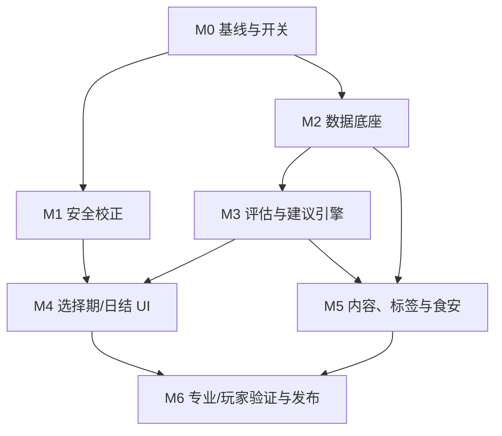

# 06 实施 Backlog

## 1. 使用方式

本文件是后续逐步实施的唯一任务入口。每个相关 PR：

1. 只选择一个可独立验收的纵向切片；
2. 在 PR 描述引用任务 ID；
3. 回填状态、实际改动文件、测试命令、截图和审校记录；
4. 如改变规则，先更新本目录相应设计文件；
5. 合并后在本文件把任务标为完成。

状态：

- `[ ]` 未开始；
- `[~]` 进行中；
- `[x]` 已完成且验收；
- `[!]` 阻塞，必须写原因和解除条件；
- `[-]` 经决策取消，保留原因。

规模只表示单人开发量：

- XS：约半天；
- S：约 1 天；
- M：约 2–3 天；
- L：超过 3 天，执行前必须再拆。

## 2. 依赖关系



推荐先完成 M1 的最小安全修正，同时并行准备 M2；新 UI 不应在新数据和引擎之前上线。

## 3. 当前状态摘要

| 里程碑 | 状态 | 出口条件 |
| --- | --- | --- |
| M0 基线与开关 | NUT-000–002 完成；决策签署和 PR 模板待办 | 旧行为有快照、功能开关可用 |
| M1 安全校正 | NUT-101–102、104–105 完成；NUT-103 工程完成待签署 | 玩家界面无营养总分/抵消暗示；日结已完成游戏化与自然语言收口 |
| M2 数据底座与旧状态拆分 | NUT-201–203、204A–D、205–207 工程完成，NUT-207 已通过全量与界面验收；NUT-208 待办 | 23 个 draft 资料全覆盖；独立健康历史可读；食物口味已归于角色资料。恢复轨道尚未拆分，M2 未整体完成；两项证据仍到期，allergen/food safety 尚未进入生产解析 |
| M3 评估与建议 | 未开始 | 四维输出、无总分、建议可行 |
| M4 UI/UX | 正式健康输出未开始；NUT-105 已提前完成可复用的日结游戏外壳 | 选择期、日结、周结和依据入口完成 |
| M5 内容扩展 | 未开始 | 来源缺口、标签和食安按范围上线 |
| M6 验证发布 | 未开始 | 所有发布门通过、旧路径可删除 |

## 4. M0：基线、决策和特性开关

### NUT-000 方案基线

- [x] 创建总路线图、数据、引擎、UI、内容、测试和 backlog 文件。
- 产物：`docs/plans/nutrition_health_guidance/`。
- 验收：文档互链有效，现有计划索引可进入。
- 规模：M（本轮文档工作）。

### NUT-001 冻结旧行为样例

- [x] 保存当前代表性 `quality` 与日汇总样例；截图随 NUT-104 收口。
- 依赖：无。
- 改动：`tests/fixtures/health_v1_baseline/`、测试说明。
- 验收：
  - 奶茶、炸鸡、跳餐、米饭+蛋+番茄、重复复合饭五类样例齐全；
  - 明确标记“只作旧行为证据，不作新模型期望”。
- 规模：S。

### NUT-002 建立功能开关

- [x] 增加 `health_guidance_v2_data/engine/ui/weekly` 四个开关。
- 依赖：无。
- 改动候选：项目配置、`GameRootV2.gd`、测试辅助。
- 验收：
  - 默认全 off；
  - 非法依赖组合自动降级并警告；
  - off 状态完整 7 天结果与基线一致。
- 回退：关闭全部开关。
- 规模：S。

### NUT-003 决策签署

- [ ] 产品、游戏设计、工程和营养专业复核确认 D1–D9。
- 依赖：NUT-000。
- 产物：本目录 README 决策记录更新。
- 验收：角色、日期、未决项和默认假设齐全。
- 规模：XS。

### NUT-004 建立健康变更模板

- [ ] PR 模板加入模型版本、证据、专业审校、失败态和回退字段。
- 依赖：NUT-003。
- 验收：健康字段/文案变更没有证据和审校时 CI/评审可识别。
- 规模：XS。

## 5. M1：最小安全校正

目标是在新引擎未完成前，先停止最容易误导的玩家表达，但不伪装成新系统已经上线。

### NUT-101 隐藏玩家可见总营养分

- [x] 从 `DailySummaryPopup`、结局和所有详情中移除 `quality` 数字与“营养评分”标题。
- 依赖：NUT-001、NUT-002。
- 改动候选：
  - `scenes/game_v2/components/DailySummaryPopup.tscn`；
  - `scripts/ui_v2/DailySummaryPopup.gd`；
  - 相关测试。
- 过渡展示：仅列“本日选择记录”，并明确详细结构功能在开发；不把旧分数换成字母或进度条。
- 验收：`rg "营养评分|quality"` 的玩家可见路径无命中或有明确技术豁免。
- 回退：`health_guidance_v2_ui=off` 可恢复旧版本；正式发布前不建议回退到误导展示。
- 规模：S。

### NUT-102 标清 `burden` 是游戏机制

- [x] 内部 `burden` 兼容保留；UI 反向显示为“角色健康”，数值越高越好，详情明确它只用于玩法结算且不评价玩家真实健康。
- 依赖：NUT-003。
- 改动候选：`CharacterHUD.tscn/.gd`、卡牌详情、日结、说明页。
- 验收：
  - 当前 `burden=24` 显示为“角色健康 76”；
  - 原 `burden +3` 的卡牌效果显示为“角色健康 -3”，颜色语义同步反向；
  - 饮水/散步/早睡只描述降低游戏资源；
  - 不出现“清零饮食影响/抵消高盐高糖”；
  - 健康层测试证明不读取 burden。
- 规模：S。

### NUT-103 修正绝对和因果文案

- [~] 工程侧已替换“餐盘完整、营养表现、脑雾、优先补齐”等风险表达；待产品/营养专业签署后转为完成。
- 依赖：NUT-003。
- 改动：`NutritionLedger` 过渡文案、`DayCarryoverService` 显示映射、日结/跨日 UI 提示及测试。
- 验收：文案映射遵循 [UI 规范第 11 节](./03_ui_ux_specification.md#11-文案映射)，规则判定不依赖显示文本。
- 实际结果：
  - 旧评分档统一为“旧版结算记录（不作健康评价）”，不再暴露健康等级；
  - 跨日状态改为“进入状态较快/较慢、需要先缓一缓”等游戏描述，内部兼容 ID 不变；
  - “身体变沉、不舒服、脑雾”等玩家文案已移除；
  - 饮食摘要明确“出现不等于份量充足”、unknown 不等于 none，建议增加来源可用条件；
  - 一般原则复核使用 `CDG-2022-DIVERSITY`、`CDG-2022-05`、`CDG-2022-06`，专业签署仍由 NUT-003/NUT-602 完成。
- 规模：M。

### NUT-104 M1 回归与截图

- [x] 已更新测试并补“健康指导区无总分”“角色健康正向显示且属于游戏层”断言；已完成桌面/移动最终截图复核。
- 依赖：NUT-101–103。
- 验收：
  - 原 57 项合理玩法回归继续通过；
  - 桌面/移动日结截图通过；
  - 完整七天 smoke 通过。
- 当前结果：
  - Godot 4.7 全量 `80/80` 通过，包含完整七天 smoke；
  - `GameRootV2.tscn` 实际运行和桌面新日弹窗复核通过；
  - 竖屏 `720×1280` 日结普通/展开态截图通过，展开后按钮仍在弹窗范围内；
  - 实际键盘确认可关闭日结；本次运行 game log 无功能错误，运行起点之后无新增 editor error。
- 规模：S。

### NUT-105 日结游戏外壳与自然语言收口

- [x] 将过渡日结从“报告式摘要”改为“今日三餐 + 今日小记 + 写给明天 + 三餐详情”，保留房间场景、游戏统计和继续动作。
- 依赖：NUT-101–104。
- 范围：只改变玩家呈现和过渡 `NutritionLedger` 文案，不启用新健康引擎，不接入暂缓的 NUT-208，也不声称睡眠/饮水已与营养结论关联。
- 验收：
  - 首层直接显示早餐、午餐、晚餐；一餐未吃时写“没吃”和“今天有一餐没吃”；
  - 不出现“营养报告、健康评估、今日饮食结构记录、餐票”等生硬或报告式主标题；
  - 《中国居民膳食指南（2022）》只在详情末尾的规则小字中出现；
  - 桌面标准内容无需滚动即可看到“查看三餐详情”，展开后自动滚到详情，固定继续按钮不被遮挡；
  - `720×1280` 和窄屏 `390×640` 布局保持可用，颜色不承担好坏含义。
- 当前结果：
  - `DailySummaryPopup` 已接入三餐来源/食物概览、未吃/缺失状态、便签式小记和详情展开动效；
  - `GameRootV2` 从真实 `today_meal_records` 生成三餐概览，每餐最多显示两项食物，更多项用“等”收口；
  - `NutritionLedger` 首层改用自然事实表达，详细区保留卡牌来源线索和必要范围声明；
  - 专项 `daily_summary_layout 3/3`、`meal_systems 13/13`、`v2_flow 19/19`，Godot 4.7 全量 `94/94` 通过；桌面普通/展开态与竖屏样例已运行复核。
- 回退：恢复旧日结场景/脚本即可；数据、存档和玩法结算未迁移。
- 规模：M。

**M1 出口：** 健康指导区域无总分、无抵消暗示、无明显诊疗因果；日结仍可一眼识别为游戏界面并使用自然中文；“角色健康”只作为游戏属性展示，旧引擎可暂时保留在内部但不得成为营养或现实健康结论。

## 6. M2：健康数据底座

### NUT-201 `HealthDataStore` 与版本读取

- [x] 新建 `data/health` 和 `scripts/health/HealthDataStore.gd`。
- 依赖：NUT-002。
- 范围：根版本、profile、component、factor、confidence 和 review status。
- 验收：正常、空、缺失、旧/未来版本 fixture 均可预测加载或降级。
- 当前结果：
  - schema v1 正常目录可读取为深拷贝结构；空目录 fixture 保留，生产目录已由 NUT-204A 加入首批 draft profile；
  - profile 缺失返回 `information_insufficient`，不回退到 `foods.xml` 旧标签；
  - 空目录、空文件、缺失文件、旧版和未来版均有独立状态；旧/未来版不做部分加载；
  - `test_health_data_store.gd` 专项 `6/6`、全量 `80/80` 通过，功能开关仍默认关闭。
- 规模：M。

### NUT-202 `HealthDataValidator`

- [x] 实现阻断错误和警告清单。
- 依赖：NUT-201。
- 改动：`HealthDataValidator.gd`、`test_health_data_validator.gd`。
- 验收：01 文档第 11 节的每种错误都有测试；错误定位到 food_id/字段。
- 当前结果：
  - 阻断错误和治理警告均统一返回 `code / food_id / field / path`；
  - 重复/不存在 ID、枚举、数值/单位、专业复核、factor 依据、复合菜组成和未来 schema 均可阻断；已知同单位配方还会校验组件总量闭合，共享原料 ID 会校验食物组一致；
  - `deep_fried` 只接受 `none / present / unknown`，做法与 `present` 因素必须双向匹配，否则阻断；
  - draft、低/未知置信度、全 unknown 组成、咖啡因缺口、商品依据缺口和废弃证据继续作为治理警告；
  - 畸形 Dictionary/Array 容器只生成定位错误，不导致校验器崩溃；
  - 首次完成时专项 `10/10`、全量 `80/80`；NUT-204C 收口后专项 `13/13`、Godot 4.7.1 全量 `108/108` 通过；NUT-204D 新增做法与咖啡因两组 `not_applicable` 一致性校验后专项 `15/15`、全量 `116/116` 通过。
- 规模：M。

### NUT-203 证据登记与过期检查

- [x] 建立 `evidence_registry.xml` 和 `HealthEvidenceRegistry.gd`。
- 依赖：NUT-201。
- 验收：
  - 首批官方来源登记；
  - 不存在/过期/被替代引用可检测；
  - CI 报告 review_due_at。
- 当前结果：
  - 登记中国居民膳食指南、WHO、CDC 和国家卫健委共 9 项官方来源、`GAME-SPEC-204B-V1 / GAME-SPEC-204C-V1 / GAME-SPEC-204D-V1` 三项内部游戏规格，以及 `PRODUCT-RECIPE-PENDING` 内部占位；
  - 每条均声明 `supports / does_not_support / status / review_due_at`，法规条目另记 `effective_at`；`active` 不等于 profile 或文案已专业审核；
  - `check_references` 支持 `required_capabilities`：可用引用的 `supports` 并集未覆盖调用方所需能力时失败关闭，并返回明确的 `does_not_support` 来源；
  - CDC 睡眠来源因目标年龄和本地化未定保持 `needs_review`，不会支持玩家睡眠时长目标；
  - 缺失、到期日当天、待复核、两段替代链、无效日期和未来 schema 均有自动化覆盖；
  - `evidence_audit_runner.gd` 输出全部 `review_due_at`、下一复核日和到期 ID，到期时以非零状态退出；
  - 首次完成时专项 `8/8`；NUT-204C 收口后专项 `10/10`、Godot 4.7.1 全量 `108/108` 通过；NUT-204D 新增独立规格边界测试后专项 `11/11`、全量 `116/116` 通过。上述无到期结果仅对应 `2026-07-20` 基线。按 `2026-09-04` 审计，`CDC-SLEEP` 和 `PRODUCT-RECIPE-PENDING` 均已超过 `2026-08-15`，维持 needs_review 和非零审计退出；详见 [复核队列](./07_profile_review_queue.md)。
- 规模：M。

### NUT-204 P0 食物 profile

- [x] 为迁移表 P0 条目建立 draft profile。
- 依赖：NUT-201–203。
- 要求：不知道的字段全部 explicit unknown；允许内容设计固定虚构产品/配方，但必须与玩法效果、健康解释分层并登记内部规格版本。
- 验收：字段校验 0 阻断错误；每条有配方待确认或正式证据 ID。
- 规模：L，执行前按 5–8 个条目拆成多个 PR。

建议拆分：

- [x] NUT-204A：基础主食/蛋/豆/蔬菜；
- [x] NUT-204B：饮品和包装食品；
- [x] NUT-204C：复合菜/外卖；
- [x] NUT-204D：牛奶、原味酸奶和全麦面包三项固定包装商品规格。

NUT-204A 当前结果：

- 已迁移 `rice_plain / mixed_grain_rice / egg / tofu / greens / tomato`；
- 只记录经品类名可支持的单一食物组身份，份量值、做法、商品/菜单配方和调味均未猜测；
- 杂粮饭只记录 `grains_tubers`，未把名称直接升级为全谷物结论；豆腐、青菜和番茄的钠状态保持 `unknown`；
- 6 条均为 `review_status="draft"`、`confidence="low"`，并引用 `PRODUCT-RECIPE-PENDING`，因此不能进入玩家肯定性指导；
- 生产目录校验 0 阻断错误；专项 `5/5`、Godot 4.7 全量 `93/93` 通过。

NUT-204B 当前结果：

- 已迁移 `coffee / bubble_tea / instant_noodles`，统一采用虚构但固定的游戏内产品，而不是继续把可设计内容留为 unknown；
- 咖啡固定为 350 ml 无糖无奶美式、咖啡因 100 mg；奶茶固定为 500 ml 半糖珍珠奶茶、添加糖 30 g、咖啡因 50 mg；方便面固定为 100 g 模拟包装（面饼 85 g、调料 15 g，按全部调料和汤食用）；
- 规格使用 `menu_recipe / package_label` 和 `confidence="high"`，但三条仍为 `review_status="draft"`；咖啡因 band/晚间时机等健康解释未越权补齐；
- 新增 `GAME-SPEC-204B-V1`，明确只支撑游戏内份量、配方、模拟标签和原始输入，不支持现实商品组成、健康阈值、玩家指导或专业审核；
- 奶茶中的 100 ml 牛奶只记为 `small`，后续评估器不得据此判定奶类完成；旧 `energy / mood / burden / tags` 没有被当作健康证据；
- 生产目录校验 0 阻断错误；迁移专项 `9/9`、证据专项 `8/8`、校验器专项 `10/10`、证据审计有效、Godot 4.7 全量 `98/98` 通过；当前没有玩家可见 UI 变化。

NUT-204C 当前结果：

- 已迁移 `fried_chicken / salad_bowl / sandwich / tomato_egg_stir_fry / celery_pork_stir_fry / steamed_fish / chicken_vegetable_rice`，完成后生产目录共 16 条 profile；`mixed_grain_rice` 仍归 NUT-204A，不重复计算；
- 七条都冻结了克重完全闭合的游戏内配方；三明治按同一包 190 g 模拟标签建模，其余按标准菜单配方建模。多来源出现同一 food_id 时暂视为同一个游戏标准物品，未来若要体现来源差异必须拆 variant 或 food_id；
- 沙拉由游戏设计固定为与卡面一致的纯蔬菜配方，明确不含水果映射；三明治从旧泛化 `animal_foods` 迁为 `eggs`；清蒸鱼葱姜只记 `trace`，炸鸡裹粉只记 `small`，均不能补齐蔬菜或主食角色；
- 白米饭、鸡蛋、番茄三个既有 profile 升至 v2，并分别复用 `cooked_white_rice / chicken_egg / tomato`，确保复合菜与单卡在后续日/周聚合中可去重；油、酱汁、调味料和 `trace` 原料须由评估器排除出“主要食材种数”；
- 新增 `deep_fried + present` 二元做法事实态及双向阻断校验；`deep_fried` 不得使用 `low / moderate / high`。七条钠 band 均保持 `unknown`，没有从旧 `high_sodium`、卡名、做法或游戏数值反推阈值；
- `GAME-SPEC-204C-V1` 只支持游戏内份量、配方、做法、模拟输入和共享原料身份，不支持现实菜品、健康阈值、玩家建议、过敏原完整性、食品安全或专业审核；
- 七条均为 `confidence="high" + review_status="draft"`：配方可稳定复现，但不能生成肯定性健康指导。本轮只补生产资料和后续 UI 契约，没有玩家可见 UI 变化；
- 生产目录校验 0 阻断错误、精确得到 `16 profile_draft + 15 confidence_limited = 31` 条治理警告；固定同单位配方总量闭合、共享原料分组一致和证据能力边界均进入通用校验。迁移专项 `14/14`、证据专项 `10/10`、校验器专项 `13/13`、证据审计有效、Godot 4.7.1 全量 `108/108` 通过。

NUT-204D 当前结果：

- 已迁移 `milk / plain_yogurt / whole_wheat_bread`，完成后生产目录共 19 条 draft profile，其中 13 条为固定游戏规格；`unsalted_nuts` 在迁移表中仍为 P1，明确留给 NUT-205，不以“商品标签”名义静默提前；
- 牛奶固定为一盒 250 ml 常温纯牛奶，组件为 `simulated_whole_milk 250 ml`，添加糖为 `none`；原味酸奶固定为一杯 180 g 微甜产品，组件为 `simulated_plain_yogurt_base 172 g + simulated_added_sugar 8 g`，添加糖 band 保持 `unknown`；全麦面包固定为两片共 70 g、谷物原料只使用全麦粉，组件为 `simulated_whole_wheat_bread 70 g`，做法为 `baked`，添加糖和钠均保持 `unknown`；
- 牛奶和酸奶的做法使用新增 `not_applicable`，只表示当前烹调枚举不适用；该值必须单独出现，不能与其他 cooking method 共存，也不能被解释为无需冷藏、无需复热、不会过期或没有食品安全要求；三条均为 `package_label + known + high + draft`，咖啡因状态为 `not_applicable/none/none`；
- 新增 `GAME-SPEC-204D-V1`，只支撑三项游戏商品的固定份量、模拟包装规格、原料、做法和因素原始输入；明确不支持现实商品/真实标签、健康阈值、玩家指导、专业审核、过敏原完整性和食品安全；
- 当前 Store/Validator 不解析/校验 allergen 与 food safety，因此本片不向 XML 填写这些节点，也不从空占位推断“无过敏原/无需冷藏”。每 100 g/ml、每份、`NRV%` 和法规标签玩法留给 NUT-505；宿舍储存、过期和冷链事件留给 NUT-506；
- 本轮不新增生产健康面板或组件，只同步酸奶卡牌不承载健康结论的自然生活文案。未来 NUT-402 先以“翻到包装背面 → 商品小档案”等世界内表达展示经过取舍、可理解的事实；内部 `confidence/review_status/basis_type/factor band` 不直接露出，虚构规格与现实边界集中放在首次帮助/二级依据页；
- 现有 M1 `NutritionLedger` 详情仍是读取旧 `foods.xml` 标签的过渡路径，不读取 NUT-204D profile，也不等于这些 draft 资料已获准输出；本片禁止再向该路径追加 D 内部字段。后续由 NUT-304 接入新账本适配器，并在 NUT-605 删除旧聚合与卡牌标签线索；完成前它属于明确的发布限制；
- 生产目录校验 0 阻断错误，并精确得到 `19 profile_draft + 15 confidence_limited = 34` 条治理 warning；迁移专项 `19/19`、校验器专项 `15/15`、证据专项 `11/11`、证据审计有效、Godot 4.7.1 全量 `116/116` 通过。

### NUT-205 其余 profile 与全量覆盖

- [x] 工程完成：补齐剩余 P1 条目 `oatmeal / apple / banana / unsalted_nuts`，实现 23 个 food_id 全覆盖；纳入开发分支 `codex/nutrition-health-m2` 检查点，尚未合并 main 或发布。
- 依赖：NUT-204。
- 验收：不存在隐式 fallback 到旧健康标签；允许的 unknown 有负责人和复核期限。
- 实际结果（2026-09-04）：
  - 四项均为 `generic_category + low + draft`，份量、做法、咖啡因等不足信息保持 unknown，不补精确克数或因素等级；苹果/香蕉只为水果，燕麦不继承旧 whole_grain 标签，坚果不从名称推断无钠或虚增品种数。
  - 目录共 23 个 draft，13 个固定游戏规格和 10 个品类资料；校验为 0 个阻断错误、`23 profile_draft + 28 confidence_limited = 51` 条治理 warning。
  - [未知项与复核队列](./07_profile_review_queue.md) 覆盖全 23 项，明确项目维护者的跟进责任、2026-09-18 复核日及专业签署依赖；不顺延原证据期限。
  - 迁移专项 `22/22`，包括全卡牌精确覆盖、未知项/食物组边界和真实卡牌在空目录下不回读旧标签；Godot 4.7.2 全量 `126/126`（另含导出配置修复的 7 项回归）及主场景烟测通过。
  - 仍不生成玩家健康指导；默认四个开关保持关闭，当前日期证据审计仍因两项到期记录退出 1。
- 规模：M。

### NUT-206 用餐健康快照与存档迁移

- [x] 工程完成：data 开启时，确认用餐或跳餐生成 `MealHealthSnapshot`，支持健康记录存取与旧记录迁移；纳入开发分支 `codex/nutrition-health-m2` 检查点，尚未合并 main 或发布。
- 依赖：NUT-201、NUT-205。
- 改动候选：用餐确认服务、存档 schema、迁移器。
- 验收：
  - 保存 profile/model 版本；
  - 旧存档标记 `legacy_unknown`；
  - 数据更新后旧记录仍可复现。
- 实际结果（2026-09-04）：
  - 新增 `MealHealthSnapshot.gd`，深拷贝完整健康资料、profile/model 版本与证据引用；保留每项组成/因素来源，draft 与 confidence 独立，不生成指导或游戏分数。
  - 新增 `MealHealthArchive.gd`，支持 schema v1 JSON 保存/读取、显式旧记录迁移、整数版本规范化与损坏/未来格式拒绝；整批验证后更新内存，写盘失败保留旧文件。
  - 旧记录无资料时为 legacy_unknown，未知日期为 null；只保留明确记录的食物、来源、餐次及 skipped 标记，不使用当前目录补造历史。
  - GameRoot 在通过预算/库存检查后一次捕获；data off 不加载资料、不写文件、不改变旧结算。跨日保留，重开清空；显式读取历史不恢复游戏状态或混入本局。
  - 验收覆盖快照冻结与版本变更、旧格式/坏 JSON/未来版本、写入失败、七天 21 条记录及开关前后游戏结果完全一致。最终测试记录见测试文档 5.4。
  - 本项仅交付健康记录持久化，不代表整局存档/续玩、评估引擎或玩家健康指导已完成。
- 规模：M。

### NUT-207 偏好与游戏数值分离

- [x] 工程与验收完成：食物口味迁入当局角色偏好，V1/V2 展示与结算同源；最终全量 180/180 及桌面/竖屏实际截图通过。本轮改动尚未提交、推送、导出或发布。
- 依赖：NUT-205。
- 改动：`data/characters/default_food_preferences.xml`、`foods.xml`、`FoodPreferenceService`、`MealResolver`、V1/V2 GameRoot、食物卡片/详情及对应测试。
- 实际范围（2026-09-04）：
  - 全部 23 项原食物 mood 数值精确迁入 `campus_student / version=1 / 本局角色`；food XML 移除顶层 mood 与 favorite/mood 标签。comfort 仅在奶茶、方便面、炸鸡三项显式设为 true。
  - 角色 XML 使用独立 schema v1，读取时检查根节点、版本、ID、重复条目、整数和布尔；失败整份返回 `{}`，不部分接受。
  - `default_profile / load_profile / reaction / decorate_food` 输出深拷贝。显式空偏好、缺失或非法数据均为 unspecified、0 心情增量、false comfort，不从标签、旧 mood 或健康 profile 回退。
  - V1/V2 卡片、详情和 MealResolver 共用当局偏好；V2 `set_food_preferences` 复制输入并刷新餐次展示，防止旧详情与新结算不一致。
  - 偏好跨日保留，重开恢复默认；`record.preference_reactions` 只保存游戏历史，健康快照不包含偏好。没有新增角色选择页或偏好事件 UI。
- 验收：23 项默认值与三项 comfort 保持；改偏好不改健康 profile/快照；同一食物显示与结算一致；未知/非法资料中性降级；桌面/竖屏详情分区和七日流程通过。
- 验证记录：Godot AI 3.2.5 更新后，`tools/verify_project.ps1` 全量 `180/180`、19 个套件通过；偏好数据 `7/7`、流程 `7/7`、UI `9/9`，导出配置回归 `7/7` 已包含在全量内。发布配置静态检查与主场景烟测通过，日志为 `life-strategy/.godot/logs/nut207-post-upgrade-verification.log`。
- 界面验收：`1920×1080`、`720×1280` 分别真实渲染 `greens-default`、`salad_bowl-default`、`greens-changed`，共 6 张截图，文字完整、无越界；`life-strategy/.godot/nut207-visual/report.json` 的 failures 为空。已修复 StickyNote 旧折行高度缓存导致的越界和异步显隐竞态。
- 边界：四个健康功能开关仍全部关闭；本项不拆除旧 quality/diet_burden，不代表 M2 整体完成。下一步为 NUT-208A 生产者/消费者盘点与新状态矩阵。
- 规模：M。

### NUT-208 拆解旧 `diet_burden` / “角色健康”

- [ ] 删除把饮食、饮水、散步、睡眠和日终恢复混入同一数值的长期路径。
- 依赖：NUT-102、NUT-206；结算迁移前需游戏设计确认。
- 目标结构：
  - `recovery_state`（暂定名）只服务游戏恢复与次日状态；
  - 睡眠、精力、压力、过度安排和恢复行动通过可解释规则进入该轨道；
  - 食物不再直接增减“健康/恢复总分”，饮食资料进入 profile 与多维观察；
  - 饮水、散步、早睡不改变添加糖、钠、油炸、餐次或组成等饮食记录。
- 验收：
  - 睡眠选项的影响能在次日游戏状态依据中单独追溯；
  - 任一恢复行为不能抵消或清除饮食观察；
  - `MealResolver`、`DayCarryoverService`、结局和 HUD 不再读取旧混合值；
  - 旧存档有显式迁移/降级态，且不会把旧值解释为现实健康；
  - 桌面、移动、七天流程和结局边界测试通过。
- 规模：L，必须拆为：
  - NUT-208A：盘点所有生产者/消费者，签署新状态矩阵；
  - NUT-208B：新增状态字段、存档版本与迁移器；
  - NUT-208C：改接行动、睡眠、跨日、稳定度和结局消费者；
  - NUT-208D：移除“角色健康”HUD、完成 UI 说明与全量回归。

**M2 出口：** 新健康资料可读取、校验、追溯和保存；23 个条目至少有完整 unknown 态；恢复玩法轨道与饮食观察已分离；游戏仍可在开关 off 下运行。

## 7. M3：多维评估和可行建议

### NUT-301 模型配置与角色映射

- [ ] 实现 `HealthGuidanceConfig.gd` 的食物组→餐盘角色、状态和版本。
- 依赖：NUT-205。
- 验收：水果不映射蔬菜，饮品不映射饮水，unknown 保留。
- 规模：S。

### NUT-302 单餐 `DietPatternEvaluator`

- [ ] 实现规律进餐、三类结构、因素并列和数据质量。
- 依赖：NUT-206、NUT-301。
- 验收：G01–G05、G08–G10、G13–G15 通过；输出无总分；健康阈值调用必须通过 `required_capabilities` 证据能力检查。
- 规模：M。

### NUT-303 日/周聚合

- [ ] 实现按 ingredient_id 去重、餐次轨迹和独立因素统计。
- 依赖：NUT-302。
- 验收：重复复合菜不增加多样性；不同模型版本正确分段。
- 规模：M。

### NUT-304 `DietPatternLedger` 与旧适配器

- [ ] 新账本存结构化快照；`NutritionLedger` 只作旧存档适配。
- 依赖：NUT-303。
- 验收：无 `average_quality` 等聚合；旧记录只显示 unknown。
- 规模：M。

### NUT-305 `FeasibleSuggestionService`

- [ ] 实现候选生成、八项可行性过滤、主/备建议限制。
- 依赖：NUT-302、真实卡池 API。
- 验收：G11 和建议矩阵通过；`verified=true` 可执行率 100%。
- 规模：L，建议拆为：
  - NUT-305A 候选动作与过滤；
  - NUT-305B 预算/库存/来源集成；
  - NUT-305C 冷却、排序和 fallback。

### NUT-306 受控文案与 Presenter

- [ ] 实现 `guidance_copy.xml`、`GuidanceComposer.gd` 和 `HealthGuidancePresenter.gd`。
- 依赖：NUT-203、NUT-302、NUT-305。
- 验收：UI 不硬编码规则；unknown 只能用 unknown 模板；变量白名单通过；每条玩家文案必须通过 `PLAYER_GUIDANCE` 等所需证据能力检查，内部游戏规格不能单独放行。
- 规模：M。

### NUT-307 影子运行与差异报告

- [ ] 开启 engine 开关但不展示，记录旧/新输出差异。
- 依赖：NUT-302–306。
- 验收：所有真实卡牌组合无崩溃；差异均可解释；不记录个人健康数据。
- 规模：S。

### NUT-308 断开旧 `quality`

- [ ] `MealResolver` 停止为玩家健康功能生成 `plate_quality`；旧函数标废弃。
- 依赖：NUT-307。
- 验收：代码搜索确认无玩家路径读取；游戏结算不变。
- 回退：仅通过版本分支/功能开关恢复，不同时显示两套结果。
- 规模：S。

**M3 出口：** 评估器返回四维结果、无总分、无抵消；建议只在可执行时出现；旧 `quality` 不再是玩家健康依据。

## 8. M4：UI/UX 纵向切片

### NUT-401 语义色和基础组件

- [ ] 新增 theme token、`FoodGroupChip` 和 `DataConfidenceBadge`。
- 依赖：NUT-306。
- 验收：文字/形状可脱离颜色辨识；无“绿=好、红=坏”。
- 规模：M。

### NUT-402 卡牌详情分区

- [ ] `StickyNotePopup` 分为游戏效果/饮食信息。
- 依赖：NUT-401。
- 验收：
  - 已知、估算、未知、profile 缺失四态；桌面/触屏可关闭；
  - `menu_recipe / package_label` 的确定值使用“一份 480 g/翻到包装背面/商品小档案/包装上写着”等自然文案，不把内部枚举或“游戏内设定”元话语反复显示给玩家，也不伪装成现实商品标签；虚构规格与现实边界集中放在首次帮助/二级依据页；
  - 余力/心情等玩法效果、固定配方事实和审核后的饮食观察分区呈现，draft 不生成健康结论。
- 规模：M。

### NUT-403 选择期餐盘预览

- [ ] 在所有 `MealStageBase` 子场景接入 `PlatePreviewPanel`。
- 依赖：NUT-302、NUT-401。
- 验收：
  - 选中/取消实时更新；
  - 健康结构不阻止合法确认；
  - 食堂/外卖/便利店/宿舍共用同一 ViewModel；
  - 桌面和竖屏布局通过。
- 规模：L，按“基础组件 + 四来源接入”拆 PR。

### NUT-404 每日结构摘要

- [ ] 将新评估器和 Presenter 接入 NUT-105 已完成的“今日三餐 + 今日小记 + 三餐详情”外壳；四维结果只用于挑选一条观察，不在首层铺成指标看板。
- 依赖：NUT-303、NUT-305、NUT-401。
- 验收：无总分；详情可展开；失败/无建议/旧存档态完整；首层保持自然中文和游戏视觉；饮水/睡眠只在各自数据、评估与 UI 任务完成后作为独立轨道接入。
- 规模：M。

### NUT-405 每周回顾

- [ ] 实现 `WeeklyPatternRecap`。
- 依赖：NUT-303、NUT-404。
- 验收：七日轨迹、图例、模型版本边界和原始记录入口；不影响结局。
- 规模：M。

### NUT-406 健康信息与依据

- [ ] 实现 `HealthInfoPanel`，从主菜单、详情和总结可进入。
- 依赖：NUT-203、NUT-306。
- 验收：范围、未知态、主要依据、版本和非医疗边界可访问。
- 规模：M。

### NUT-407 响应式与无障碍收尾

- [ ] 完成五个尺寸、130% 字体、键盘、触屏、减少动态效果验证。
- 依赖：NUT-402–406。
- 验收：03 文档第 17 节全部通过并保存截图。
- 规模：M。

**M4 出口：** 玩家能在选择当下看到结构，在日/周回顾中看到模式；健康信息没有挤掉游戏取舍，也没有隐藏评分。

## 9. M5：内容、标签、饮水/睡眠与食品安全

这些任务可独立决定是否进入首发；未完成时对应功能保持关闭，不得用半套内容上线。

### NUT-501 来源池与建议可行性复核

- [ ] 全量检查四来源、三餐、预算和库存。
- 依赖：NUT-305。
- 验收：便利店/宿舍无蔬菜时不产生错误建议；保留来源差异。
- 规模：M。

### NUT-502 候选新卡牌

- [ ] 根据玩家测试决定是否增加小番茄/黄瓜、蛋、豆浆等。
- 依赖：NUT-501、产品决策。
- 每张卡需独立 profile、素材、来源、价格、玩法和专业审核。
- 验收：新增卡不是为了制造“唯一正确餐盘”，且建议可执行性提高。
- 规模：L，必须每张/每组拆分。

### NUT-503 咖啡因和睡眠时机

- [ ] 基于 NUT-204B 已固定的咖啡/奶茶产品模型，加入版本化咖啡因 band 和晚间观察。
- 依赖：NUT-203、NUT-302、目标年龄决策。
- 验收：游戏内 100 mg/50 mg 可作为规格事实显示；band、时间窗和提示需单独依据与专业复核；无确定性失眠因果；游戏效果与教育提示分开。
- 规模：M。

### NUT-504 饮水记录

- [ ] 决定只记事件还是明确容量。
- 依赖：产品决策。
- 若无容量：只显示次数；若有容量：每个容器必须有可核验值。
- 验收：不宣称未记录行为，不改变饮食因素。
- 规模：S–M。

### NUT-505 营养标签学习玩法

- [ ] 在 NUT-204B/D 固定商品规格之上，新增真正版本化的虚构标签结构、统一单位比较和 `NRV%` 阅读；不得把现有 `package_label` basis_type 当作已完成标签表。
- 依赖：NUT-203、法规专业复核。
- 验收：
  - `GB28050-2011/2025` 明确区分；
  - 2025 版实施日期 `2027-03-16` 正确；
  - 当前日期语境不提前声称全面强制；
  - 不生成同类商品“健康总排名”。
- 规模：L，建议独立成小里程碑。

### NUT-506 宿舍库存食品安全

- [ ] 明确冰箱/加热设备，基于后续 food safety schema 为酸奶等库存增加储存、过期、冷链和复热事件；NUT-204D 的 `not_applicable` 做法不提供任何食安捷径。
- 依赖：世界观决策、NUT-205。
- 验收：只有明确条件触发；错误建议属 S0/S1；不把健康光环当食安依据。
- 规模：L，按存储模型/事件/UI 拆分。

**M5 出口：** 选定范围内的内容均有完整资料和专业审核；未选范围明确关闭。

## 10. M6：审校、玩家验证和发布

### NUT-601 完整自动化与组合报告

- [ ] 实现 05 文档中的数据、金样例、属性、组合、建议、UI 和存档测试。
- 依赖：M2–M4。
- 验收：所有 GATE-DATA/ENGINE/FEASIBILITY/SAVE 条件通过。
- 规模：L，随各功能 PR 持续完成，最后只做缺口收口。

### NUT-602 营养与法规专业审校

- [ ] 提交完整审校包，处理 S0–S2。
- 依赖：P0 profile、引擎、文案和 UI 稳定。
- 验收：S0/S1 为 0；S2 豁免有双签和到期日。
- 规模：外部周期，不以开发天数估算。

### NUT-603 两轮形成性玩家测试

- [ ] 执行理解、未知态、可行建议和无总分任务。
- 依赖：NUT-407、NUT-602 第一轮。
- 验收：达到 05 文档暂定门槛；重复误解通过设计修复。
- 规模：M + 招募周期。

### NUT-604 发布候选

- [ ] 打开 data/engine/ui，weekly 按范围决定。
- 依赖：NUT-601–603。
- 验收：
  - 完整七天和五尺寸通过；
  - 证据/模型/审校版本记录；
  - 回退演练通过；
  - 发布说明明确一般教育边界。
- 规模：M。

### NUT-605 删除旧健康评分路径

- [ ] 删除 `plate_quality`、旧 `NutritionLedger` 分数聚合和死 UI。
- 依赖：NUT-604 后至少两个稳定候选/版本。
- 验收：全仓搜索没有玩家可见旧分数；旧存档仍可加载；测试全绿。
- 规模：M。

**M6 出口：** 所有发布门通过，新系统成为唯一玩家可见健康指导路径，旧代码完成清理。

## 11. 建议的前 10 个 PR

| 顺序 | PR 主题 | 任务 | 玩家变化 |
| --- | --- | --- | --- |
| 1 | 冻结问题样例 + 功能开关 | NUT-001–002 | 无 |
| 2 | 去总分和游戏机制标注 | NUT-101–102 | 有，先降低误导 |
| 3 | 因果/绝对文案安全修正 | NUT-103–104 | 有 |
| 4 | HealthDataStore + 基础 schema | NUT-201 | 无 |
| 5 | Validator + evidence registry | NUT-202–203 | 无 |
| 6 | 基础/P0 profile 第一批 | NUT-204A | 开关 off，无 |
| 7 | 商品/复合菜 profile | NUT-204B–D | 开关 off，无 |
| 8 | 全量覆盖 + 快照存档 | NUT-205–206 | 开关 off，无 |
| 9 | 单餐评估器 + 金样例 | NUT-301–302 | 影子运行 |
| 10 | 日/周聚合 + 可行建议基础 | NUT-303–305A | 影子运行 |

NUT-207 已验收完成，下一片推进 NUT-208A：盘点旧混合值的全部生产者/消费者，形成并确认新状态矩阵。NUT-208B–D 必须在 M3 对外展示前完成。之后按 NUT-306 → 307 → 308 → 401–407 推进。每个 PR 以测试和可回退为边界，不按“尽量多改文件”组织。

## 12. PR 描述模板

```markdown
## 任务
- Backlog ID:
- 目标里程碑:
- 模型版本:
- 数据 schema 版本:

## 用户可见变化
- （填写）

## 健康/安全边界
- 使用的 evidence_id:
- unknown/失败态:
- 是否涉及专业复核:

## 代码与数据
- 修改文件:
- 存档兼容:
- 功能开关:

## 验证
- 自动化测试:
- 金样例:
- 分辨率/输入:
- 截图:

## 回退
- 开关/迁移回退步骤:

## 文档回填
- [ ] 更新 Backlog 状态
- [ ] 更新决策/证据/版本
```

## 13. 每项任务完成定义

- [ ] 目标和非目标清楚，没有顺手扩张到诊疗或个体处方。
- [ ] 数据、规则、文案和 UI 至少形成一个可用纵向切片。
- [ ] unknown、失败和旧存档状态明确。
- [ ] 有单元/金样例/流程测试，风险相称。
- [ ] 建议经过实时可行性验证。
- [ ] 玩家可见健康文案有证据和审校。
- [ ] 桌面和移动端完成必要验证。
- [ ] 开关/回退已演练。
- [ ] 本文件状态和实际一致。

## 14. 默认产品假设

在用户/团队未另行决定前，执行采用以下保守默认：

- 主角年龄不明确，因此不显示个体化数值目标；
- 健康信息只面向一般教育，不收集现实健康资料；
- 食物按虚构但固定的游戏内产品/配方建模；
- 无可靠配方时使用 unknown；
- 周回顾不影响结局；
- 新营养标签玩法保持关闭，直至法规专业复核；
- 来源池不强求每处都能组成完整餐盘；
- 首要发布范围为饮食结构，饮水/睡眠只做独立记录。

这些假设可以修改，但必须更新总方案决策记录和受影响任务。

## 15. 风险登记

| 风险 | 早期信号 | 缓解 | Owner |
| --- | --- | --- | --- |
| 换名后隐藏总分仍存在 | UI 仍有进度条/颜色排序 | 结构检查 + 玩家复述测试 | 产品/UI |
| 数据大量 unknown 让功能显得空 | 详情多为“未明确” | 先冻结具体产品/配方，分批审核 | 内容 |
| 建议与卡池不一致 | 点击后找不到卡/买不起 | 实时可行性服务，禁止 UI 自拼建议 | 工程 |
| 健康 UI 压过游戏取舍 | 玩家只寻找“正确答案” | 无总分、保持价格/口味显著、测试多解 | 游戏设计 |
| 标准更新导致内容过期 | evidence review_due_at 到期 | CI 过期检查和降级 | 专业/内容 |
| 旧存档被新规则重写 | 同一历史日结果变化 | 保存快照和模型版本 | 工程 |
| 移动端信息过载 | 确认按钮被遮挡/选择变慢 | 底部摘要、详情抽屉、五尺寸测试 | UI |
| 文案形成诊疗暗示 | 出现“导致/缺乏/预防” | lint + 人工审校 + S0/S1 门 | 内容/专业 |
