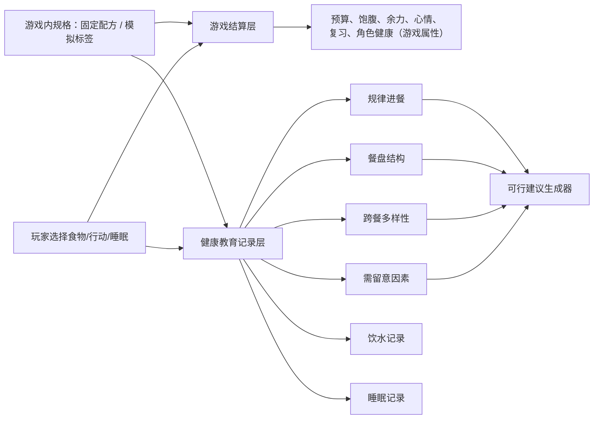

# 营养与健康指导能力升级总方案

> 当前G4A8（2026-10-12）：[原餐次评分生产退休](../../../../docs/process/G4A8_SCORE_RETIREMENT_2026-10-12.md)完成，NUT-308工程退出。425/425、38套件、9项专项/MCP、28图通过；510局只删10,260个旧字段，其余一致。余力公式独立且逐行保持，旧历史与废弃游戏签名兼容保留；四开关关闭，正式营养输出待审，下方为历史。

> 当前G4A7（2026-10-12）：[日结事实与旧评分回退清理](../../../../docs/process/G4A7_FACT_SUMMARY_2026-10-12.md)统一日结/三餐标记/结局/周回顾的冻结事实，旧评分/标签汇总与UI回退退休，实际详情滚动修复。416/416、37套件、16项专项/MCP、28图及510局无差异；NUT-308原字段生产/API退休继续待办，四开关关闭、正式营养输出待审。

> 此前G4A6（2026-10-12）：[正常流程的事实记录入口](../../../../docs/process/G4A6_NORMAL_RECORD_ENTRY_2026-10-12.md)接菜单/日结/结局，399/399、36套件、12项专项/MCP、26图和510局对照通过。下方为历史。

> 当前G4A5（2026-10-11）：[冻结日／周账本和只读预览](../../../../docs/process/G4A5_PERIOD_LEDGER_2026-10-11.md)，16项专项、六组布局/26图、8组真实流程对照通过；并行数值任务收口后全量387/387、35套件及本地Web审计通过。餐次/角色/原料聚合完成切片，完整因素/旧适配和正式输出仍待后续，四开关关闭。下一项G4A6记录入口与未知回退，下方为历史。

> 当前G4A4（2026-10-09）：[当前可执行候选/备选/冷却和下一餐计划](../../../../docs/process/G4A4_SUGGESTIONS_2026-10-09.md)，360/360、33套件、14项专项/22项门禁、本地Web审计/MCP通过，1,348主建议/730备选真实执行。正式输出待审、四开关关闭；下一项冻结日/周聚合与账本，下方G4A3及更早为历史。

> 当前G4A3（2026-10-09）：[真实四来源适配/旧建议复核/冻结日记与影子检查](../../../../docs/process/G4A3_REAL_SOURCES_AND_SHADOW_2026-10-09.md)，346/346、32套件、14项专项/22项门禁及本地Web审计通过。656个生产组合、4,488个真实手牌组合、1,178条模拟建议执行及MCP通过，72局对照无差异。四开关关闭、正式输出待审；下一项候选排序/下一餐计划与聚合，下方G4A2及更早为历史。

> 当前G4A2（2026-10-08）：[可操作菜单/组成/日记与基础筛选](../../../../docs/process/G4A2_PREVIEW_AND_GAME_COPY_2026-10-08.md)，330/330、31套件、12项专项/22项门禁和本地Web审计通过；六组画布、原生/MCP操作及72局对照通过。开发预览使用隔离资料，不开放生产营养输出；文案按游戏场景改短，下一项G4A3真实适配/影子验证。

> 当前G4A1检查点（2026-10-08）：[独立单餐组成与受控文案接口](../../../../docs/process/G4A1_MEAL_INTERFACES_2026-10-08.md)，318/318、30套件、23项专项、22项门禁和本地Web审计通过；MCP运行时隔离调用通过，生产UI/健康开关未接。下一项G4A2开发预览，专业审校仍待办。下面EDU/D/C按历史阅读。

> 当前EDU-02/03检查点（2026-10-08）：[八份资料准备、旧提示与文案修订](../../../../docs/process/EDU02_EDU03_COPY_2026-10-08.md)，295/295、29套件、22项门禁及本地Web审计通过。十条草稿待专业审校，当前玩家提示回到事实与游戏效果；下一项G4独立接口。下面D/C按历史阅读。

> 当前D检查点（2026-10-08）：[恢复依据与真实轨迹表达](../../../../docs/process/NUT208D_RECOVERY_PRESENTATION_2026-10-08.md)完成，288/288、28套件、门禁22项及本地Web审计通过；Godot MCP实际跨日与原生窄屏输入通过。NUT-208/M2本地工程出口完成，下一项EDU-02/03与G4；下面C3/C2/C1按历史阅读。

> 当前C3检查点（2026-10-08）：[旧负担路径/V1共享迁移](../../../../docs/process/NUT208C3_LEGACY_RETIREMENT_2026-10-08.md)完成，274/274、27套件、门禁22项及本地Web审计通过；36项旧配置退休，下一项D完整表达。健康资料与专业门槛保持，下方C2/263项为此前检查点。

> 最新C2执行（2026-10-08）：[冻结恢复消费、余力与结局](../../../../docs/process/NUT208C2_RECOVERY_CONSUMPTION_2026-10-08.md)接入V2，263/263、26套件、门禁22项及本地Web审计通过；下一项C3/D。23份资料仍draft，新营养开关全关，未完成专业签署或完整教育候选。下方C1/247项按当时状态保留。

> 最新执行（2026-10-08）：[C1日终恢复记录](../../../../docs/process/NUT208C1_DAY_SETTLEMENT_2026-10-08.md)已接入V2，247/247、25套件，门禁21项及本地Web审计通过；72局对照原玩法不变，444条有效记录。C2/C3/D未完成，旧消费者仍在；下一项C2，不将C1记录接入视为整套恢复或健康教育完成。

> 文档状态：`v1.34 / G4A8原评分生产与餐食评分方法退休、NUT-308工程退出完成；303/304及正式营养UI继续按切片推进，未整体完成M3/M4。425/425、38套件及本地Web审计通过；默认配置/正向文案及23份资料未审批、新营养开关全关、2项证据到期状态保持，正式输出与教育候选未完成`
>
> 适用范围：`life-strategy` 当前 Godot V2 原型
>
> 方案性质：方案与实施记录并存；只有 Backlog 中标记完成并通过测试的工程项才算已落地，仍不等于玩家功能已上线或完成专业签署
>
> 维护方式：每个相关 PR 必须回填任务状态、测试结果、证据版本和决策变更

> 2026-10-08执行续接：[EDU-01设计任务包](../../../../docs/education/EDU01_LEARNING_SCENARIOS_AND_ASSESSMENT.md)与UX-03/04已完成相应范围，见[执行记录](../../../../docs/process/EDU01_UX03_UX04_2026-10-08.md)。下一项NUT-208C1；EDU-02/03待准备。上述233项工程通过不代表营养输出、专业签署或教育效果已验证。

> 2026-10-08当前目标：用户明确“营养科普教育为主要目的，同时保证趣味性”。[项目开发目标](../../../../docs/design/PROJECT_GOALS.md)与[全项目路线](../../../../docs/ROADMAP.md)要求最小科普闭环成为教育候选必做：课程与资料准备→决策界面→恢复分离→组成预览/记录/观察/可行调整→策略与两轮试玩。完整M3–M6仍按切片推进，已确认R2与专业/证据边界保持；本次不代表任何profile或玩家健康文案获得审核。

> 2026-09-05历史排期：当时用户采用“玩法优先，营养科普辅助”，健康M3–M6按需推进。该优先级由2026-10-08要求更新；历史工程、规则和审核记录保留。

> 2026-10-05完整评估补充：先处理G0.1已发现的决策界面问题，再接NUT-208C/D、策略平衡与试玩。新健康输出仍关闭，23份资料仍draft；本轮只修复健康脚本漏打包、升级MCP和复核现有功能，没有开始M3/M4，也没有补专业签署。见[完整评估](../../../../docs/process/PROJECT_AUDIT_2026-10-05.md)。

## 1. 目标

把项目现有的“饮食质量评分”改造成一套可信、克制、可解释、可行动的饮食结构反馈系统，同时保留游戏原有的预算、时间、便利、心情与复习取舍。

本方案只面向一般校园生活情境中的健康教育，不提供疾病诊断、治疗建议、个体化营养处方、减重方案，也不把一次选择描述成即时健康结果。睡眠、饮水、活动等健康内容与饮食结构并列呈现，互不抵消。

## 2. 方案起始基线

方案启动时的评估确认：

- 项目主流程、主场景烟雾测试及当时的自动化测试可运行，冻结基线为 `57/57` 通过；最新实现计数见变更记录与测试文档。
- `foods.xml` 共有 23 个食物条目，21 个带 `nutrient_tags`，只有 3 个带 `limit_tags`，没有份量、克重、配料占比或营养标签依据。
- `MealResolver` 会把食物组、营养标签和限制标签合成为一个 20–95 区间的 `quality` 分数。
- 跳餐记录当时为 25 分，而奶茶、炸鸡可为 20 分；这种排序容易被理解为“跳过一餐更好”。
- 单份“鸡肉时蔬饭”与“米饭 + 鸡蛋 + 番茄”都可得到 86 分；同一复合餐连续三餐仍会得到 86 分并被判为“餐盘完整”，多样性无法区分。
- `NutritionLedger` 当时已注明“记录出现，不代表摄入充足”，但 UI 仍突出显示 0–100 的“营养评分”，解释依据位于次级详情。
- 饮水、散步、早睡和日终恢复都会降低 `burden`，容易形成“用其他健康行为抵消饮食因素”的隐喻。
- 用餐选择阶段当时主要显示饱腹、价格和游戏数值，饮食结构反馈集中在日终，玩家无法在选择当下形成判断。
- 便利店和宿舍库存当时没有蔬菜选项，若系统直接建议“补蔬菜”，建议可能无法执行。

上述基线是后续回归测试的起点，不是对玩家个人健康状况的判断。

## 3. 产品边界

### 3.1 做什么

- 帮玩家识别一餐和一天中已出现、尚未出现或无法判断的饮食结构。
- 反馈规律进餐、餐盘结构、跨餐多样性和需留意因素。
- 给出一条在当前来源、预算、库存、时间和可选卡牌内可执行的下一步。
- 让玩家理解食物可以同时具有多种特征，不贴“好/坏食物”标签。
- 通过一周趋势帮助玩家观察模式，而不是给出等级或人格评价。

### 3.2 不做什么

- 不推断玩家或角色患病、缺乏某种营养素、肥胖、焦虑或注意力障碍。
- 不依据身高、体重、性别、病史等敏感健康数据提供个体化建议。
- 不把单餐选择与“免疫力提升”“脑雾”“变胖”等结果直接建立因果关系。
- 不展示总营养分、健康排名、红黑榜或惩罚式连续签到。
- 不声称游戏可替代医生、注册营养师或其他专业人员。
- 不在份量和配方未知时，把“出现过某类食物”表述为“摄入充足”。

## 4. 不可破坏的设计决定

| 编号 | 决定 | 验收判断 |
| --- | --- | --- |
| D1 | 健康指导界面不再展示总“营养评分/健康评分” | 饮食信息、日结健康区、周结健康区和结局中都没有可汇总为现实健康等级的单一数字；“角色健康”只能作为明确标注的游戏属性出现 |
| D2 | 不允许健康行为相互抵消 | 饮水、活动、睡眠不能清除高钠、添加糖、油炸或跳餐等观察 |
| D3 | 游戏数值与健康教育数据分层 | 改 `mood`、`energy`、`cost` 不会改变饮食结构分类 |
| D4 | 未知必须显式呈现 | 份量、配方或做法不明确时返回“信息不足”，不得偷偷套默认值 |
| D5 | 建议必须可执行 | 每条建议能映射到当前或下一阶段真实可选的来源/卡牌；否则提供可行备选或不建议 |
| D6 | 保持非诊疗边界 | 不出现诊断、治疗、个体处方、确定性健康因果 |
| D7 | 健康结论必须可追溯 | 玩家可见健康文案都有 `evidence_id`、模型版本和复核状态 |
| D8 | 使用中性、非道德化语言 | 不使用“罪恶餐、作弊餐、垃圾食物、自律失败”等表达 |
| D9 | 以纵向切片逐步上线 | 每个阶段都可用功能开关回退，不留下半套新旧口径混显 |
| D10 | 游戏感来自场景与交互，自然中文优先 | 首层使用“今日三餐、没吃、查看详情”等自然说法；不靠反复造物件隐喻，也不套用报告/仪表盘骨架 |
| D11 | 允许固定虚构产品，但规格与解释分层 | 游戏设计可定义杯量、配方、模拟标签和玩法数值；健康影响仍须版本化规则、外部依据与专业审核，且不得泛化到现实同名商品 |

这些决定如需改变，必须先更新本文件的决策记录，并由产品、营养专业复核和技术负责人共同确认。

## 5. 目标能力模型

系统先读取可版本化的游戏内产品规格，再进入两个互不替代的输出层：

### 5.1 游戏结算层

负责好不好玩：花费、饱腹、余力、心情、压力、复习进度、库存和事件后果。它可以夸张，但必须明确是游戏效果。

### 5.2 健康教育记录层

负责信息是否准确：

1. **规律进餐**：记录完成、跳过或信息不足，不给跳餐数值。
2. **餐盘结构**：识别主食/谷薯、蔬菜、蛋白质来源等是否有记录，并结合份量置信度。
3. **跨餐多样性**：基于真实原料 ID 和天/周窗口去重，不因同一复合菜重复出现而增加。
4. **需留意因素**：添加糖、钠、油炸方式、咖啡因时机等独立陈述，不与积极特征相减。
5. **饮水和睡眠**：各自记录与提示，不换算为饮食分，也不互相抵消。

各维度只输出 `有支持 / 有但不完整 / 可留意 / 信息不足` 等状态、依据和行动，不生成总分。

## 6. 文档地图

| 文件 | 回答的问题 | 主要产物 |
| --- | --- | --- |
| [01 数据模型与字段规范](./01_data_model_and_schema.md) | 食物、复合菜、份量、做法和证据如何表示？ | XML 字段、枚举、校验和迁移兼容 |
| [02 评估与建议引擎](./02_assessment_and_coaching_engine.md) | 如何得出结构观察而不制造伪精确分数？ | 维度算法、输出契约、不变量和建议排序 |
| [03 UI/UX 规范](./03_ui_ux_specification.md) | 玩家何时看到什么，桌面和竖屏如何布局？ | 组件、线框、状态、文案和无障碍规则 |
| [04 内容迁移与证据治理](./04_content_migration_and_evidence.md) | 23 个食物如何补数据，依据如何维护？ | 逐条迁移表、来源池修正和证据登记 |
| [05 测试、专业审校与效果评估](./05_testing_review_and_measurement.md) | 如何证明正确、安全、可用？ | 单元/组合/UI 测试、审校门槛和研究指标 |
| [06 实施 Backlog](./06_implementation_backlog.md) | 后续如何按 PR 逐步完成？ | 任务 ID、依赖、改动文件、验收和回退 |
| [07 食物资料未知项与复核队列](./07_profile_review_queue.md) | 谁跟进当前未知项，何时复核，什么条件才能解除？ | 23 项资料的跟进角色/期限、到期证据与签署缺口 |
| [08 旧状态盘点与恢复规则 R2](./08_recovery_state_migration.md) | 如何拆分 burden，具体规则和旧记录怎样迁移？ | NUT-208A 全部路径、已确认 R2、B 实施契约与 C/D 测试范围 |

与现有文档的关系：

- 通用 V2 布局和视觉基线仍以 [UI 重制计划](../../UI_REMAKE_PLAN.md) 为准；本目录只定义营养与健康相关的增量 UI。
- 一般玩法取舍仍由 [玩法与餐前来源](../01_gameplay_and_meal_sources.md) 管理。
- 健康相关文案优先遵循本目录，再遵循 [文案与叙事](../03_copy_and_narrative.md) 的通用口吻。
- 场景拆分和测试组织继续遵循 [Godot 场景架构与测试](../04_godot_scene_architecture_and_testing.md)。

## 7. 分阶段路线图

| 里程碑 | 目标 | 可发布结果 | 建议周期 |
| --- | --- | --- | --- |
| M0 基线冻结 | 固化问题样例、测试和术语 | 文档、金样例、功能开关，无玩家变化 | 1–2 天 |
| M1 安全校正 | 去除最容易误导的分数和抵消叙事 | 日结改为结构记录；内部 `burden` 仅以正向“角色健康”游戏属性呈现 | 3–5 天 |
| M2 数据底座与旧状态拆分 | 补齐健康资料，并拆除混合的 `diet_burden` | 23 个条目可区分已知/未知；恢复玩法轨道与饮食观察分离；旧存档可读 | 1–2 个迭代 |
| M3 评估与建议 | 上线四维观察和可行建议 | 无总分、无抵消、建议可映射到可选项 | 1 个迭代 |
| M4 选择期 UI | 把反馈前移到选择当下 | 餐盘预览、饮食信息详情、日结和周结新版 | 1 个迭代 |
| M5 内容扩展 | 修来源池、标签阅读和食安内容 | 建议可执行；新旧营养标签模型有版本说明 | 1–2 个迭代 |
| M6 专业与玩家验证 | 通过专家审校和可用性试验 | 达到发布门槛并移除旧实现 | 1 个迭代 |

周期只用于拆分，不是承诺日期。每个里程碑都必须满足自己的发布门槛，不能为了进度跳过证据和测试。

当前落点（2026-09-04）：NUT-205 已覆盖 23 个食物条目，全部仍为 draft；NUT-206 已接入 V2 确认用餐和跳餐，只有 data 开关开启时才冻结资料并保存独立健康历史。历史导入仅返回旧记录，不恢复余额、库存或游戏阶段，不混入当前局，也不读取今天的 profile 重算。它不提供完整游戏存档或断点续玩。默认 data/engine/ui/weekly 四个开关仍全部关闭，本轮不导出、不发布；NUT-206 最终验证状态见 [测试记录 5.4](./05_testing_review_and_measurement.md#54-nut-206-快照与独立健康历史验证记录)。

NUT-207 已把 23 项食物的原 mood 数值迁入独立角色偏好 XML，默认仍为“本局角色”；只有奶茶、方便面、炸鸡显式配置 comfort。V1/V2 显示与结算共用当局偏好，V2 支持复制输入后刷新显示；跨日保留、重开恢复默认。显式 `{}` 或非法偏好按“口味未设置”处理，不从食物标签、旧 mood 或健康资料回退。偏好反应只进入游戏历史，健康快照不含偏好；没有新增角色选择或事件 UI。工程与验收完成：Godot AI 3.2.5 更新后，全量 `180/180`、19 个套件、发布配置静态检查与主场景烟测通过；桌面 `1920×1080` 和竖屏 `720×1280` 共 6 张实际截图文字完整、无越界。详情便签的旧折行高度缓存和异步显隐竞态已修复，详见 [NUT-207](./06_implementation_backlog.md#nut-207-偏好与游戏数值分离)。

NUT-207 与 Godot AI 3.2.5 已包含在开发分支 `codex/nutrition-health-m2` 的本地提交 `f4f0efe`；A 开工时工作区干净，本次 B 续接保留其未提交文档、独立 probe 与冻结 JSON。新增 B 实施也尚未提交，本轮不推送、导出或发布，main 与 Play/ 保持不变。四个健康功能开关仍全部关闭。

NUT-208A 已完成盘点、可复现基线和[规则 R2 确认](./08_recovery_state_migration.md)。用户同意刷手机按实际状态判断，最佳结局不增加恢复门槛，仅通过余力、复习效率间接影响；具体阈值和权重由工程实现后模拟校准。B 严格四键输入的独立规则、冻结恢复记录与纯迁移接口已完成工程验收，并加固健康快照四键隔离校验；尚未接当前局，也不提供完整游戏存档。C/D 未实施，生产恢复规则未改，M2 尚未整体完成。B 的 Godot 4.7.2 全量 217/217、22 套件，含规则14/14、记录9/9、迁移14/14，静态配置与烟测通过；9 条旧日记录降级和 A 冻结 JSON/14 项来源哈希核对通过，详见[测试记录 5.7](./05_testing_review_and_measurement.md)。两项到期证据和专业签署缺口继续按[复核队列](./07_profile_review_queue.md)跟进；旧 NutritionLedger、quality 与 diet_burden 仍由 NUT-208/304/308/605 分步迁移，M3 评估与建议引擎尚未开始。

## 8. 纵向切片规则

一个合格的 PR 应从数据贯穿到显示和测试，例如：

> `fried_chicken` 补充烹调方式和钠信息置信度 → 评估器输出独立“需留意因素” → 详情便签展示依据 → 金样例验证“蛋白质来源”与“油炸/钠”可以同时存在。

这是完成规则与专业审核后的目标闭环示例。当前 NUT-204C/D profile 仍为 draft，只保存固定配方、包装商品规格和做法事实，不输出上述玩家观察。

不建议提交“先批量加字段但无人读取”或“先改 UI 却继续使用旧总分”的大范围半成品。若确实需要底层先行，必须：

- 默认关闭 `health_guidance_v2`；
- 不改变玩家当前结果；
- 同一里程碑内补齐消费者；
- 给出删除旧路径的明确任务 ID。

## 9. 全局完成定义

每个健康指导功能只有同时满足以下条件才算完成：

- [ ] 数据字段有单位、枚举、未知态和来源。
- [ ] 评估结果不依赖游戏正负数值，不产生总分或抵消。
- [ ] 文案经过产品和营养专业复核，能追溯到证据 ID。
- [ ] 建议在真实卡池、预算、库存和时间条件下可执行。
- [ ] 桌面 `1920×1080`、`1280×720` 与竖屏 `720×1280` 可操作。
- [ ] 键盘、触屏和屏幕阅读顺序可用；颜色不是唯一状态提示。
- [ ] 单元、金样例、组合、流程和 UI 测试通过。
- [ ] 旧存档/旧数据有兼容路径，功能开关可回退。
- [ ] “一般健康教育、非医疗建议”的范围入口可随时访问。
- [ ] 变更记录包含模型版本、证据版本和审校人/日期。

## 10. 角色与审批

| 角色 | 必须负责 |
| --- | --- |
| 产品/叙事 | 用户场景、反馈时机、非道德化口吻、非诊疗边界 |
| 营养专业复核 | 食物组映射、份量表达、限制因素、证据适用性 |
| 游戏设计 | 游戏数值仍有取舍，不把健康建议变成唯一正确答案 |
| 工程 | 分层、版本迁移、可行性过滤、自动化测试和遥测最小化 |
| UI/UX | 信息层级、移动端、无障碍、分数误解测试 |
| QA | 组合穷举、旧存档、边界值、失败和未知状态 |

营养专业复核应由具备相应资质或有可靠专业背景的人完成；自动化和模型生成只能辅助，不能替代最终签署。

## 11. 决策与变更记录

最新补记（2026-09-04，v1.18）：用户已确认 R2 的两项玩法取舍，A 完成；B 独立恢复服务、记录和纯迁移接口工程验收完成，新增健康快照隔离护栏；全量217/217、22套件、静态配置与主场景烟测通过。C/D 未实施，不改变生产结算，下一步 C。A 旧 probe/JSON/来源哈希保留；本轮无新增 UI 截图、不提交推送、导出发布；下表旧版本“尚未提交”保留为当时状态。

| 日期 | 版本 | 变更 | 状态 |
| --- | --- | --- | --- |
| 2026-10-08 | 1.24 | C3删除36项旧配置及生产写入/读取，V1补同源记录/消费、补货与门槛；旧服务/生成器只读归档，数字入口隐藏 | 274/274、27套件，新专项11/11、门禁22项及本地Web审计通过；V1/V2七日、72局对照/444条记录、三个画布通过。下一项D；不改健康资料/schema/开关、冻结JSON或发布 |
| 2026-10-08 | 1.23 | C2消费本局冻结记录，开场一次性恢复→事件→限幅，复习用冻结效果；V2余力10/7/4/1与R2结局 | 263/263、26套件，新专项16/16、门禁22项及本地Web审计通过；72局/444条记录、58局终态字段变化；原生第二日核验。C3/V1共享清理与D仍待完成，不改健康资料/版本/开关或发布 |
| 2026-10-08 | 1.22 | C1日终恢复记录接入V2，真实输入/效果冻结、一次结算、深拷贝与健康隔离；新依赖打包门 | 247/247、25套件，门禁21项与本地Web审计通过；72局原玩法无差异、444条有效记录、34条未来效果差异另存；C2/C3/D与专业签署待后续，不改规则/健康数据版本或发布 |
| 2026-10-08 | 1.21 | 用户明确营养科普教育为主要目的；增加L1–L4学习目标及学习/趣味双重验证，最小科普切片成为教育候选必做 | 仅文档规划；不改NUT完成状态、R2、draft、证据登记或开关，无新工程测试和专业签署；历史行按当时状态保留 |
| 2026-07-15 | 1.0 | 建立专项方案；确认去总分、去抵消、显式未知、可行建议和证据治理 | 已记录，待实施 |
| 2026-07-15 | 1.1 | 完成 NUT-001、002、101、102：冻结旧样例、加入默认关闭开关、移除玩家可见分数、统一“游戏负荷”标识 | 已实施；旧评分仍仅用于兼容玩法结算 |
| 2026-07-15 | 1.2 | 根据产品反馈将内部 `burden` 反向展示为“角色健康”：高值为好、卡牌增减符号同步反向；明确它只属于游戏层 | 已实施；不得进入营养评估、日/周健康总结或现实健康结论 |
| 2026-07-15 | 1.3 | 确认“角色健康”仍是不可长期保留的混合指标；新增 NUT-208，拆为恢复玩法轨道与独立饮食观察 | 已记录；当前只冻结旧值，不再继续围绕其扩展 UI 或指导能力 |
| 2026-07-15 | 1.4 | 完成 NUT-103 工程实施：移除健康分档、脑雾/身体不适等过度文案，统一为记录语言或明确游戏结算语言 | 测试通过，待 NUT-003/NUT-602 专业签署；内部旧 ID/分数待 NUT-208/NUT-308 删除 |
| 2026-07-15 | 1.5 | 完成 NUT-104 与 NUT-201：收口桌面/竖屏日结运行验证；加入独立 `HealthDataStore`、schema v1 空目录和正常/空/缺失/旧版/未来版 fixtures | 全量 `70/70` 通过；旧版和未来版均失败关闭，不从旧标签或游戏数值推断 profile；真实内容待 NUT-202–205 |
| 2026-07-15 | 1.6 | 完成 NUT-202：加入 `HealthDataValidator`，覆盖阻断错误、警告、字段定位与畸形容器降级；补充 `composition_status` | 专项 `10/10`、全量 `80/80` 通过；目前只完成工程校验能力，不代表任何 profile 已获专业审核 |
| 2026-07-15 | 1.7 | 完成 NUT-203：登记首批 9 项官方来源和 1 项内部待补占位，加入证据读取、结构审计、到期降级、替代链与 CI 审计入口 | 专项 `8/8`、全量 `88/88` 通过；`active` 仅表示来源可用，不代表 profile/文案已专业审核；睡眠与待补配方保持 `needs_review` |
| 2026-07-15 | 1.8 | 完成 NUT-204A：为白米饭、杂粮饭、鸡蛋、豆腐、青菜和番茄建立首批 6 个保守 draft profile，并加入生产目录集成测试 | 专项 `5/5`、全量 `93/93` 通过；份量、做法和配方缺口全部显式保留，配方待补占位会阻止发布使用 |
| 2026-07-16 | 1.9 | 完成 NUT-105：日结改为“今日三餐 + 今日小记 + 写给明天 + 三餐详情”，并根据实机反馈删除生硬的“餐票”隐喻 | 专项 `3/3 + 13/13 + 19/19`、全量 `94/94` 通过；膳食指南只留在规则小字；NUT-208 与睡眠/饮水独立轨道继续按后续任务拆解 |
| 2026-07-16 | 1.10 | 确认游戏可自定义固定食品数值，完成 NUT-204B：咖啡、奶茶和方便面采用版本化虚构配方/模拟标签，新增内部规格边界与后续 UI 验收 | 规格事实、玩法效果、健康解释三层分离；迁移 `9/9`、证据 `8/8`、校验 `10/10`、全量 `98/98` 通过；三条 profile 仍为 draft，不产生玩家健康指导 |
| 2026-07-20 | 1.11 | 完成 NUT-204C：为炸鸡、蔬菜沙拉、鸡蛋蔬菜三明治、两道食堂炒菜、清蒸鲈鱼和鸡肉时蔬饭冻结 7 套游戏配方，并统一跨卡牌原料 ID | 生产目录共 16 个 profile；新增 `present` 油炸事实态但不补钠阈值，沙拉移除旧水果误映射，三明治迁为明确蛋类；迁移 `14/14`、证据 `8/8`、校验 `11/11`、全量 `104/104` 和证据审计通过；仍无玩家可见健康输出 |
| 2026-07-20 | 1.12 | 收紧 NUT-204C 通用治理：油炸二元事实双向阻断、固定同单位配方总量闭合、共享原料分组一致、证据所需能力正向校验 | 校验器 `13/13`、证据 `10/10`、迁移 `14/14`、全量 `108/108` 通过；内部游戏规格可支撑固定配方，但单独请求 `PLAYER_GUIDANCE` 会失败关闭 |
| 2026-07-20 | 1.13 | 完成 NUT-204D：为牛奶、原味酸奶和全麦面包冻结 3 套游戏内包装商品规格；明确 `package_label` 只是内部规格依据，不等于完整或合规的现实营养标签 | 生产目录共 19 个 draft profile，其中 13 个为固定游戏规格；目录精确产生 34 条治理 warning，迁移 `19/19`、校验器 `15/15`、证据 `11/11`、全量 `116/116` 和证据审计通过；本片不新增生产健康面板/组件，只同步酸奶卡牌的自然生活文案；不交付过敏原完整性、冷链/过期规则、营养标签教学或玩家健康指导，原味坚果仍归 NUT-205 |
| 2026-09-04 | 1.14 | 完成 NUT-205 工程：新增燕麦、苹果、香蕉、原味坚果四项保守资料，建立全 23 项未知复核队列；修复插件更新丢失导出配置清理的回归 | 23/23 覆盖、全部 draft（13 固定规格 + 10 品类资料），0 阻断错误、51 条治理 warning；迁移 `22/22`、导出回调 `7/7`、全量 `126/126` 和主场景烟测通过。两项证据已到期，审计保持退出 1；实际 Web 导出因本机缺少 4.7.2 匹配模板未通过。改动尚未提交/发布，新健康功能开关维持关闭 |
| 2026-09-04 | 1.15 | 完成 NUT-206 工程：新增不可变用餐健康快照、独立 JSON 健康历史、显式旧记录迁移及 data 开关门控的 V2 用餐接入；收紧 known 组成不能为空的校验 | 快照保留 profile/model 版本、证据和未知态，high 与 draft 独立；历史读取不重算、不恢复或混入当前游戏。快照 `10/10`、归档 `13/13`、接入 `7/7`、最终全量 `157/157`、发布配置静态检查与主场景烟测通过，见测试记录 5.4。所有功能开关仍关闭，两项到期证据仍阻塞；本轮不导出、不发布，完整游戏存档、NUT-207/208 与 M3 仍待后续 |
| 2026-09-04 | 1.16 | NUT-207 工程与验收完成：23 项原 mood 迁入角色偏好 XML，三项 comfort 显式配置；V1/V2 展示与结算同源，偏好历史与健康快照分离 | 数据 `7/7`、流程 `7/7`、UI `9/9`，Godot AI 3.2.5 更新后全量 `180/180`、19 个套件、发布配置静态检查与主场景烟测通过；导出配置回归 `7/7` 包含在全量内。桌面/竖屏 6 张实际截图通过，已修复详情旧折行高度缓存和异步显隐竞态。显式空/非法偏好中性降级，跨日保留、重开默认；未新增角色/事件 UI。新改动尚未提交推送、导出或发布；四个健康开关仍关闭，两项证据仍到期，下一步 NUT-208A，M2 未整体完成 |
| 2026-09-04 | 1.17 | NUT-208A 完成旧路径盘点、旧行为基线、候选 R1 与迁移/测试方案，当时待游戏设计确认 | 全量 180/180、19 套件、静态配置与主场景烟测通过；旧 probe 两次一致，冻结七天与提前结束证据；未改生产结算，无新 UI 截图，未提交发布 |
| 2026-09-04 | 1.18 | 用户确认修订 R2：刷手机按实际状态判定，最佳结局不设恢复门槛；A 完成，B 独立服务/记录/纯迁移接口工程验收完成，并加固健康快照隔离 | 全量 217/217、22 套件、静态配置与烟测通过，规则14/14、记录9/9、迁移14/14；9条旧日记录降级，A冻结基线及14项来源哈希一致。R1未实现，运行规则仍为recovery-gameplay-v1；不接当前局/完整存档，C/D未实施；无新UI截图，四开关关闭、插件保留、不提交发布 |
